<h1 align="center">SmartSched</h1>

<p align="center">
  Classroom and exam planning for a university, built on top of classroombookings.
</p>

<p align="center">
  <a href="https://www.gnu.org/licenses/agpl-3.0.html"></a>
  
  
  
</p>

SmartSched is for the office that plans a faculty's rooms each term, and for the staff who book those
rooms. Today that office works in Excel: a planning list of every section, a weekly room grid, a room
list, and a lot of checking by hand. SmartSched reads those workbooks as they are, places every class
it can into a room and a period without breaking a hard rule, and says plainly which classes it could
not place and why.

It is a superset of [classroombookings](https://www.classroombookings.com/) (CRBS): rooms, room
groups, periods, sessions, holidays, single and recurring bookings, roles and permissions work the
way they do in CRBS, checked row by row by a parity gate. The planning side (imports, the solver, the
calendar, the run report) is new, and so are the reservation panel, calendar sync, approvals, the audit
log with undo and 14 interface languages. The legacy PHP app is still in this repository and
SmartSched can import its database.

<p align="center">
  <a href="docs/images/recordings/import-generate.mp4">
    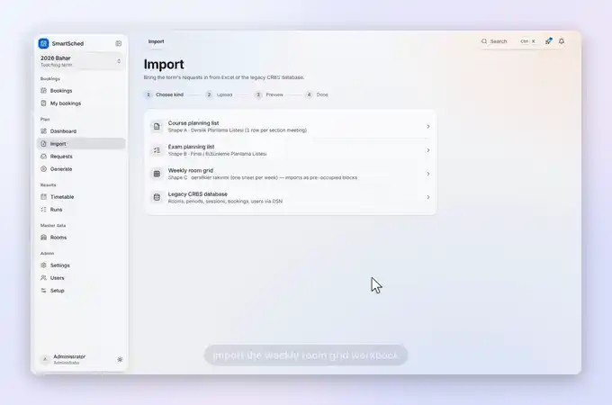
  </a>
  <br>
  <sub>From two Excel files to a checked timetable: import the Bahar 2026 workbooks, generate week 3, read the report.
  Waits for the import jobs and the solver are cut. <a href="docs/images/recordings/import-generate.mp4">MP4</a></sub>
</p>

Four more recordings, each under a minute, all made against the real backend with the real 2026 data
(how: [Recordings and screenshots](#recordings-and-screenshots)).

<table>
  <tr>
    <td width="50%" valign="top">
      <a href="docs/images/recordings/calendar-move.mp4">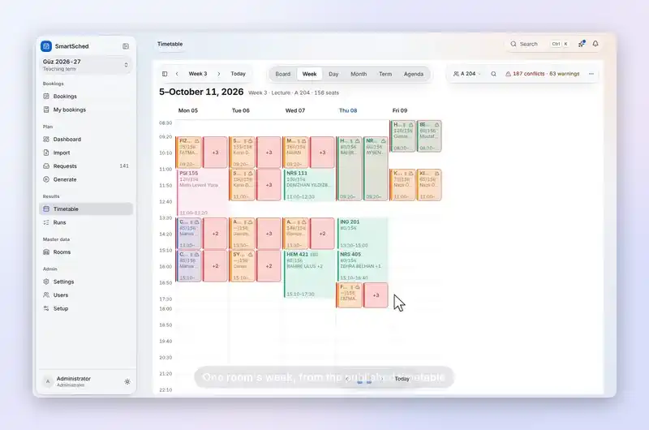</a>
      <br><sub><b>Calendar.</b> Open a class, move it to a free room the server has checked, undo. <a href="docs/images/recordings/calendar-move.mp4">MP4</a></sub>
    </td>
    <td width="50%" valign="top">
      <a href="docs/images/recordings/studio-rule-fix.mp4">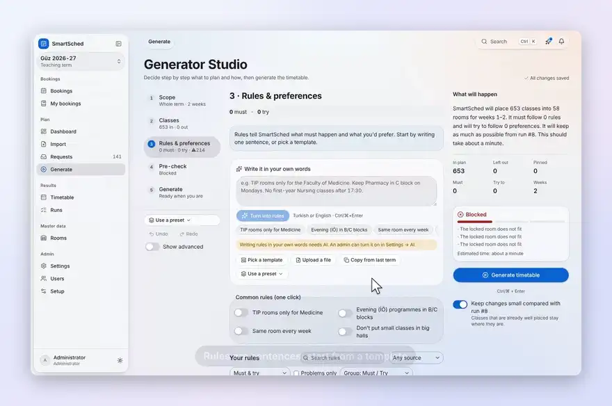</a>
      <br><sub><b>Generator Studio.</b> Add a rule from a template, run the pre-check, apply one of its fixes. <a href="docs/images/recordings/studio-rule-fix.mp4">MP4</a></sub>
    </td>
  </tr>
  <tr>
    <td width="50%" valign="top">
      <a href="docs/images/recordings/room-booking.mp4">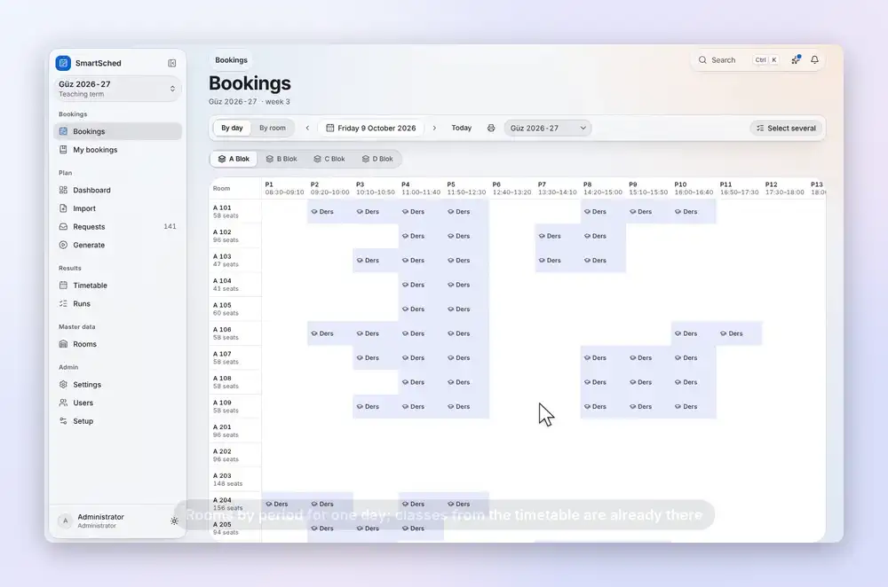</a>
      <br><sub><b>Bookings.</b> Pick a free period, add a note, book it, find it under My bookings. <a href="docs/images/recordings/room-booking.mp4">MP4</a></sub>
    </td>
    <td width="50%" valign="top">
      <a href="docs/images/recordings/admin-user.mp4">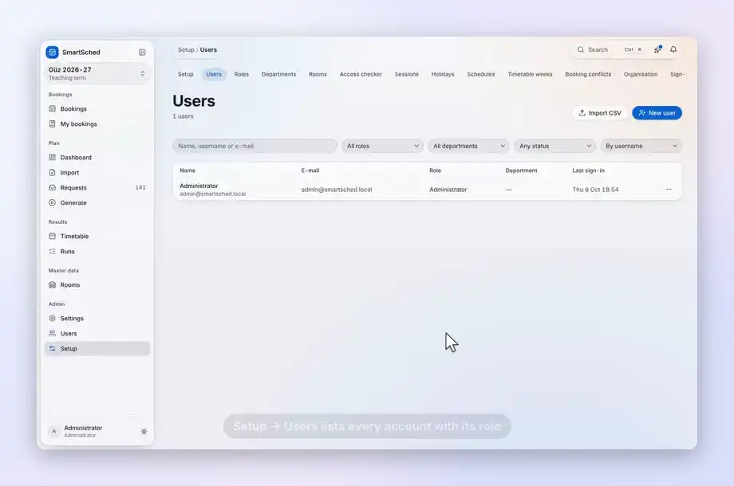</a>
      <br><sub><b>Administration.</b> Create an account and pick its role; roles you could not grant are greyed out. <a href="docs/images/recordings/admin-user.mp4">MP4</a></sub>
    </td>
  </tr>
</table>

## What is built

Status on branch `claude/gracious-cerf-w1598m`, 2026-10-15. *Done* means code, tests and a screen.
*Backend only* means the API and its tests exist and the screen does not yet.

**Planning**

| Feature | Status |
|---|---|
| Import of planning lists, exam lists, weekly room grids, a room master CSV and the CRBS database, each with an import report | Done |
| Rules from settings, templates, the workbooks and (with an API key) sentences or uploaded files; AI rules need a person's approval | Done |
| Generator Studio: scope, classes, rules, pre-check with fixes, generate | Done |
| CP-SAT solver for a week, a month, the whole term or the exam period; partial runs; every unplaced class explained | Done |
| Planner-level validator: stored runs re-checked against the raw workbook rows (`tools/validate_planner.py`) | Done, runs in pod CI |
| Calendar with six views and an inspector; move with a server check, then undo | Done |
| Exports to Excel, CSV and iCal | Done |

**Bookings (the classroombookings side)**

| Feature | Status |
|---|---|
| Booking grid by day or by room, single, recurring and multi bookings, limits, holidays, timetable weeks; the published timetable blocks its slots | Done |
| Reservation panel: click a free slot to reserve it, drag or Shift-click to book several periods, a reason on cells you cannot book, a *Free slots* list (the default on phones), a department view, room details with the next free slot and other rooms free at the same time | Done (`e2e/reserve.spec.ts`) |
| Calendar sync: private ICS feed links (my bookings, a room, a department) with copy, webcal and Google / Outlook / Apple buttons, in the reservation panel and on My bookings; room-group feeds through the API | Done |
| Organisation switch for calendar sync (KVKK): off turns every feed link into a 404; switching it is audited | Backend only (`PUT /calendar/admin/settings`, no settings screen yet); on by default |
| Google Calendar and Microsoft 365 push, once an administrator enters the organisation's OAuth client | Backend only (client set through `PUT /calendar/admin/settings`, no settings screen yet); tested against mocked Google and Microsoft APIs, not yet against a live tenant. The reservation panel shows a *Connect* button only when a client is configured |
| Signed outgoing webhooks (HMAC-SHA256), off by default | Backend only |
| Typed room features (yes/no, number, option, text) and find-a-room (`POST /rooms/find`) | Backend done; the reservation panel's *other available rooms* uses find-a-room. A features tab in Setup → Rooms and a `/find-room` page are in the tree as work in progress |
| Approvals by designated approvers: rules per room, room group or room type, requests wait as `PENDING`, a sweeper expires them | Backend done; `/approvals` (inbox) and `/admin/approval-rules` are in the tree as work in progress |
| Append-only audit log with undo of booking create, series create, move and cancel | Backend done; `/admin/audit` is in the tree as work in progress |
| In-app notifications (`GET /me/notifications`) next to the e-mail outbox | Backend done; the notification bell in the top bar is work in progress |
| No privilege escalation: nobody grants a role, or edits a role, whose permissions they do not all hold | Done |
| Sign-out, a password change, disabling an account and a role change revoke the user's tokens on every device | Done |
| 14 interface languages (the 13 CRBS languages plus Turkish); a missing string falls back to English per key | Done |

*Work in progress* means the wave-1 frontend agent is still building these screens: they were
committed in progress checkpoints on 2026-10-15, no Playwright spec covers them yet, and the CRBS parity
gate still lists them as gaps. This README does not describe them as finished.

## Quick start

### Docker, one command

Docker Engine 24+ with the Compose v2 plugin is all the host needs.

```bash
cd smartsched/deploy
./deploy.sh        # writes .env with random secrets, builds, starts, waits for /api/v1/health
# SmartSched is up at http://localhost:8080; the admin login is ADMIN_EMAIL / ADMIN_PASSWORD in .env
```

This starts PostgreSQL, the FastAPI backend, the Next.js frontend and nginx. Useful flags:
`--tls` adds a Caddy HTTPS edge, `--legacy` also runs the original classroombookings (PHP 8.3 and
MySQL 8.4) for live imports, `--update` pulls, rebuilds and migrates, `--down` stops the stack and
keeps the data. Set `PUBLIC_URL` to the address browsers use: calendar feed links and the OAuth
redirect addresses are built from it. The full list, backups and sizing are in
[smartsched/deploy/README.md](smartsched/deploy/README.md).

### On AWS

One EC2 instance (t4g.large, us-east-1 by default) runs the whole stack behind Caddy TLS, plus the
project's CI. It is controlled by pushing a change to `infra/aws/POD_ACTION`; the first line is the
command, and `.github/workflows/aws-bootstrap.yml` runs it with a GitHub OIDC role, so no AWS keys are
stored in the repository.

```bash
echo "status $(date -u +%FT%TZ)" > infra/aws/POD_ACTION   # the timestamp makes every push a change
git add infra/aws/POD_ACTION && git commit -m "pod: status" && git push
```

| First line | What it does |
|---|---|
| `up` | create or update everything (IAM role, security group, Elastic IP, instance, alarm, budget) and print the panel URL |
| `status` | inventory, alarm and budget state, orphaned resources, estimated monthly cost |
| `logs` | boot progress from the instance's serial console (no SSH or SSM session needed) |
| `stop` / `start` | stop or start the instance; data is kept |
| `cost` | month-to-date spend from Cost Explorer, the budget and the estimate |
| `down destroy` | delete everything tagged `Project=smartsched`; the budget is kept (a plain `down` is refused) |

Cost control: the budget `smartsched-monthly-100usd` e-mails at 50, 80 and 100 % of actual spend and
at 100 % of forecast, and a budget action stops the instance at 100 % actual. The pod stops itself
after 60 minutes with no CI job and CPU below 5 %, and the CloudWatch alarm `smartsched-pod-idle-stop`
does the same as a backstop. Running all month costs about 57 USD in us-east-1; stopped, about 8 USD
([docs/deploy/AWS.md](docs/deploy/AWS.md)).

The pod generates its own secrets. The administrator's password is stored in the SSM SecureString
parameter `/smartsched/admin_password` (the e-mail in `/smartsched/admin_email`); read it with
`aws ssm get-parameter --name /smartsched/admin_password --with-decryption`. No workflow prints it.

### Local development

Python 3.12+ and Node 22+.

```bash
scripts/dev.sh --run     # venv + npm ci, SQLite, seeded admin, backend :8000, frontend :3000
```

The admin is your `git config user.email` (or `DEV_ADMIN_EMAIL`) with a random password printed once.
The frontend always talks to the real backend; there is no mock or demo mode.

### Load the real 2026 data

The planning office's workbooks for Bahar 2026, Güz 2026-27 and the 2026 finals are in
`smartsched/backend/tests/fixtures/`.

```bash
cd smartsched/backend && source .venv/bin/activate
python -m app.cli import weekly-grid   tests/fixtures/bahar_derslikler_takvimi_2026.xlsx --term 2026-BAHAR --year 2026
python -m app.cli import planning-list tests/fixtures/bahar_derslik_planlama_listesi_v5.xlsx --term 2026-BAHAR
python -m app.cli import room-master   tests/fixtures/room_master.csv
python -m app.cli solve --term 2026-BAHAR --kind COURSE --horizon TERM --time-limit 300
```

Importing a weekly grid also stores the planner's own published board as a run, so the calendar has
something to show straight away. The same importers are on the Import page. The CRBS importer reads
SQL dumps (`import crbs structure.sql data.sql`) or a live server (`import crbs --dsn mysql://…`).
Requests and room grids are read today from the office's three workbook shapes (`.xlsx`), a room
master CSV and the CRBS database. Reading requests and schedule maps from other formats is planned
in Phase 19 ([Roadmap](#roadmap)).

## How it works

1. **Import.** Planning lists, exam lists and weekly room grids are read from the office's workbooks;
   a room master CSV corrects capacities and tags. Turkish day names, dotted times, comma decimals,
   room spellings such as `A 101`, `A101` and `B Blok Bilg. Lab.` and multi-value cells are normalised
   ([docs/DATA_ANALYSIS.md](docs/DATA_ANALYSIS.md)). Every import ends with a report of what was read,
   what was skipped and why.
2. **Rules.** Settings, rule templates, the workbooks themselves and, with an Anthropic API key,
   sentences in Turkish or English and uploaded preference files (`.xlsx`, `.csv`, `.docx`, `.pdf`,
   `.txt`, `.md`) all become the same thing: a typed rule that is either *Must* (hard) or *Try to*
   (soft, weighted), with a link to where it came from. Nothing written by the AI is used until a
   person accepts it.
3. **Pre-check.** Before solving, the Generator Studio checks the plan against the data and lists what
   cannot work (a locked room that is too small, two classes locked into one room at once), each with
   fixes.
4. **Solve.** OR-Tools CP-SAT places classes into rooms and periods for a week, a month or the whole
   term (14 weeks), or exams into exam slots.
5. **Validate and explain.** Scores are computed again in plain Python from the finished timetable, so
   the solver, manual moves and AI edits are judged by the same code. Anything not placed is explained
   one class at a time. A second, independent check compares the stored timetable with the raw
   workbook rows (`app/services/planner_check.py`); pod CI runs it on four real instances for every
   commit.
6. **Publish and book.** Activating a run publishes it: its classes hold their slots in the booking
   grid, and staff book the free periods around them.

<table>
  <tr>
    <td align="center" width="50%">
      <picture>
        <source media="(prefers-color-scheme: dark)" srcset="docs/images/lottie/nl-to-rules-dark.gif">
        
      </picture>
      <br><sub>With an API key, a sentence becomes a rule you review before it is used (illustration).</sub>
    </td>
    <td align="center" width="50%">
      <picture>
        <source media="(prefers-color-scheme: dark)" srcset="docs/images/lottie/file-to-rules-dark.gif">
        
      </picture>
      <br><sub>Rules read from an uploaded file keep a link to their source row (illustration).</sub>
    </td>
  </tr>
</table>

### Hard rules, waived exceptions and partial runs

The hard rules are: a room seats the class, a room holds one class at a time, a cohort and an
instructor are in one place at a time, fixed times stay fixed, and a class that needs a lab gets one.
SmartSched never relaxes one of them quietly.

Real planning data breaks these rules in a few known ways, and the planner usually knows. A class is
locked into a room with fewer seats than its enrolment estimate; two fixed classes of the same
instructor overlap; two rows lock the same room at the same time. SmartSched does not overrule the
planner here. It keeps the planner's decision, records each case as a *waived exception* with the
class and the room named, and lists them under *Problems in your data* in the run report, grouped and
exportable to Excel. Only the planner's own locks are trusted this way: a lock made by a fix button, a
manual move or an AI edit (`lock_trusted=False`) must fit the room like any other placement. Three switches control this, all on by default and all per run:
trust the planner's locked rooms, treat clashes between fixed classes as warnings, and keep the best
partial timetable when not everything fits
([solver README](smartsched/backend/app/solver/README.md#real-data-modes-d1d3)).

When not every class can be placed, the run is **partial**, labelled for example
*Partial · 522/548 placed*. A relaxation first places as many classes as it can, keeping the
planner's locks where it can; the placed classes are then optimised for the soft rules. Every placed
class keeps every hard rule, apart from the waived exceptions it lists (hard score 100, re-checked
against the workbook rows). Each class
left out is listed with the reason (for example: *every room that fits is taken at that time*, with
the rooms and what holds them) and with fixes such as freeing a named room. Applying a fix creates a
new run; the old one stays as it was.

Claude is optional and is never the planner. It turns sentences and files into rule proposals,
proposes edits from the chat panel, and writes explanations. Every proposal goes through the same
validation as a manual move. Import, solving, the calendar, bookings and manual edits work without a
key. Details: [solver README](smartsched/backend/app/solver/README.md),
[AI README](smartsched/backend/app/ai/README.md), [research notes](docs/RESEARCH.md).

### Bookings, calendar sync and approvals

Every change to a booking, a series or an approval goes through one function,
`app/services/events.publish_event`, inside the database transaction of the change. It writes the
audit row, sends the e-mail notification when there is one, and calls its subscribers: the calendar
push outbox and the outgoing webhooks. A failing subscriber is logged and never undoes the booking.

- **Audit log.** `audit_events` is append-only; database triggers refuse updates and deletes on SQLite
  and PostgreSQL. Secrets are redacted. A booking create, series create, move or cancel can be undone
  while nothing later has changed it, within 24 hours or before it starts.
- **Calendar sync.** A feed link carries a random token; only its SHA-256 hash is stored. A user can
  hold several links, revoke one or reset all. The organisation switch `calendar_sync_enabled` (KVKK)
  turns every feed into a 404. Google Calendar and Microsoft 365 push appears only after an
  administrator enters the organisation's OAuth client; no client ships with the product.
- **Webhooks.** Signed with HMAC-SHA256, retried with backoff, switched off after five failures in a
  row. They send data outside the server, so `webhooks_enabled` is off by default; payloads carry no
  notes and no e-mail addresses.
- **Approvals.** A rule on a room, a room group or a room type sends requests to designated approvers.
  The booking answers `202` and waits as `PENDING`; the approver approves, rejects or suggests another
  room. A background sweep every 60 seconds expires overdue requests and releases tentative holds. With
  no rule, booking works as in CRBS.
- **Sessions.** Each token carries the user's token version. Sign-out, a password change or reset,
  disabling the account, a role change and deleting the role raise the version, so every earlier
  token stops working on every device.

## Measured on the real data

From [docs/testing/2026-10-08-real-data-feasibility.md](docs/testing/2026-10-08-real-data-feasibility.md),
section "Review fixes": the planning office's 2026 workbooks, default run settings, 4 vCPU shared with
other work, CP-SAT with 4 workers. A *request* is one row of the planning or exam list; *placed* means
placed in every week of the run. "Planner-level hard" re-checks the stored timetable against the raw
workbook rows, independently of the solver.

| Instance | Requests placed | Solver events placed | Planner-level hard | Violations |
|---|---|---|---|---|
| Bahar 2026, whole term (300 s limit) | 838 / 883 (94.9 %) | 682 / 720 | 100 | 0 |
| Bahar 2026, week 3 (120 s) | 845 / 882 (95.8 %) | 689 / 719 | 100 | 0 |
| Güz 2026-27, week 3 (120 s) | 626 / 653 (95.9 %) | 522 / 548 | 100 | 0 |
| Final 2026 exams (120 s) | 724 / 729 (99.3 %) | 624 / 629 | 100 | 0 |

Every exception behind these numbers is the planner's own data and is reported per class (locked rooms
smaller than the enrolment estimate, fixed-time clashes of one instructor or cohort, missing
enrolments). The same report records an earlier mistake: before the review fixes the solver reported
hard 100 while the planner-level check found 134, 68 and 56 violations on the Bahar, Güz and Final week
runs (for example 136 students seated in a 72-seat room), because the bridge clipped merged groups to
the room. The placement rates went down a little when that was fixed. Earlier still, the same Bahar
data ended *infeasible within 0.05 s, with 356 diagnoses and no timetable*.

When the planner's rooms are only hints instead of locks, the solver picks exactly the planner's room
set for 89.5 % of the placed Bahar week 3 requests and 94.9 % of the Güz ones; for the Final exams it is
74.1 % exact and 93.4 % sharing at least one room, every run with planner-level hard 100.

These figures were measured on 2026-10-08. The importer changed after that (non-room venues such as
CASE or ONLINE need no room, course codes with leading zeros are merged, a missing week sheet is
reported), so the counts of the next run will differ. The pod CI gate `planner` now repeats this check
on every commit (`python -m tools.validate_planner`, the four instances above at 120 s each) and fails
the run on any planner-level violation.

The recordings and screenshots on this page come from a fresh import of the same workbooks and two
runs made through the API for Güz 2026-27: week 3 placed 522 of 548 solver events (the row above) and
the whole term 519 of 548, both with hard score 100.

## Screenshots

All screenshots show the real 2026 data, taken at 1440 px wide, in light or dark mode following your
GitHub theme. Most were taken on 2026-10-08; the booking screenshots were retaken on 2026-10-15 after the
reservation panel landed. Screens of the wave-1 features (approvals, find-a-room page, audit viewer,
room features admin) will be added when those screens are finished.

**Dashboard.** Room use for the week, classes that still need a room, requests waiting for review,
and use by building and day for the published run.

<picture>
  <source media="(prefers-color-scheme: dark)" srcset="docs/images/screens/dashboard-dark.webp">
  
</picture>

**Generator Studio.** Scope, classes, rules, pre-check and generate, with a running summary of what
will happen.

<table>
  <tr>
    <td><picture>
      <source media="(prefers-color-scheme: dark)" srcset="docs/images/screens/studio-scope-dark.webp">
      
    </picture></td>
    <td><picture>
      <source media="(prefers-color-scheme: dark)" srcset="docs/images/screens/studio-rules-dark.webp">
      
    </picture></td>
  </tr>
  <tr>
    <td><picture>
      <source media="(prefers-color-scheme: dark)" srcset="docs/images/screens/studio-precheck-dark.webp">
      
    </picture></td>
    <td><picture>
      <source media="(prefers-color-scheme: dark)" srcset="docs/images/screens/run-report-dark.webp">
      
    </picture></td>
  </tr>
</table>

**Run report.** Each class that could not be placed, with the reason and fixes; below it, the problems
found in the workbooks themselves.

<table>
  <tr>
    <td><picture>
      <source media="(prefers-color-scheme: dark)" srcset="docs/images/screens/run-diagnoses-dark.webp">
      
    </picture></td>
    <td><picture>
      <source media="(prefers-color-scheme: dark)" srcset="docs/images/screens/run-data-issues-dark.webp">
      
    </picture></td>
  </tr>
</table>

**Calendar.** Six views of one run (Board, Week, Day, Month, Term, Agenda) and an inspector that shows
when and where a class is, why it is there and what conflicts with it.

<picture>
  <source media="(prefers-color-scheme: dark)" srcset="docs/images/screens/calendar-board-dark.webp">
  
</picture>

<table>
  <tr>
    <td><picture>
      <source media="(prefers-color-scheme: dark)" srcset="docs/images/screens/calendar-week-dark.webp">
      
    </picture></td>
    <td><picture>
      <source media="(prefers-color-scheme: dark)" srcset="docs/images/screens/calendar-inspector-dark.webp">
      
    </picture></td>
  </tr>
  <tr>
    <td colspan="2"><picture>
      <source media="(prefers-color-scheme: dark)" srcset="docs/images/screens/calendar-term-dark.webp">
      
    </picture></td>
  </tr>
</table>

**All classes and rooms.** Every section of the term with its status, programme, instructor, size and
room; every room with its seats, tags and use through the week.

<table>
  <tr>
    <td><picture>
      <source media="(prefers-color-scheme: dark)" srcset="docs/images/screens/classes-dark.webp">
      
    </picture></td>
    <td><picture>
      <source media="(prefers-color-scheme: dark)" srcset="docs/images/screens/rooms-dark.webp">
      
    </picture></td>
  </tr>
  <tr>
    <td colspan="2"><picture>
      <source media="(prefers-color-scheme: dark)" srcset="docs/images/screens/room-detail-dark.webp">
      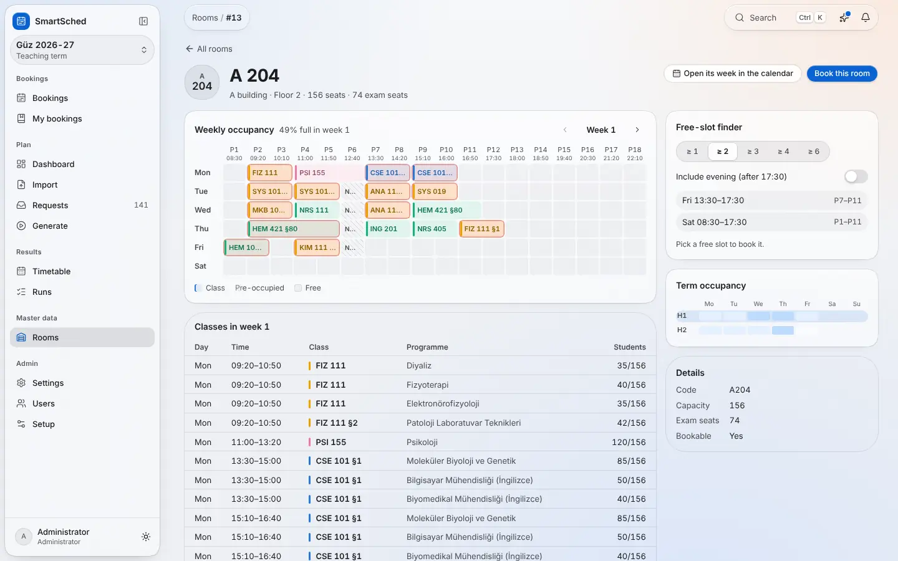
    </picture></td>
  </tr>
</table>

**Bookings and the reservation panel.** The classroombookings grid with the published Güz 2026-27
timetable in place. Free cells say *Free* and offer *Reserve* on hover; drag or Shift-click books
several periods. These shots are cropped to the page content: the sidebar is mid-change (see
[What is built](#what-is-built)).

<table>
  <tr>
    <td><picture>
      <source media="(prefers-color-scheme: dark)" srcset="docs/media/reserve-grid-dark.png">
      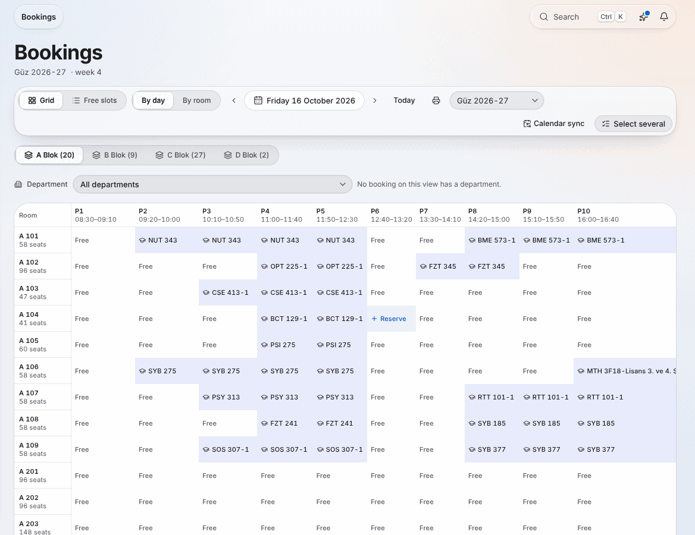
    </picture></td>
    <td><picture>
      <source media="(prefers-color-scheme: dark)" srcset="docs/media/reserve-free-slots-dark.png">
      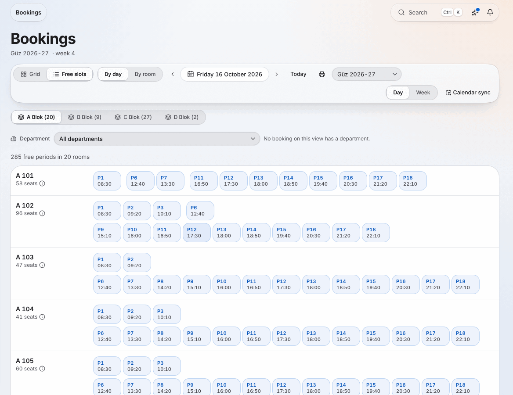
    </picture></td>
  </tr>
  <tr>
    <td><picture>
      <source media="(prefers-color-scheme: dark)" srcset="docs/media/reserve-room-details-dark.png">
      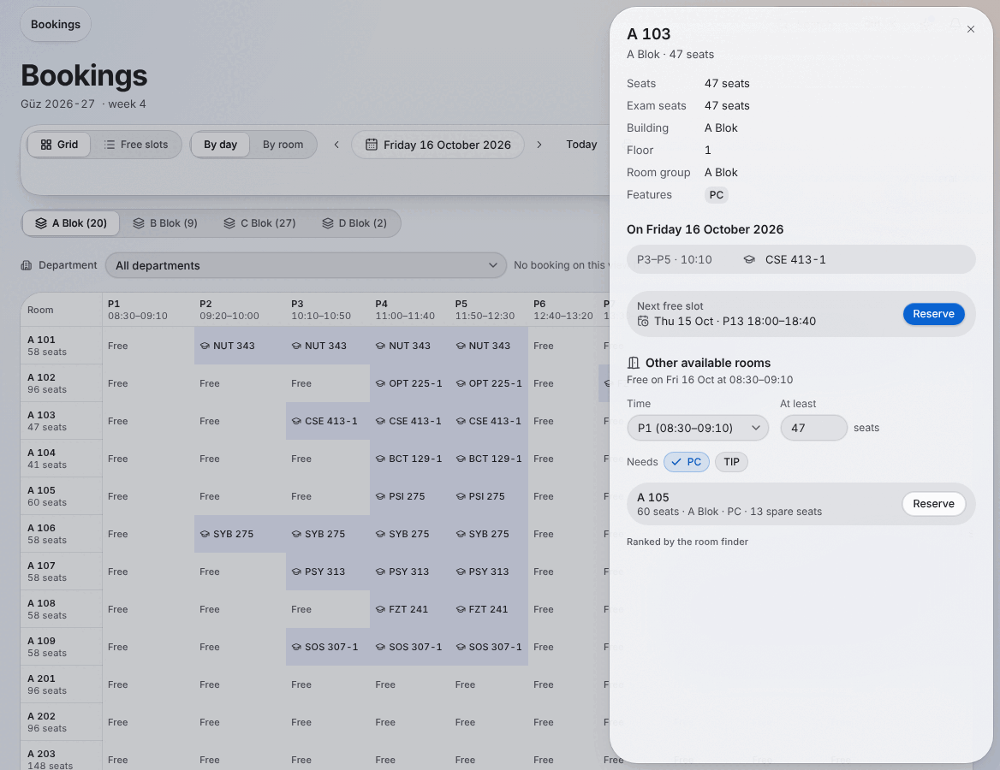
    </picture></td>
    <td><picture>
      <source media="(prefers-color-scheme: dark)" srcset="docs/media/calendar-sync-dark.png">
      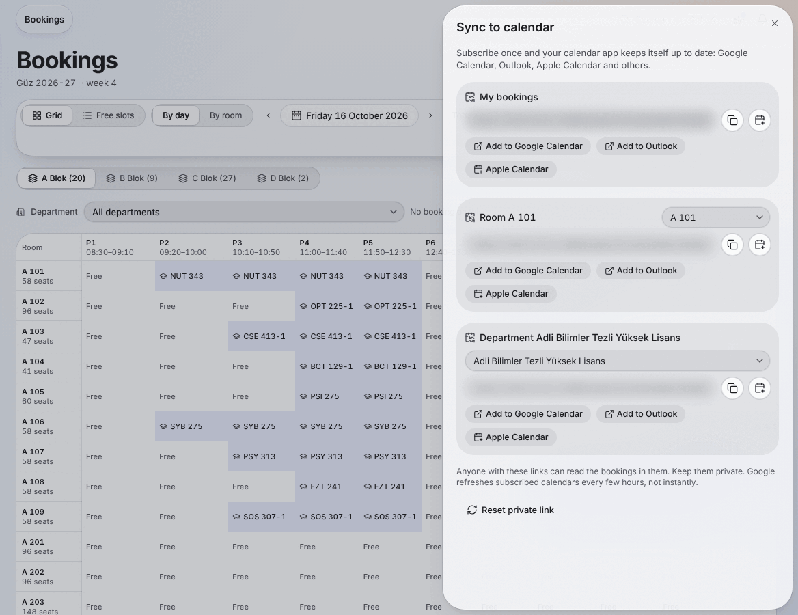
    </picture></td>
  </tr>
</table>

<details>
<summary><strong>Administration, settings, sign-in, phone and Turkish</strong></summary>

<br>

<table>
  <tr>
    <td><picture>
      <source media="(prefers-color-scheme: dark)" srcset="docs/images/screens/admin-users-dark.webp">
      
    </picture></td>
    <td><picture>
      <source media="(prefers-color-scheme: dark)" srcset="docs/images/screens/admin-roles-dark.webp">
      
    </picture></td>
  </tr>
  <tr>
    <td><picture>
      <source media="(prefers-color-scheme: dark)" srcset="docs/images/screens/setup-requirements-dark.webp">
      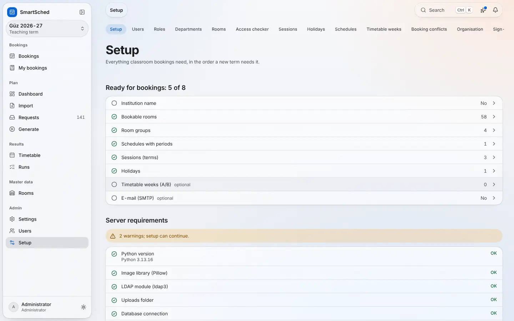
    </picture></td>
    <td><picture>
      <source media="(prefers-color-scheme: dark)" srcset="docs/images/screens/settings-appearance-dark.webp">
      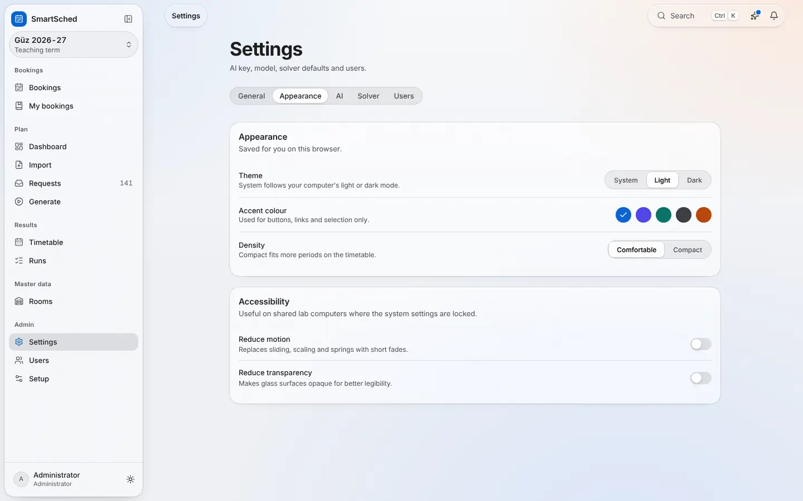
    </picture></td>
  </tr>
  <tr>
    <td colspan="2"><picture>
      <source media="(prefers-color-scheme: dark)" srcset="docs/images/screens/login-dark.webp">
      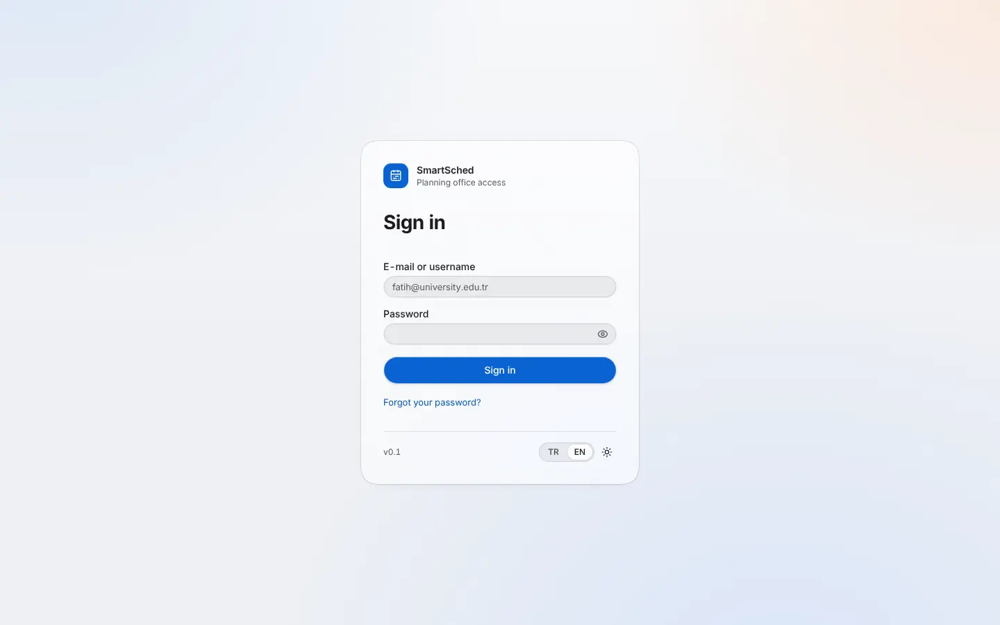
    </picture></td>
  </tr>
</table>

On a phone the sidebar becomes a tab bar, and the calendar's Day view becomes a list.

<table>
  <tr>
    <td align="center"><picture>
      <source media="(prefers-color-scheme: dark)" srcset="docs/images/screens/mobile-dashboard-dark.webp">
      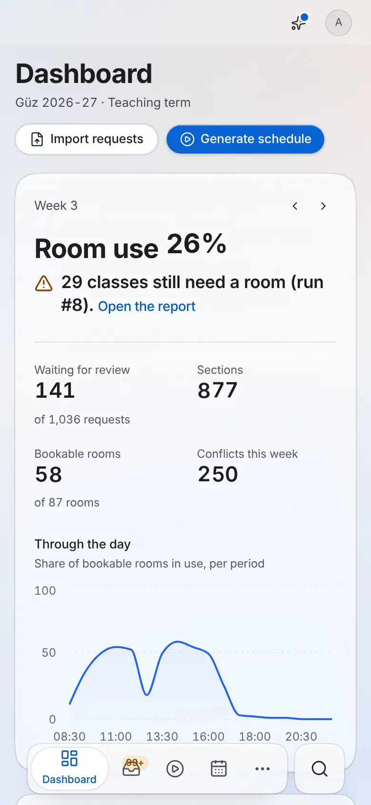
    </picture></td>
    <td align="center"><picture>
      <source media="(prefers-color-scheme: dark)" srcset="docs/images/screens/mobile-calendar-dark.webp">
      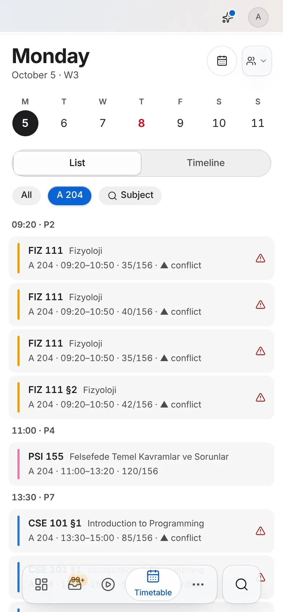
    </picture></td>
  </tr>
</table>

The interface is in 14 languages (the 13 classroombookings languages plus Turkish); these two are in
Turkish.

<table>
  <tr>
    <td>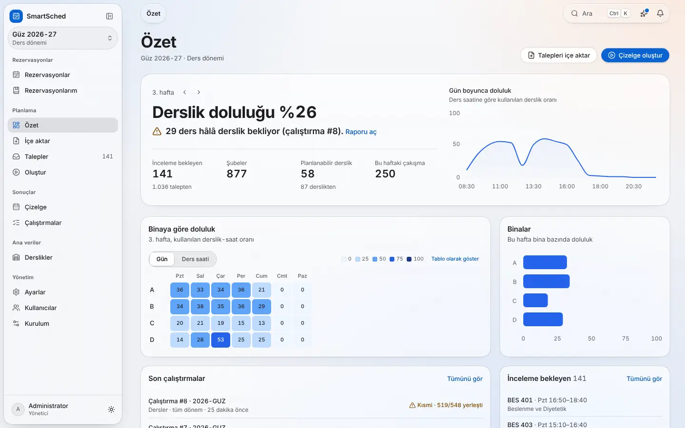</td>
    <td>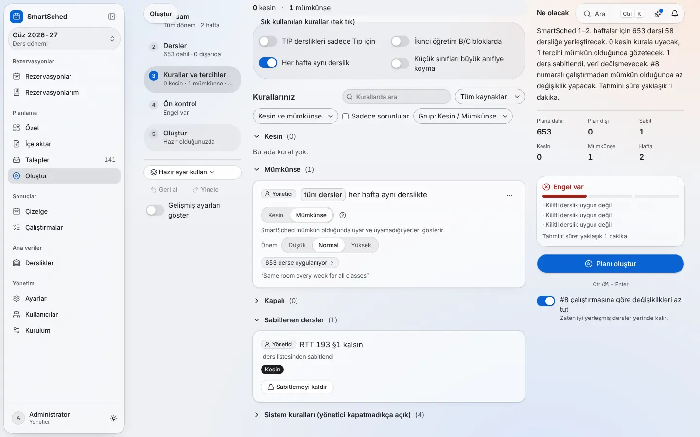</td>
  </tr>
</table>

</details>

## Relation to classroombookings

This repository is a fork of classroombookings by Craig A Rodway. The original PHP app is unchanged at
the root (`crbs-core/`, `index.php`, `assets/`), and `./deploy.sh --legacy` runs it next to
SmartSched. SmartSched imports its database: users with their password hashes, roles, access lists and
bookings. The import is tested on CRBS's own install SQL; an upgrade of a running CRBS server is still a
declared gap.

What stays the same: the booking grid by day or by room, single and recurring bookings, booking
limits, holidays and timetable weeks, roles with the CRBS permissions, room access lists, LDAP
sign-in, the CSV export columns, and the 13 CRBS interface languages. What is added: the planning side,
a published timetable that bookings can never collide with, the reservation panel, calendar feeds and
push, approvals, an audit log with undo, in-app notifications and an e-mail outbox. Where SmartSched
behaves differently on purpose (mostly security, such as no privilege escalation in the role editor,
sign-out ending every session, or keeping booking history when a user is deleted), the difference is
listed with its setting, if there is one, in [docs/CRBS_PARITY.md](docs/CRBS_PARITY.md).

The CRBS superset gate (`python3 scripts/parity_check.py`) holds one row per CRBS behaviour, audit item
or screen, each tied to API tests on the real Bahar data and, where there is a screen, to a Playwright
test title. Run on 2026-10-15 at commit `bd0db48`: **192 rows, 172 pass, 19 declared gaps, 1 fail, 0
missing**; 157 API tests ran and 156 passed. The failure is a stale assertion:
`tests/test_wave1_migrations.py` still expects the Alembic head `0015_approvals`, while
`0016_course_code_keys` landed after it. The test stops there, so the rest of it (the room-features
upgrade path) did not run, and row X-08 fails until the test is updated. The 19 gaps, each declared in the inventory with a reason and a proposed fix: 11 rows have a screen
that no Playwright step in the inventory drives yet (multi-booking, cancel many, the staff dashboard, SMTP, the
installer's requirements step on an empty database, and others); 3 are wave-1 screens not built yet
(find-a-room, audit viewer, approvals inbox); 2 are the Google/Microsoft push and the webhooks, which
have no settings screen and no live tenant test; 3 are the legacy MySQL upgrade and a side-by-side
comparison with a running CRBS (Phase 18 parts 3 and 4). The UI column
of this run checks that the Playwright titles exist; the specs themselves run in the pod CI `e2e-real`
gate. Details: [docs/CRBS_PARITY.md](docs/CRBS_PARITY.md) §9.

## Roadmap

The full plan, with every backlog item, is [docs/ROADMAP.md](docs/ROADMAP.md). In short:

| Phase | Where it stands on this branch |
|---|---|
| 1-6: backend and importers, solver, AI layer, frontend, deploy, CI and reviews | Built and in the pod CI gates; open backlog items are listed per phase in the roadmap |
| 8 Generator Studio, 9 real-data feasibility, 10 Liquid Glass redesign | Built; polish and solver backlog items open |
| 11 CRBS parity, 18 CRBS superset gate | Gate runs in CI; open: the declared gaps above, the legacy MySQL upgrade, the side-by-side check |
| 13 AWS pod, 14 no placeholders, 15 schedule comparison, 16 recordings | Built |
| 17 Booking enhancements wave 1 (room features, find-a-room, audit with undo, approvals, notifications) | Backend built; screens being built. Conflict resolver, booking policies, public view and KVKK retention not started |
| 7 Live import from the university's panel | Not started (needs access details) |
| 12 Universal edition: any-format intake through an "Ingestion Council" (branch `claude/smartsched-universal`) | On its own branch, being merged into this one; not part of this branch yet |
| **19 Intake, learned suggestions, from-scratch programmes, moderation** | **Planned, in design** (requested 2026-10-15) |

### Phase 19 (planned, in design)

None of this is built yet. The analysis and the UX specs are being written; the build waves come after
the universal branch is merged. What the user asked for, and the decisions already taken:

- **Multi-format intake** of new requests and schedule maps. Structured formats first, read without
  AI: Excel (`.xlsx`, `.xls`), CSV and TSV (UTF-8 or Windows-1254, delimiter sniffed), ODS, JSON, XML
  and ICS. Then AI-assisted formats: PDF, DOCX, TXT and EML, and images. Rows read from an
  AI-assisted format always need a coordinator's review before they are saved; extraction uses the
  organisation's own Claude API key, shows a KVKK notice and can be switched off by an administrator.
- **Learned suggestions** from earlier changes and requests. They are never applied automatically:
  accepting one adds a soft preference, so the hard-rule guarantee (every hard rule kept, or each
  failure explained) does not change. The memory can be reset per person, per term or entirely, by
  an administrator only; a reset is audited and can be undone for 30 days.
- **From-scratch programme creation**: a wizard for a term that has no workbook yet.
- **A moderation tab** per class, person, academician, request, preference and matching, with the
  person's request history, administrator edits and a minimal-change re-solve that shows the diff.
- **Conflict policy**: locks first (a locked class is never moved), then the priority a coordinator
  sets, then the largest number of classes placed. Configurable per term.

Order of work: analysis; merge of the universal branch; then structured intake, moderation and
re-solve, learned suggestions, the programme wizard, and AI-assisted intake, with the remaining CRBS
gaps alongside; then one commit with every pod gate green before deploying.

## Development

```
smartsched/
  backend/    FastAPI, SQLAlchemy 2, Alembic, OR-Tools CP-SAT, Anthropic SDK; tests/fixtures holds the real workbooks
  frontend/   Next.js 16, TypeScript, Tailwind 4, TanStack Query, dnd-kit, motion; 14 message files in messages/
  deploy/     docker compose, deploy.sh, nginx, Caddy, the legacy CRBS image, pod CI
infra/aws/    the AWS pod (boto3 CLI, IAM, user data) and POD_ACTION
scripts/      dev.sh, record/ (recordings and screenshots), parity_check.py, watchdog.py, agent_state.py
docs/         architecture, roadmap, data analysis, product contracts, design specs, test reports
```

| Command | What it runs |
|---|---|
| `make -C smartsched check` | backend ruff, mypy and the fast pytest suite (including the real workbooks), frontend tsc, eslint and vitest |
| `make -C smartsched check-all` | the above plus the solver and AI gates and `deploy/validate.sh` |
| `cd smartsched/backend && make test-slow` | the heaviest real-workbook tests |
| `cd smartsched/backend && python -m tools.validate_planner` | solve Bahar week 3, Güz week 3, the Final exams and the Bahar term and check each run at planner level |
| `python3 scripts/parity_check.py` | the CRBS superset gate; writes `docs/testing/crbs-parity-report.md` (`--report PATH` to write elsewhere) |
| `E2E_REAL=1 NEXT_PUBLIC_API_URL=http://127.0.0.1:8000 npx playwright test` | every Playwright spec against a real backend started with `smartsched/deploy/pod-ci/gates/e2e-backend-entry.sh` |

End-to-end tests run only against a real backend. There is no mock API: without `E2E_REAL=1` every
spec skips with a pointer to the setup. The e2e backend imports the real Bahar 2026 workbooks, seeds
an administrator, solves the term and pins the booking clock inside Bahar 2026.

CI runs on the AWS pod, not on GitHub-hosted runners. A systemd timer polls the repository every two
minutes, runs one job at a time in Docker, posts a commit status per gate and shows the results at
`/ci/` on the panel ([smartsched/deploy/pod-ci/README.md](smartsched/deploy/pod-ci/README.md)):

| Gate | What it checks |
|---|---|
| `prepare` | builds the Python CI image and pulls the Playwright image |
| `validate` | `smartsched/deploy/validate.sh` (compose, env completeness, no secrets, pinned images, nginx) |
| `backend` | ruff, mypy, pytest, the solver gate and `alembic upgrade head` |
| `infra` | tests for `infra/aws` and the pod CI itself |
| `frontend` | `npm run check` (tsc, eslint, vitest) |
| `e2e-real` | every Playwright spec against the real backend with the Bahar fixtures, then a check that the build holds no mock code |
| `parity` | the CRBS superset gate |
| `planner` | `tools/validate_planner.py` on the four real instances; any planner-level violation fails |
| `images` | `docker build` of the backend, frontend and legacy CRBS images |
| `watchdog` | the agent ledger report (not blocking) |

The pod redeploys the deploy branch only when every blocking gate is green and the commit is still
the head of that branch. `.github/workflows/smartsched.yml` is manual-only (backend, frontend, Docker
build and stack smoke jobs, without the e2e, parity and planner gates); `aws-bootstrap.yml` is the
only workflow that runs on its own, and only when `infra/aws/POD_ACTION` changes.

Configuration is through environment variables (`DATABASE_URL`, `APP_SECRET`, `JWT_SECRET`,
`PUBLIC_URL`, `ADMIN_EMAIL`, `ADMIN_PASSWORD`, `ANTHROPIC_API_KEY`, `SOLVER_WORKERS`, …), listed with
comments in `smartsched/backend/.env.example` and `smartsched/deploy/.env.example` and described in
[smartsched/README.md](smartsched/README.md). In production the backend refuses to start with a default,
short or shared secret. The Anthropic key can also be stored, encrypted, under Settings → AI.

More documentation:

| Document | Contents |
|---|---|
| [smartsched/README.md](smartsched/README.md) | developer guide: modules, environment, make targets, CLI, API |
| [docs/ARCHITECTURE.md](docs/ARCHITECTURE.md) | design principles, domain model, solver contract, event bus, API surface |
| [docs/DATA_ANALYSIS.md](docs/DATA_ANALYSIS.md) | the workbook shapes, column meanings and quirks |
| [docs/ROADMAP.md](docs/ROADMAP.md) | phases, decisions and backlog |
| [docs/CRBS_PARITY.md](docs/CRBS_PARITY.md) | classroombookings behaviour and the deliberate differences |
| [docs/product/](docs/product/) | API contracts: calendar sync, booking enhancements wave 1 |
| [docs/design/](docs/design/) | UI specs, including the Liquid Glass system and the calendar |
| [docs/universal/](docs/universal/) | universal onboarding: [Ingestion Council architecture](docs/universal/ARCHITECTURE.md), [2026 research](docs/universal/RESEARCH-2026.md), [Ruflo dev harness](docs/universal/RUFLO.md) |
| [docs/testing/](docs/testing/) | test reports: real-data feasibility, real-backend end to end, CRBS parity, planner comparison |
| [docs/deploy/AWS.md](docs/deploy/AWS.md), [docs/deploy/calendar-oauth.md](docs/deploy/calendar-oauth.md) | the AWS pod; setting up the Google and Microsoft OAuth clients |
| [docs/AGENTS.md](docs/AGENTS.md), [docs/PROGRESS.md](docs/PROGRESS.md), [docs/AGENT_STATE.md](docs/AGENT_STATE.md) | SmartSched is built by parallel Claude Code agents: their protocol, ledger and resume guide |

### Recordings and screenshots

Everything above was captured by scripts in [`scripts/record/`](scripts/record/), against the real
backend and a production build of the frontend, never against mock data:

```bash
scripts/record/stack.sh up && scripts/record/stack.sh runs   # import the three terms, make two solver runs
node scripts/record/screens.mjs                                # screenshots, light and dark
scripts/record/record-all.sh /tmp/recordings                   # the five recordings: MP4, animated WebP, poster
```

The recordings are driven by Playwright, captured with Playwright's own video, and finished with
ffmpeg in the style of [Recordly](https://github.com/webadderallorg/Recordly) (camera zoom on the
action, an enlarged cursor, click ripples, captions). Each take also writes a `.recordly` project that
opens in Recordly for hand editing. Recordly's own renderer does run headless in a Linux container but
needs about 13 minutes per 17 seconds of video, so it was not used for these files. Details:
[docs/recording/RECORDLY.md](docs/recording/RECORDLY.md).

---

## Legacy classroombookings

### classroombookings - open source room booking system for schools.

By Craig A Rodway.

[](https://www.gnu.org/licenses/agpl-3.0.html)
[](https://twitter.com/crbsapp)

This is a web-based room booking system for schools and is designed to be as easy to use as possible. Set up your bookable rooms, day schedule and timetable for the year. Add user accounts, and allow them to make and manage bookings from anywhere.

It is available to [download and install yourself](https://www.classroombookings.com/self-host/) or there is a great value [hosted service](https://www.classroombookings.com/pricing/).

It is web-based - PHP and MySQL - and currently uses the [CodeIgniter 3](https://codeigniter.com/) framework.

#### Documentation
For installation instructions and configuration guide, please [read the documentation pages](https://www.classroombookings.com/docs/self-hosted/).

#### Bug Reports & Feature Requests
Please check out [GitHub Issues](https://github.com/craigrodway/classroombookings/issues) to view existing issues or open a new bug report.

#### Security
To report any security issues, please email craig@classroombookings.com instead of using the issue tracker.

#### Credits

This project makes use of several third parties, some of which are listed below.

- [CodeIgniter](https://codeigniter.com/) (MIT)
- [Unpoly](https://unpoly.com/) (MIT)
- [FamFamFam Silk Icons](http://www.famfamfam.com/lab/icons/silk/) ([CC BY 3.0](https://creativecommons.org/licenses/by/3.0/), Unmodified)

## Licence

This repository is licensed under the
[GNU Affero General Public License v3.0](https://www.gnu.org/licenses/agpl-3.0.html). See
[LICENSE.txt](LICENSE.txt).
