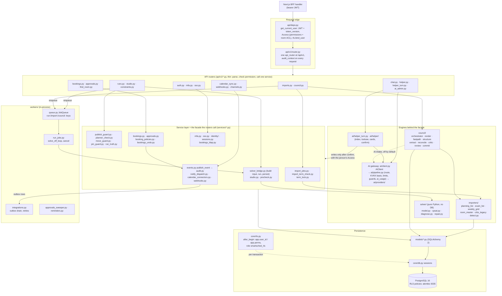

# Backend components (the facade view)

How a request travels through the FastAPI backend, and which module is the facade for each area. Index:
[README.md](README.md). Paths are relative to `smartsched/backend/app/`.

Routers are meant to stay thin and call the service of their area; that service is the facade. Business rules (term
write lock, publish guard, approval routing, event bus) live there, so the CLI, workers and the helper reuse them
instead of calling routers. Known exception: `api/v1/runs.py` still holds the publish switch and the move endpoint's
orchestration itself (it calls `publish_guard`, `planner_check` and `move_guard`). The solver is a pure function `solve(SolverInput) -> SolverResult`: only `services/solver_bridge.py`
turns database rows into its input and its result back into `assignments`. Every model call goes through `AIClient`
and the gateway pipeline; no router or service calls a provider SDK directly. PostgreSQL row-level security is a
second fence under the API checks: `api/deps.py` binds the signed-in user to the session and `core/rls.py` writes the
context into each transaction (a no-op on SQLite).

Where in the code: [`api/deps.py`](../../smartsched/backend/app/api/deps.py),
[`api/v1/router.py`](../../smartsched/backend/app/api/v1/router.py),
[`services/`](../../smartsched/backend/app/services/),
[`services/solver_bridge.py`](../../smartsched/backend/app/services/solver_bridge.py),
[`services/events.py`](../../smartsched/backend/app/services/events.py),
[`importers/`](../../smartsched/backend/app/importers/), [`council/`](../../smartsched/backend/app/council/),
[`solver/`](../../smartsched/backend/app/solver/) ([README](../../smartsched/backend/app/solver/README.md)),
[`ai/client.py`](../../smartsched/backend/app/ai/client.py), [`ai/pipeline.py`](../../smartsched/backend/app/ai/pipeline.py),
[`ai/helper_turn.py`](../../smartsched/backend/app/ai/helper_turn.py), [`workers/`](../../smartsched/backend/app/workers/),
[`core/rls.py`](../../smartsched/backend/app/core/rls.py),
[`alembic/versions/0035_rls_policies.py`](../../smartsched/backend/alembic/versions/0035_rls_policies.py).

## Frontend layout (for orientation)

| Folder | What lives there |
|---|---|
| [`src/app/(app)/`](../../smartsched/frontend/src/app/(app)/) | signed-in pages (import, runs, timetable, bookings, admin, ...) |
| [`src/app/api/`](../../smartsched/frontend/src/app/api/) | the BFF route handlers: `v1/[...path]` proxy and `auth/mfa/[step]` sign-in steps |
| [`src/components/`](../../smartsched/frontend/src/components/) | one folder per feature (import, runs, bookings, helper, shell, ...) |
| [`src/lib/api/`](../../smartsched/frontend/src/lib/api/) | typed API clients and React Query hooks, one file per area |
