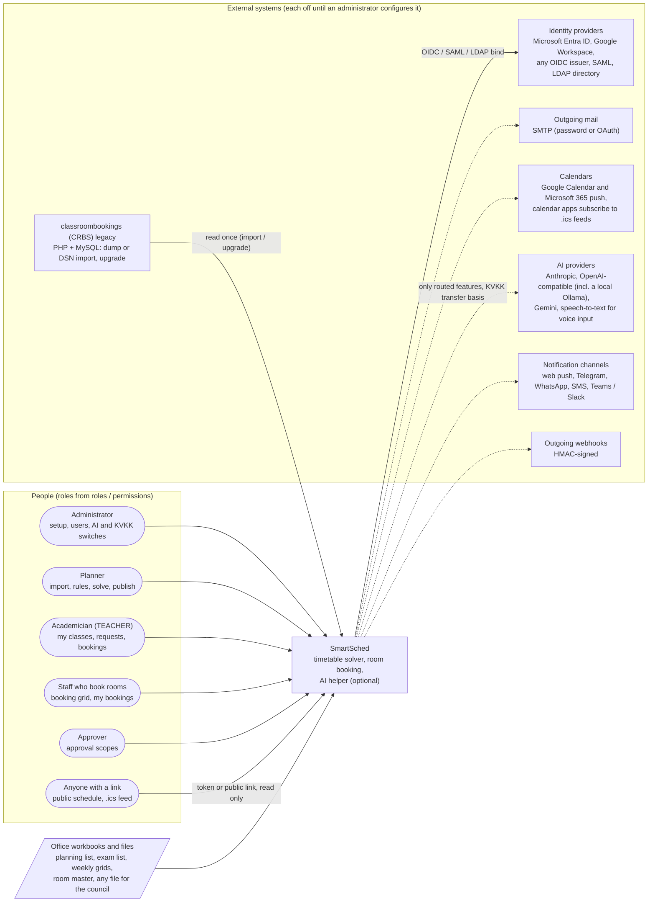
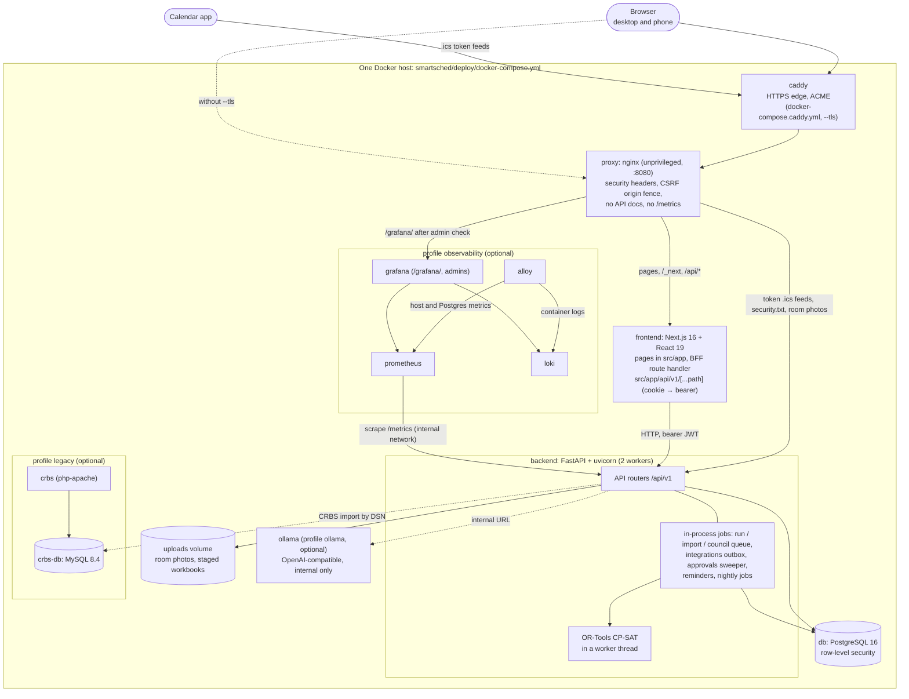

# C4 context and containers

Two levels of the [C4 model](https://c4model.com/): who and what SmartSched talks to (level 1), and the
containers of one deployment (level 2). Index: [README.md](README.md).

## Level 1: system context

Everything to the right is optional: import, solving, the booking grid and manual edits work with no external system
at all. Dotted arrows leave the server only after an administrator has entered the institution's own sender, client
or key, and (for personal data) recorded a KVKK sign-off; outbound calls go through an outbox or the AI gateway,
never straight from a request handler. CRBS is a data source only; SmartSched never writes back to it.

Where in the code: roles [`models/booking.py`](../../smartsched/backend/app/models/booking.py) (`roles`,
`permissions`), identity [`services/sso.py`](../../smartsched/backend/app/services/sso.py),
[`services/identity/`](../../smartsched/backend/app/services/identity/),
[`services/bookings_ldap.py`](../../smartsched/backend/app/services/bookings_ldap.py), mail
[`services/mail.py`](../../smartsched/backend/app/services/mail.py), calendars
[`services/calendar_connectors.py`](../../smartsched/backend/app/services/calendar_connectors.py) and
[`services/calendar_feeds.py`](../../smartsched/backend/app/services/calendar_feeds.py), AI
[`ai/providers/`](../../smartsched/backend/app/ai/providers/) and [`ai/voice/`](../../smartsched/backend/app/ai/voice/),
channels [`services/channels/`](../../smartsched/backend/app/services/channels/), webhooks
[`services/webhooks.py`](../../smartsched/backend/app/services/webhooks.py), CRBS
[`importers/crbs_legacy.py`](../../smartsched/backend/app/importers/crbs_legacy.py) and
[`services/crbs_upgrade.py`](../../smartsched/backend/app/services/crbs_upgrade.py), public pages
[`services/public_schedule.py`](../../smartsched/backend/app/services/public_schedule.py).

## Level 2: containers (docker compose)

The browser never talks to FastAPI directly: nginx sends every `/api/*` request through the Next.js route handler,
which keeps the JWT in an httpOnly cookie and adds the bearer header; only the token feed URLs, `security.txt` and
room photos go straight to the backend. There is **no separate worker container**: solver runs, imports, council
jobs, outboxes and sweeps run as asyncio jobs inside the backend process, and CP-SAT runs in a thread off the event
loop (a dedicated worker service is listed as planned under "Scaling" in the deploy README). Profiles stay off
unless `deploy.sh` is asked for them.

Where in the code: [`deploy/docker-compose.yml`](../../smartsched/deploy/docker-compose.yml),
[`deploy/docker-compose.caddy.yml`](../../smartsched/deploy/docker-compose.caddy.yml),
[`deploy/nginx/default.conf`](../../smartsched/deploy/nginx/default.conf),
[BFF handler](../../smartsched/frontend/src/app/api/v1/[...path]/route.ts),
[`app/main.py`](../../smartsched/backend/app/main.py) (lifespan starts the jobs),
[`workers/queue.py`](../../smartsched/backend/app/workers/queue.py),
[`workers/integrations.py`](../../smartsched/backend/app/workers/integrations.py),
[`workers/approvals_sweeper.py`](../../smartsched/backend/app/workers/approvals_sweeper.py),
[`deploy/README.md`](../../smartsched/deploy/README.md).
