# Core data model (ER)

The main tables and their keys, read from the SQLAlchemy models. About 30 of the more than 100 tables; the full column
list is the table in [ARCHITECTURE.md § Domain model](../ARCHITECTURE.md#domain-model-sqlalchemy-postgres-in-prod--sqlite-in-tests).
Index: [README.md](README.md).

```mermaid
erDiagram
  terms ||--o{ weeks : "term_id"
  terms ||--o{ sections : "term_id"
  terms ||--o{ exam_requests : "term_id"
  terms ||--o{ blocks : "term_id"
  terms ||--o{ constraints : "term_id (null = global)"
  terms ||--o{ schedule_runs : "term_id"
  terms ||--o{ bookings : "term_id"
  buildings ||--o{ rooms : "building_id"
  room_groups ||--o{ rooms : "room_group_id"
  courses ||--o{ sections : "course_id"
  programs ||--o{ sections : "program_id"
  sections ||--o{ section_instructors : "section_id"
  instructors ||--o{ section_instructors : "instructor_id"
  sections ||--o{ meeting_requests : "section_id"
  sections |o--o{ exam_requests : "section_id"
  rooms ||--o{ blocks : "room_id"
  schedule_runs ||--o{ assignments : "run_id"
  schedule_runs |o--o{ schedule_runs : "parent_run_id"
  schedule_runs |o--o{ constraints : "run_id (null = term-wide)"
  meeting_requests |o--o{ assignments : "meeting_request_id"
  exam_requests |o--o{ assignments : "exam_request_id"
  rooms ||--o{ bookings : "room_id"
  booking_periods ||--o{ bookings : "period_id"
  booking_series |o--o{ bookings : "series_id"
  bookings ||--o{ booking_slots : "booking_id"
  rooms ||--o{ booking_slots : "room_id"
  bookings |o--o{ approval_requests : "booking_id"
  approval_rules |o--o{ approval_requests : "rule_id"
  approval_requests ||--o{ approval_decisions : "request_id"
  roles |o--o{ users : "role_id"
  roles ||--o{ role_permissions : "role_id"
  users |o--o{ bookings : "user_id"
  users |o--o| instructors : "user_id"
  users |o--o{ schedule_runs : "created_by"
  users |o--o{ import_jobs : "created_by_id"
  users |o..o{ audit_events : "actor_id (no FK)"

  terms {
    int id PK
    string code UK "2026-BAHAR"
    string kind "REGULAR FINAL BUT SUMMER"
    json periods_json
  }
  rooms {
    int id PK
    string code UK "A101"
    int capacity
    json tags "TIP PC LAB"
  }
  sections {
    int id PK
    int term_id FK
    int course_id FK
    int program_id FK
    int enrolment
  }
  meeting_requests {
    int id PK
    int section_id FK
    string status "NEW PARSED NEEDS_REVIEW LOCKED"
  }
  schedule_runs {
    int id PK
    int term_id FK
    string kind "COURSE EXAM"
    string status "see states.md"
    bool is_active "one per term and kind"
    int hard_score
    int parent_run_id FK
  }
  assignments {
    int id PK
    int run_id FK
    int day
    int start_period
    json room_ids "ordered, no FK"
    string origin "SOLVER AI_EDIT MANUAL IMPORT"
  }
  bookings {
    int id PK
    int room_id FK
    date date
    int period_id FK
    string status "BOOKED PENDING CANCELLED REJECTED EXPIRED WITHDRAWN"
    int user_id FK
  }
  booking_slots {
    int booking_id PK
    int period PK
    int room_id FK
    date date "unique room+date+period"
  }
  users {
    int id PK
    string username UK
    int role_id FK
    int token_version
  }
  audit_events {
    int id PK
    string action "booking.create run.activate"
    string entity_type
    string entity_id
    int actor_id
  }
  import_jobs {
    int id PK
    string kind
    string status "QUEUED RUNNING DONE FAILED"
    json summary "dry_run preview_of applied_job_id"
  }
```

The planning side (terms, sections, requests) feeds the solver; a run's `assignments` are the timetable, and the one
active run per term and kind is what the booking grid shows next to `bookings`. `assignments.room_ids` is a JSON list
without a foreign key, so deleting a room does not cascade into old runs. `audit_events` is append-only (database
triggers refuse UPDATE and DELETE) and names its actor by id without a foreign key, so audit rows outlive the user.
Row-level security covers the per-person tables: `bookings`, `booking_series`, `approval_requests`,
`inapp_notifications`, `calendar_feed_tokens`, `consents`, `dsr_requests` and `ai_usage`.

Where in the code: [`models/catalog.py`](../../smartsched/backend/app/models/catalog.py) (terms, weeks, buildings,
rooms, programs, instructors, courses), [`models/scheduling.py`](../../smartsched/backend/app/models/scheduling.py)
(sections, requests, blocks, constraints), [`models/runs.py`](../../smartsched/backend/app/models/runs.py),
[`models/booking.py`](../../smartsched/backend/app/models/booking.py) (roles, bookings, slots, periods),
[`models/approvals.py`](../../smartsched/backend/app/models/approvals.py),
[`models/system.py`](../../smartsched/backend/app/models/system.py) (users, import_jobs),
[`models/audit.py`](../../smartsched/backend/app/models/audit.py),
[`alembic/versions/0035_rls_policies.py`](../../smartsched/backend/alembic/versions/0035_rls_policies.py).
