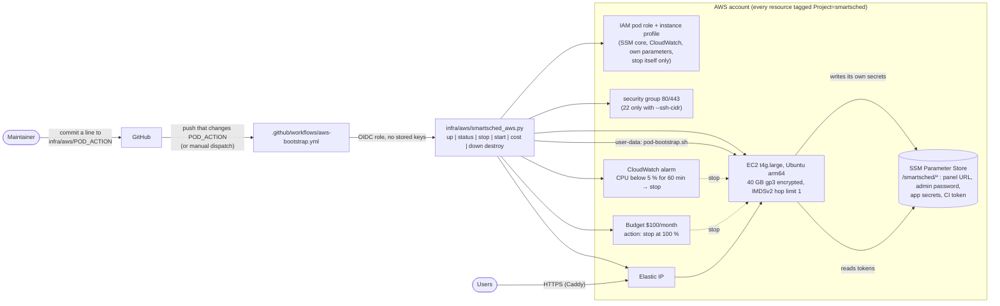
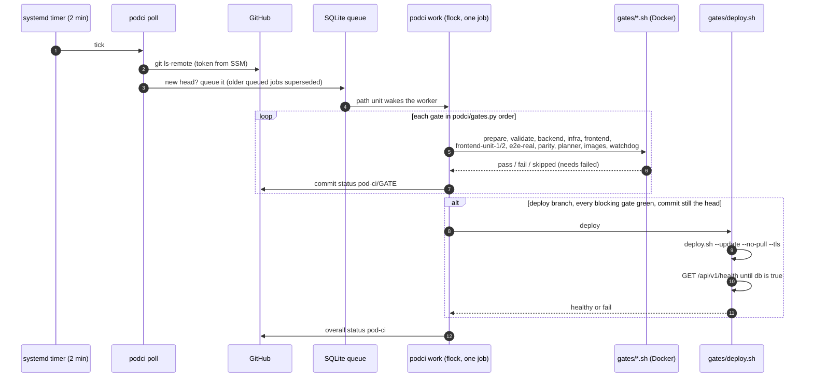
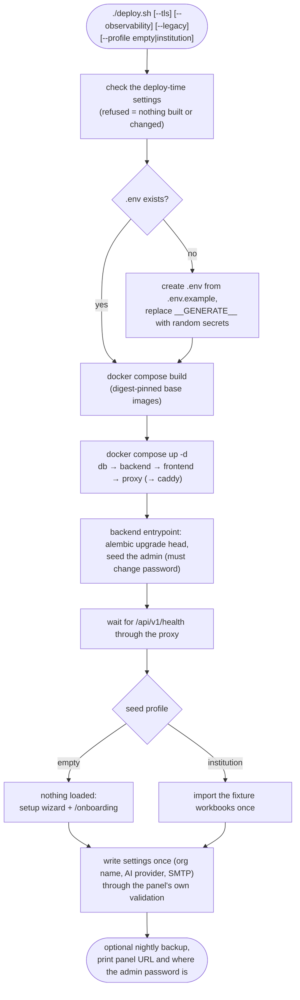

# Deployment

Two ways SmartSched runs: the AWS pod (one EC2 instance that also runs its own CI) and the local one-click deploy on
any Docker host. Index: [README.md](README.md). Runbooks: [docs/deploy/AWS.md](../deploy/AWS.md),
[docs/deploy/ONE-CLICK.md](../deploy/ONE-CLICK.md).

## AWS pod: control path

`POD_ACTION` is the only workflow that runs automatically, and only when that file changes; it assumes an OIDC role
and runs the idempotent bootstrap CLI. The pod generates its secrets on first boot and stores them in SSM itself
(nothing secret travels through the workflow). Cost is capped twice: an idle alarm stops the instance and a budget
action stops it at $100 a month.

Where in the code: [`infra/aws/POD_ACTION`](../../infra/aws/POD_ACTION),
[`infra/aws/smartsched_aws.py`](../../infra/aws/smartsched_aws.py),
[`infra/aws/user-data.sh.tmpl`](../../infra/aws/user-data.sh.tmpl),
[`aws-bootstrap.yml`](../../.github/workflows/aws-bootstrap.yml),
[`pod-ci/pod-bootstrap.sh`](../../smartsched/deploy/pod-ci/pod-bootstrap.sh).

## AWS pod: CI gates → deploy → health

The pod is its own CI: no hosted runner, no registration. Gates run strictly one after another inside Docker with
CPU and memory caps; a gate whose prerequisite failed is reported as an error, never green. Only the configured deploy
branch is deployed, only when every blocking gate passed and the commit is still that branch's head, and a deploy
counts only after the health endpoint reports the database up. Results are also served on the panel under `/ci/`.

Where in the code: [`pod-ci/README.md`](../../smartsched/deploy/pod-ci/README.md),
[`pod-ci/podci/gates.py`](../../smartsched/deploy/pod-ci/podci/gates.py),
[`pod-ci/podci/runner.py`](../../smartsched/deploy/pod-ci/podci/runner.py),
[`pod-ci/gates/deploy.sh`](../../smartsched/deploy/pod-ci/gates/deploy.sh),
[`pod-ci/systemd/`](../../smartsched/deploy/pod-ci/systemd/).

## Local one-click deploy

The same script serves a laptop, a school server and the pod (the pod calls it with `--update --no-pull --tls`).
Secrets are generated on first run, never passed as flags and never committed; settings are written once through the
admin panel's own validation, so a later deploy never overwrites what an administrator changed. For development
without Docker, `scripts/dev.sh --run` starts the backend and frontend on SQLite.

Where in the code: [`deploy/deploy.sh`](../../smartsched/deploy/deploy.sh),
[`deploy/docker-compose.yml`](../../smartsched/deploy/docker-compose.yml),
[`deploy/seed/`](../../smartsched/deploy/seed/), [`deploy/README.md`](../../smartsched/deploy/README.md),
[`scripts/dev.sh`](../../scripts/dev.sh).
