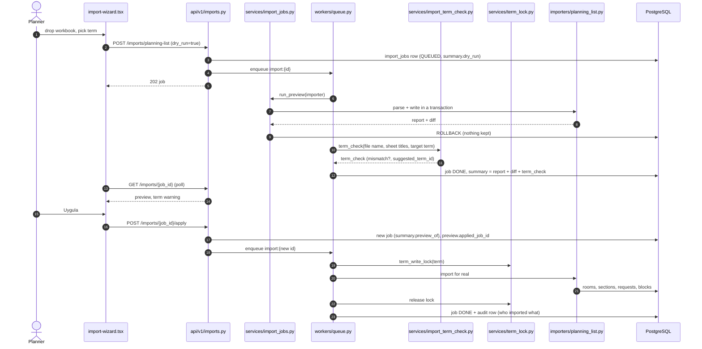
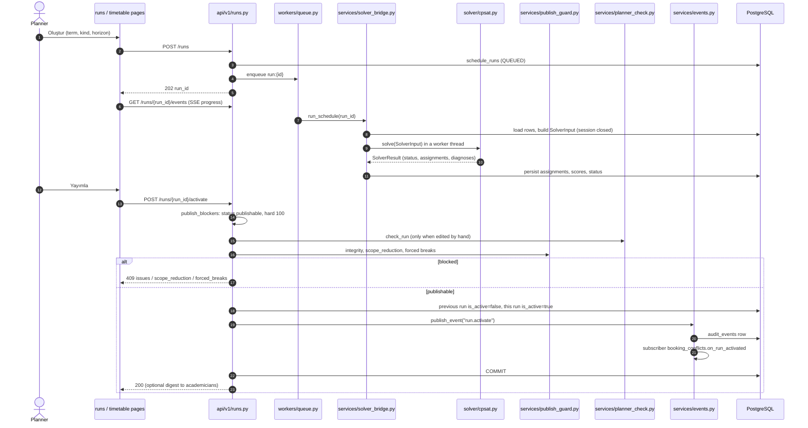
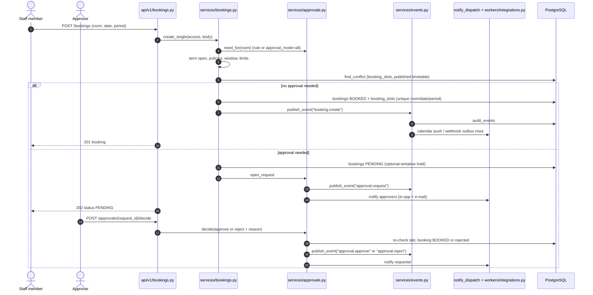
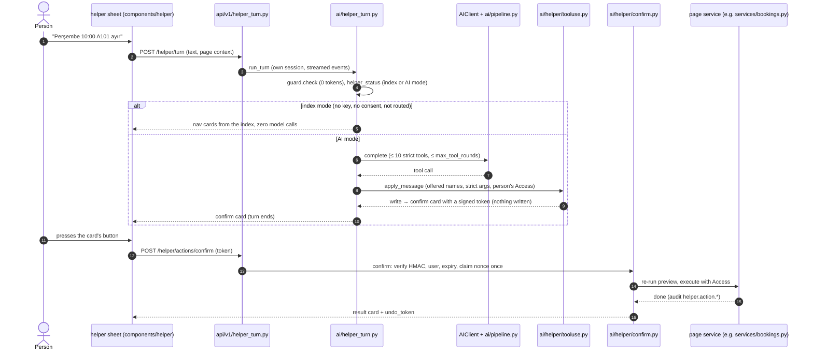
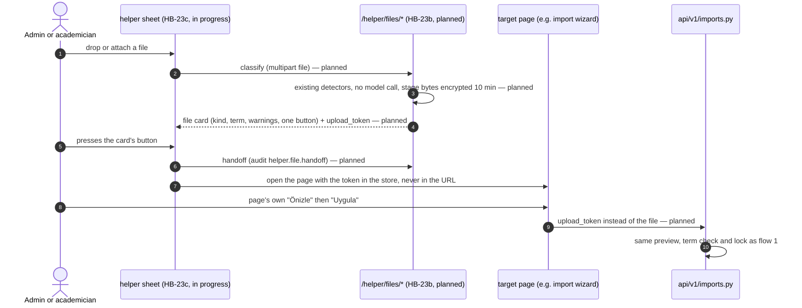
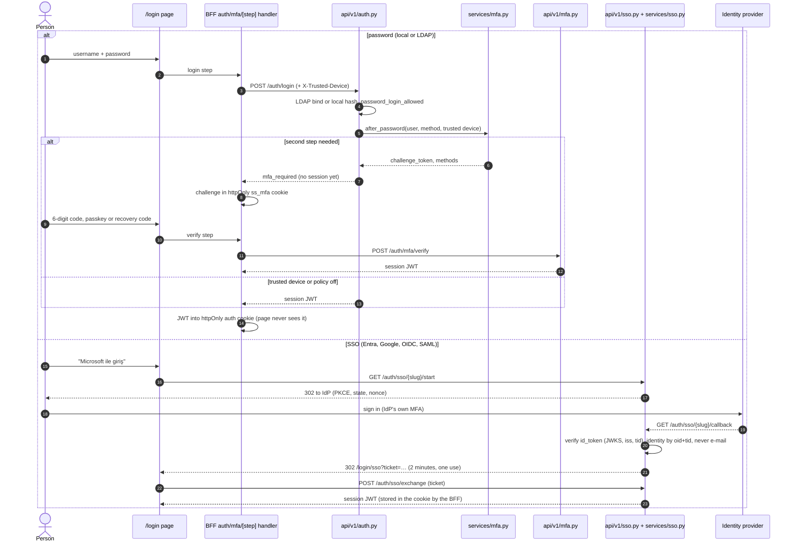

# Key flows (sequence diagrams)

Five flows a new contributor or a reviewer meets first. Backend paths are under `/api/v1` and every browser call
goes through the Next.js BFF handler (left out below unless it does something). Index: [README.md](README.md).

## 1. Workbook import: preview → term check → Uygula

Every workbook upload is a preview first: the importer runs inside a transaction that is rolled back, so the person
sees the diff and the term check before anything is written. "Uygula" imports the stored file once (a second apply
answers 409 `preview_already_applied`), under the term's write lock so two imports of one term never interleave. A
file of the wrong kind fails with `WrongFileError` and the wizard offers "… olarak içe aktar".

Where in the code: [`api/v1/imports.py`](../../smartsched/backend/app/api/v1/imports.py) (`_start_job`,
`apply_preview`), [`services/import_jobs.py`](../../smartsched/backend/app/services/import_jobs.py),
[`services/import_term_check.py`](../../smartsched/backend/app/services/import_term_check.py),
[`services/term_lock.py`](../../smartsched/backend/app/services/term_lock.py),
[`importers/detect.py`](../../smartsched/backend/app/importers/detect.py),
[`import-wizard.tsx`](../../smartsched/frontend/src/components/import/import-wizard.tsx).

## 2. Solve and publish a run

A solve is a background job: the request returns 202 at once and the page follows the SSE stream. The solver never
sees the database: the bridge builds a frozen `SolverInput`, CP-SAT runs off the event loop, and the result is
written in a fresh session. Publishing is a guarded switch of `is_active` (one active run per term and kind, enforced
by a partial unique index); bookings that the new timetable now overlaps are detected in the same transaction.

Where in the code: [`api/v1/runs.py`](../../smartsched/backend/app/api/v1/runs.py) (`create_run`, `activate_run`,
`publish_blockers`), [`services/solver_bridge.py`](../../smartsched/backend/app/services/solver_bridge.py)
(`run_schedule`), [`workers/run_jobs.py`](../../smartsched/backend/app/workers/run_jobs.py),
[`solver/cpsat.py`](../../smartsched/backend/app/solver/cpsat.py),
[`services/publish_guard.py`](../../smartsched/backend/app/services/publish_guard.py),
[`services/planner_check.py`](../../smartsched/backend/app/services/planner_check.py),
[`services/booking_conflicts.py`](../../smartsched/backend/app/services/booking_conflicts.py).

## 3. A booking, with approval

All booking-side changes go through `publish_event` inside the change's own transaction: it writes the audit row and
calls subscribers (calendar push, webhooks), which only enqueue outbox rows; a failing subscriber is logged and never
undoes the booking. The `booking_slots` unique key is the database guarantee against double booking. With no
approval rule the flow is the CRBS one; an approval sweep every 60 s expires overdue requests and releases holds.

Where in the code: [`api/v1/bookings.py`](../../smartsched/backend/app/api/v1/bookings.py) (`create_booking`),
[`services/bookings.py`](../../smartsched/backend/app/services/bookings.py) (`create_single`),
[`services/approvals.py`](../../smartsched/backend/app/services/approvals.py) (`need_for`, `open_request`, `decide`),
[`api/v1/approvals.py`](../../smartsched/backend/app/api/v1/approvals.py),
[`services/events.py`](../../smartsched/backend/app/services/events.py),
[`services/notify_dispatch.py`](../../smartsched/backend/app/services/notify_dispatch.py),
[`workers/integrations.py`](../../smartsched/backend/app/workers/integrations.py),
[`workers/approvals_sweeper.py`](../../smartsched/backend/app/workers/approvals_sweeper.py).

## 4. Helper turn with a confirm card (and the HB-23 file hand-over)

A write never runs from model output or from typed text. The model can only call the tools it was offered; a write
stops at a confirm card whose token is HMAC-signed, bound to the person, valid 10 minutes and usable once. The confirm
re-runs the preview and answers 409 `changed` when the world moved. The file router (second diagram, design
[helper-file-router.md](../design/v3/helper-file-router.md)) follows the same rule: the helper never imports, it hands
the staged file to the page whose own preview and "Uygula" write. Steps marked "planned" are not merged yet.

Where in the code: [`api/v1/helper_turn.py`](../../smartsched/backend/app/api/v1/helper_turn.py),
[`api/v1/helper.py`](../../smartsched/backend/app/api/v1/helper.py),
[`ai/helper_turn.py`](../../smartsched/backend/app/ai/helper_turn.py) (`run_turn`),
[`ai/helper/guard.py`](../../smartsched/backend/app/ai/helper/guard.py),
[`ai/helper/tooluse.py`](../../smartsched/backend/app/ai/helper/tooluse.py),
[`ai/helper/confirm.py`](../../smartsched/backend/app/ai/helper/confirm.py),
[`ai/pipeline.py`](../../smartsched/backend/app/ai/pipeline.py),
[`components/helper/`](../../smartsched/frontend/src/components/helper/).

## 5. Sign-in: password + second step, or SSO

The browser never holds a token: the BFF handlers keep the second-step challenge, the trusted-device token and the
session JWT in httpOnly cookies. Every JWT carries `token_version`; sign-out, a password or role change and disabling
the account raise it, so all earlier sessions die on every device. SSO accounts skip SmartSched's own second step
(the provider does it); errors on `/login?error=` never say whether an account exists.

Where in the code: [`api/v1/auth.py`](../../smartsched/backend/app/api/v1/auth.py),
[`services/mfa.py`](../../smartsched/backend/app/services/mfa.py) (`after_password`),
[`api/v1/mfa.py`](../../smartsched/backend/app/api/v1/mfa.py), [`api/v1/sso.py`](../../smartsched/backend/app/api/v1/sso.py),
[`services/sso.py`](../../smartsched/backend/app/services/sso.py),
[`services/identity/`](../../smartsched/backend/app/services/identity/),
[`core/security.py`](../../smartsched/backend/app/core/security.py),
[BFF sign-in steps](../../smartsched/frontend/src/app/api/auth/mfa/[step]/route.ts),
[`sso-exchange.tsx`](../../smartsched/frontend/src/components/auth/sso-exchange.tsx).
