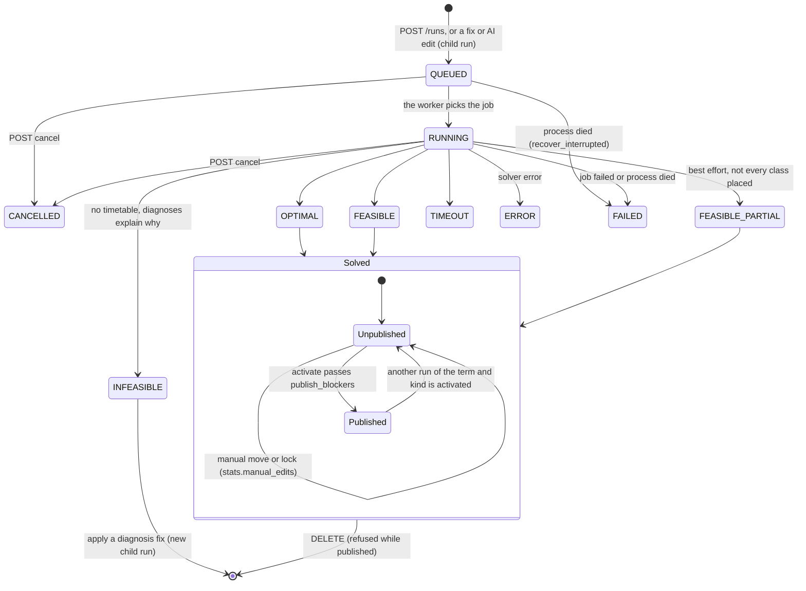
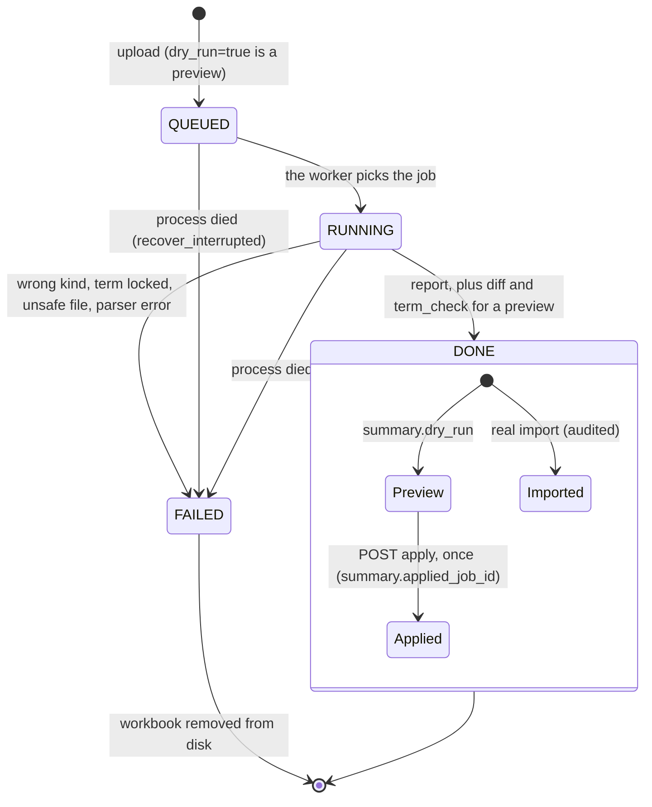

# State diagrams: a run and an import job

Index: [README.md](README.md).

## Schedule run

The owner's "draft → solved → published" maps onto two columns of `schedule_runs`: `status` (the solve) and
`is_active` (published). There is no `DRAFT` status; a Generator Studio draft becomes a run when it is solved.

Only `OPTIMAL`, `FEASIBLE` and `FEASIBLE_PARTIAL` can be published, and only with hard score 100 (or, after manual
edits, when the planner check finds nothing but accepted exceptions and reasoned forced moves). Exactly one run per
term and kind is published at a time; a partial unique index on `is_active` makes a concurrent second activation fail.
Manual moves change a run in place and are re-checked at publish time; fixes and AI edits create a child run
(`parent_run_id`), so the old one stays as it was.

Where in the code: [`schemas/runs.py`](../../smartsched/backend/app/schemas/runs.py) (`RUN_STATUSES`,
`TERMINAL_STATUSES`), [`models/runs.py`](../../smartsched/backend/app/models/runs.py) (`uq_schedule_runs_active`),
[`services/solver_bridge.py`](../../smartsched/backend/app/services/solver_bridge.py) (`run_status`),
[`api/v1/runs.py`](../../smartsched/backend/app/api/v1/runs.py) (`PUBLISHABLE`, `publish_blockers`, `activate_run`),
[`workers/queue.py`](../../smartsched/backend/app/workers/queue.py) (`recover_interrupted`).

## Import job

A preview and its apply are two `import_jobs` rows linked by `summary.preview_of` and `summary.applied_job_id`: the
apply is a new job that starts at `QUEUED` and holds the term's write lock, while the preview writes nothing. A
failed job keeps no workbook on disk, and a job left `QUEUED` or `RUNNING` by a dead process is marked `FAILED` on the
next start (the person uploads again). The council (`council_jobs`) has its own longer lifecycle:
`QUEUED → RUNNING → REVIEW | READY → COMMITTED`, or `FAILED`.

Where in the code: [`models/system.py`](../../smartsched/backend/app/models/system.py) (`ImportJob`),
[`api/v1/imports.py`](../../smartsched/backend/app/api/v1/imports.py) (`_start_job`, `apply_preview`),
[`services/import_jobs.py`](../../smartsched/backend/app/services/import_jobs.py),
[`council/orchestrator.py`](../../smartsched/backend/app/council/orchestrator.py),
[universal/ARCHITECTURE.md § 2](../universal/ARCHITECTURE.md#2-orchestrator-and-blackboard).
