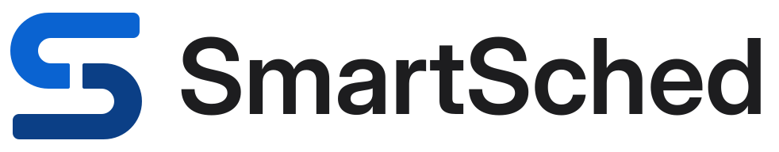
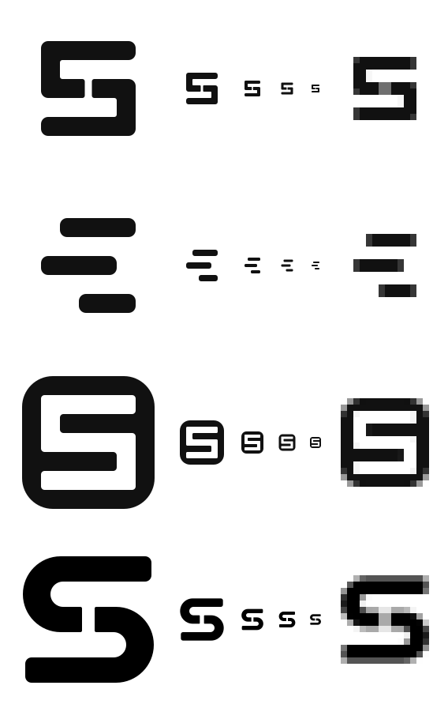

# Brand: the SmartSched mark

Owner: design-pro (brand-logo-2026-10-15) · Status: v1.0 (2026-10-15) · Process: `.claude/skills/logo-design`
(vendored MIT skill, see its `SOURCE.md`) · Tokens: aligned with [`tokens.md`](tokens.md) and
[`v2/liquid-glass.md`](v2/liquid-glass.md) §5 · Files: [`docs/images/brand/`](../images/brand/) ·
Component: `smartsched/frontend/src/components/brand/logo.tsx`

**In one sentence:** the S is drawn on a 5 × 5 period grid and split into two identical blocks, rotated
180° and sitting side by side in the middle period row. They are two classes that fit, like the solver's output.

<p>
  
</p>

---

## 1. Brief

| | |
|---|---|
| Name | **SmartSched** (one word, camel case, both S capital). Never "Smart Sched", "Smartsched" or "SMARTSCHED". |
| What it is | University timetabling (CP-SAT solver), exam planning and room booking for a Turkish university. It is a superset of classroombookings. |
| Users | Planners (the planning office), academicians, and staff who book rooms. They use it daily and often for long sessions. |
| Adjectives | **precise, calm, trustworthy, institutional-modern, quietly clever** |
| Where it must work | Favicon (16 px), sidebar (24 to 32 px, Liquid Glass chrome), login card, README header, PWA and home-screen icon. It needs light and dark versions and one colour. |
| Constraints | One tint in the UI (liquid-glass G3), so the mark must not add a second hue to the chrome. It must avoid "AI logo" tropes. The UI type is Inter (SF Pro on Apple). |
| Problem with the old mark | The sidebar and auth card used lucide `CalendarRange` in a blue tile, which is a stock icon and the category's most generic sign. The README had only an `<h1>`. |

Assumptions: the mark identifies the product, not the university (each university's own logo stays in
`LoginBrand` via `org.logo_url`). Turkish and English names are identical, so no localisation is needed.

## 2. Research

### 2.1 What I looked at (Mobbin, 2026-10-15)

| App (screen) | What the brand does | Take / avoid |
|---|---|---|
| [Motion, web login](https://mobbin.com/screens/d85cd9d1-6e1b-405e-9b0e-0948846634e9) | A letterform M in a dark disc, plus a lowercase wordmark | **Take**: a single letterform in a container is a safe norm for scheduling tools. |
| [Calendar Todo, web login](https://mobbin.com/screens/308b9e59-d0e2-430e-8c4a-08f22ef8a2b9) | A stock calendar glyph next to the name | **Avoid**: this is exactly the old SmartSched mark. |
| [Cal.com, web login](https://mobbin.com/screens/7d325112-d2be-46fc-a236-438968254134) | A quiet wordmark only | **Take**: typographic restraint. The wordmark should whisper and the symbol should carry recognition. |
| [Calendly, web login](https://mobbin.com/screens/275fcd1b-1caf-4143-b676-f09542baeef7) | A blue C ring | **Avoid**: a plain blue ring or letter is the category default. Our blue is the UI accent, so the *form* has to be distinctive. |
| [Clockwise, web login](https://mobbin.com/screens/8aed9ccc-7703-4a05-8d17-98828607ada4) | A four-point sparkle in a green disc | **Avoid**: the sparkle is the "AI" trope the user called out. |
| [Rise, web login](https://mobbin.com/screens/3f540058-9c68-4f4e-bb89-7c3497c65b38) | A sunrise asterisk with a gradient | **Avoid**: gradient as identity. |
| [Fresha, web login](https://mobbin.com/screens/fa8ca1e1-9d96-4315-affc-9f2156f148cd), [Beside, iOS onboarding](https://mobbin.com/screens/cd1e20cb-94d8-4266-a28e-cca65ab8f347), [SchoolAI, web login](https://mobbin.com/screens/ff440964-6442-43c5-af1b-4414cd0a44fc) | Glowing gradient orbs and blobs | **Avoid**: the AI-generated look. |
| [Saturn Calendar, iOS welcome](https://mobbin.com/screens/9efc1ae1-bd4f-4332-b473-082e0f67a929) | An illustrated gradient planet (a student calendar) | **Avoid**: illustration does not survive 16 px. |
| [7shifts, web login](https://mobbin.com/screens/47839127-0cfb-4c32-9109-f1ee2b27b9a7), [Deputy, web login](https://mobbin.com/screens/aa905e20-651b-4ad3-85b7-5f256c90e266) | Shift-scheduling tools: a numeral in a tile, a radial asterisk | **Take**: one bold, flat shape in a tile reads well in tabs. |
| [Amie, web calendar](https://mobbin.com/screens/deabf595-6a23-4fdf-8d9f-fc8153dcb565) | A tiny tile mark in the app sidebar, calm chrome | **Take**: in a dense calendar UI, the sidebar mark stays small and flat. |
| [Teachable](https://mobbin.com/screens/a06d16a0-8f95-4502-a9c3-c2b70636ad1f), [ClassDojo](https://mobbin.com/screens/fec767c1-6e6d-4d2b-a201-b326f88e7926), [Kajabi](https://mobbin.com/screens/19cd2db1-30f0-4a0c-a8e6-43e0e94e75ff), [Babbel](https://mobbin.com/screens/fee3a98f-2f36-4448-b4fe-bc8090dd2006) (education logins) | Letterform tiles (t:, K, +B) and a mascot | **Take**: a letter-based mark is the norm in edtech. **Avoid**: mascots, which are too playful for a planning office. |
| [Outlook, iOS onboarding](https://mobbin.com/screens/346bb621-5e13-4dfe-adb8-bfdf0f1a81b5), [Linktree, iOS calendar connect](https://mobbin.com/screens/ec62ac11-39e0-4dc7-8e03-e9ac2b80693b) | Stacked event cards, the Google "31" tile | **Avoid**: date tiles and stacked cards, which belong to the calendar giants. |

Web: I searched for the dedicated university timetabling vendors (Untis, aSc TimeTables, UniTime, TimeEdit, Scientia,
CELCAT, Semestry). The search confirmed the products ([SaaSHub](https://www.saashub.com/compare-unitime-university-timetabling-system-vs-untis-express),
[AlternativeTo](https://alternativeto.net/software/unitime-university-timetabling-system),
[Gitnux](https://gitnux.org/best/university-timetable-software/)) but not their marks. From general knowledge
(not verified visually this session), they mostly use plain wordmarks or calendar or grid icons. There is no strong
symbol in the niche, which is room for an ownable one.

### 2.2 Category clichés (off-limits)

A calendar page with binder rings, a "31" date tile, a check-in-calendar, clocks and hourglasses, mortarboards,
books, owls, gradient orbs, four-point sparkles, swooshes, puzzle-piece knobs and Bento-grid mosaics.

### 2.3 Word map

*Period, row, column, cell, room, slot, fit, place, solve, constraint, week, five days.* The intersections
I circled were **fit** (the solver places classes so that nothing clashes), **cell** (a room in a period) and
**S** (the name). Opposites to avoid: chaos, clash, the overlap of two events.

## 3. Concepts

### 3.1 Longlist (one sentence each)

1. **Fitted S**: two identical blocks, rotated 180°, fit together into an S on a 5 × 5 period grid. *(built)*
2. **Period stack**: three staggered class blocks in a day column that zig-zag like an S. *(built)*
3. **Corridor**: a building tile with an S-shaped corridor cut through it, so the rooms are the walls. *(built)*
4. Free cell: a 3 × 3 room grid with one lit cell. Rejected because it reads as a generic "apps" launcher icon.
5. Double lesson: two grid cells merged into one long block. Rejected because it is too literal (it draws the product).
6. Week ribbon: five bars for Mon to Fri with one gap. Rejected because it is a bar-chart cliché.
7. Pin and slot: a block sliding into a notch. Rejected because it is a puzzle cliché.
8. "SS" monogram from two period rows. **Rejected outright**: a doubled S monogram has an unacceptable historical
   reading in Europe and Türkiye.
9. Door-arc S: two quarter-circle door swings from a floor plan. Rejected because the arcs read as a swoosh or power icon.
10. Wordmark only. Rejected because it gives nothing to put in a 16 px favicon or a collapsed sidebar.

### 3.2 The three built concepts (black first, greyscale review)



| | A · Fitted S (letterform) | B · Period stack (abstract) | C · Corridor (negative-space emblem) |
|---|---|---|---|
| Idea | Two identical blocks fit into an S, the way the solver fits classes into periods | A day column of classes that never clash | Rooms as walls, the S as the corridor |
| Small-size strength | Strong: a 2 px grid snaps cleanly at 16 px | It collapses into three dashes | The strongest: a solid tile |
| Distinction | High: no timetabling vendor owns a symbol | **Fails**: it reads as a hamburger or "align" icon | Low: a generic "S in a rounded square" |
| Relevance | Grid + fit + name in one form | Grid only | Rooms only |
| Honest risk | v1 square bowls read as a seven-segment "5" (fixed in refinement, §5) | Same as distinction | Interchangeable with many S app icons |
| Files | [`concept-a-fitted-s-v1.svg`](../images/brand/concepts/concept-a-fitted-s-v1.svg) | [`concept-b-period-stack.svg`](../images/brand/concepts/concept-b-period-stack.svg) | [`concept-c-corridor.svg`](../images/brand/concepts/concept-c-corridor.svg) |

**Pick: A, the Fitted S.** It is the only concept that carries the name, the period grid and the solver's
"fit" in one shape. It is pixel-exact at 16 px, and it is a construction rather than an effect, so it does not
look generated. B is kept as a pattern idea (the README header's grid uses its language). C is not pursued.

> Process note: the skill pauses for the user after the concepts. This task asked for concepts plus a refined pick
> in one pass, so the pause was collapsed. All three concepts stay in `docs/images/brand/concepts/` so the user
> can still redirect.

## 4. Colour tokens

The mark uses **fixed brand colours**, not the user's accent preset (`data-accent` in liquid-glass §5.2). It looks
the same whether the UI tint is blue, indigo, teal, graphite or orange. The primary brand blue *is* the
default UI accent, so in the default theme the logo and the UI share one hue (G3 holds).

| Token | Light | Dark | Source / use |
|---|---|---|---|
| `--brand-blue` | `#0A63D1` | `#4DA0FF` | = liquid-glass §5.2 blue `--accent` (light / dark). Top block. |
| `--brand-navy` / `--brand-sky` | `#0B3F86` | `#A9D0FF` | The deeper or lighter step of the same hue. Bottom block. |
| `--brand-ink` | `#1D1D1F` | `#F5F5F7` | = `--label-1`. Wordmark. |
| `--brand-tile` | `#0A63D1` | `#0A63D1` | App icon and favicon tile (the same in both themes, like any app icon). |
| `--brand-on-tile` | `#FFFFFF` | `#FFFFFF` | Glyph on the tile. |

In code these are exported as `BRAND_COLORS` from `@/components/brand`. They are not added to `globals.css`,
because the logo is the only consumer.

### 4.1 Verified contrast (WCAG 2.x, `docs/images/brand/source/contrast.py`)

| Pair | Ratio | Needs |
|---|---|---|
| blue `#0A63D1` on white / scene `#eef0f4` / chrome `#f7f8fa` / regular glass `#fafbfc` | 5.65 / 4.95 / 5.31 / 5.45 | 3:1 (graphic) ✓ |
| navy `#0B3F86` on the same | 10.15 / 8.89 / 9.55 / 9.79 | ✓ |
| ink `#1D1D1F` (wordmark) on the same | 16.83 / 14.75 / 15.84 / 16.24 | 4.5:1 ✓ |
| blue-dark `#4DA0FF` on scene `#0d0e12` / chrome `#1b1c21` / thick `#222328` / GitHub `#0d1117` | 7.15 / 6.31 / 5.82 / 7.02 | ✓ |
| sky `#A9D0FF` on the same | 12.08 / 10.65 / 9.82 / 11.85 | ✓ |
| ink-dark `#F5F5F7` on the same | 17.72 / 15.62 / 14.40 / 17.38 | ✓ |
| white glyph on tile `#0A63D1` | 5.65 | ✓ |
| tile edge on dark scene / chrome / **thick** | 3.42 / 3.01 / **2.78** | The tile edge is decorative; the glyph (5.65:1) carries recognition. Prefer the bare mark on thick dark glass. |
| blue vs navy (between the two blocks) | 1.8 (dark: 1.69) | **Decoration only**. The split is never information, and the gap shows it at ≥ 48 px. |

Greyscale and one-colour versions work because the identity is the silhouette, not the two tones.

## 5. Construction of the chosen mark

- **Grid**: 5 × 5 periods, `u = 32` units. Glyph 160 × 160. Mark files use a `0 0 192 192` viewBox
  (`u/2` padding). Tile files use `0 0 256 256` with the glyph at 62.5 %.
- **Bars and counters**: everything is one period thick (bar, counter, bar, counter, bar), so at 16 px each is
  exactly 2 px (tile) and at 32 px exactly 4 px.
- **Bowls**: outer radius 48 = 1.5 u, inner 16 (concentric), so each bowl is a true semicircle. This is
  what makes it an S and not a seven-segment "5" (v1 had square bowls).
- **Terminals**: radius 8 (u/4), close to the UI's event-chip corners. **Join**: radius 2.
- **The fit**: the top block's half-arm stops half a period (16 units) before its twin's. Both blocks are the
  same polygon rotated 180° about the centre, so the mark is point-symmetric and looks the same upside down.
- **Optical corrections**: the round bowls overshoot the flat terminals by 3 units (about 2 %), so the left and
  right edges look aligned. The reversed (light-on-dark) files are thinned by 0.75 units per edge, because white
  on black reads heavier.
- **Small-size cut** (`*-small-*.svg`, `tile-small`, favicon): the gap is closed, because 16 units is under
  one device pixel below about 48 px. The `Logo` component switches automatically below 48 px.
- **Wordmark**: Inter Display SemiBold (SIL OFL 1.1, the UI's own family), HarfBuzz-kerned, tracking
  −0.5 %, **outlined to paths** (no `<text>`, no font dependency). Cap height is 96 = 3 periods = one bowl.
  In the lockup the caps run from the top of period row 2 to the top of row 5. That aligns the baseline with
  the top of the bottom bar.
- **Lockup**: glyph, then a 48-unit gap (1.5 u), then the wordmark. Height 192, width 982.28.
- **Readings checked**: rotated 180° it is itself. Mirrored it becomes a reversed S, not a letter. At 90° it is
  an abstract hook. It has 2-fold symmetry, not 4-fold, so there is no cross or swastika reading. It does not read
  as a "5" with the round bowls, and it has no doubled S.

## 6. Files (`docs/images/brand/`)

| File | What |
|---|---|
| `smartsched-mark-{light,dark,mono-black,mono-white,mono}.svg` | The symbol, regular cut (`mono` uses `currentColor`) |
| `smartsched-mark-small-{…}.svg` | Gapless small-size cut, ≤ 48 px |
| `smartsched-wordmark-{…}.svg` | Outlined wordmark |
| `smartsched-lockup-{…}.svg` | Horizontal lockup (mark + wordmark) |
| `smartsched-tile.svg`, `smartsched-tile-small.svg`, `smartsched-tile-maskable.svg` | App icon (radius 25 %), its small cut, and the full-bleed maskable version (glyph inside the 80 % safe zone) |
| `readme-header-{light,dark}.{svg,png}` | README header, 1280 × 320 (SVG 6 KB, PNG 28 to 54 KB) |
| `png/` | Lockups at 192 px tall, marks and tile at 512 px |
| `concepts/` | The three concepts plus the overview sheet |
| `checks/legibility-16-24-32.png`, `checks/backgrounds.png` | The render tests from §8 |
| `source/` | The generator (geometry, wordmark outlining, exports, ICO writer, contrast script). See §9. |

Every logo SVG is hand-built geometry with no raster, filter, mask or `<text>`. Sizes: mark 0.5 to 0.8 KB,
wordmark 3.8 KB, lockup 4.3 to 4.5 KB, header 6.2 to 6.4 KB (the header uses one `pattern`, one gradient and one
`clipPath` for the decorative grid; the logo inside it is plain paths).

Public icons (`smartsched/frontend/public/`): `favicon.svg` (small-cut tile), `icons/favicon.ico` (16/32/48,
PNG-in-ICO, 1.8 KB), `icons/icon-{16,32,48,192,512}.png`, `icons/icon-maskable-512.png`,
`apple-touch-icon.png` (180, opaque) and `site.webmanifest`.

## 7. Usage rules

### 7.1 Clear space and minimum sizes

- **Clear space** = one period, `u` = ⅕ of the glyph height, on every side of the glyph or lockup. The files
  already include u/2, so leave at least u/2 more around the file box. Example: a 28 px mark (23 px glyph) needs
  about 5 px of clear space beyond the glyph.
- **Minimum sizes** (screen / print):

| Asset | Minimum | Notes |
|---|---|---|
| Mark, small cut | 16 px / 5 mm | Below 16 px use nothing; do not shrink further |
| Mark, regular cut (visible gap) | 48 px / 12 mm | Below this the component uses the small cut |
| Tile | 16 px | Favicon. Tabs and docks |
| Lockup | 24 px tall / 8 mm | The wordmark cap height is then 12 px |
| Wordmark alone | 10 px cap height | Only where the mark is already visible nearby |

### 7.2 Do

- Use the **mark** in product chrome (sidebar, mobile top bar) and the **tile** where an app icon is expected
  (favicon, PWA, auth card).
- Use `theme="auto"` in the app (follows `.dark`). Use the explicit `light` or `dark` files for static media and the
  `<picture>` pattern for the README.
- Use `mono` (`currentColor`) on photos, on tinted surfaces and in print with one ink.
- Keep the visible product name as live text next to the mark in the UI. It is accessible and selectable, and
  then the logo is `decorative`.

### 7.3 Don't

- Don't recolour the mark with the user's accent preset, add gradients, glows or glass to it, or put it on
  the grain/sheen material as a fill.
- Don't rotate (except the free 180°), skew, outline, or animate the blocks apart without a motion spec
  (any logo motion goes through `/motion_designer` and `docs/design/v2/motion.md`, ≤ 300 ms, none under
  reduced motion).
- Don't set the wordmark in live text as a "logo", re-letterspace it, or swap the font.
- Don't use the regular cut below 48 px (the gap turns into a grey smudge), or the tile on thick dark glass
  when the bare mark fits.
- Don't use the two tones to mean anything (for example "planner vs solver" in a legend).
- Don't place the SmartSched mark where the university logo belongs (`LoginBrand` shows `org.logo_url`).

## 8. Accessibility and tests

- **Accessible name**: `<Logo />` is `role="img"` with `aria-label="SmartSched"` (`label` prop for localised text).
  Use `decorative` (`aria-hidden`) when the adjacent text or link label already says "SmartSched", as in
  the sidebar, where the link has `aria-label={t("app.name")}`. Files carry `<title>SmartSched</title>`.
- **Contrast**: §4.1. All the mark and wordmark pairs pass. The one sub-3:1 pair is decorative and documented.
- **Forced colours**: the `mono` theme uses `currentColor`, so it follows `CanvasText` in Windows High Contrast.
- **Reduced transparency**: the mark is flat, with nothing to remove.
- **Legibility render test** (`checks/legibility-16-24-32.png`, looked at): the tile and the bare mark at 16 / 24 / 32 px
  on white, scene, chrome, the Chrome light tab `#dee1e6`, the dark scene, dark chrome and the Chrome dark tab `#35363a`. At 16 px
  the glyph lands on whole pixels (2 px bars). At 24 px it is slightly soft but reads clearly as S.
- **Backgrounds** (`checks/backgrounds.png`): colour, dark, one-colour black and one-colour white.
- **Unit tests**: `src/components/brand/logo.test.tsx` (11 tests: name, variants, aspect ratio, small-cut switch,
  colours per theme, the auto `dark:` classes, decorative, label).
- **Not done** (be honest): no side-by-side shelf render with competitor logos (they are trademarks, so I reviewed against the
  Mobbin screenshots by eye), and no trademark clearance. Before external use, search TÜRKPATENT, EUIPO
  eSearch and the WIPO Global Brand Database, and do a reverse image search.

### 8.1 Mobile layout

- **Mobile top bar (< 768 px)**: the mark at 24 px (small cut, `decorative`) left of the page title. No
  wordmark, because width is precious and the title carries context. The tab bar never shows the logo.
- **Mobile login**: the auth card's header row keeps the tile at 36 px + the live text "SmartSched".
  On ≤ 360 px wide screens the subtitle wraps under it. The university's own logo (`LoginBrand`) sits above it.
- **Home screen / PWA**: `apple-touch-icon.png` (opaque, iOS masks it) and the maskable 512 for Android.
  `theme_color` follows the light scene `#eef0f4` (layout.tsx already sets the per-scheme `themeColor`).

## 9. How the files are built

`docs/images/brand/source/README.md` has the exact commands. `brand.py` holds the geometry (one `piece()`
polygon, rotated for its twin), outlines the wordmark with fontTools and uharfbuzz, writes every SVG, and
**generates `logo.tsx`**, so the component and the files cannot drift. `export.mjs` renders PNGs with the frontend's
`sharp` (librsvg). `ico.py` packs exact 16/32/48 PNGs into the ICO, so the 16 px icon is drawn at 16 px rather
than downscaled. `contrast.py` reproduces §4.1. The logo-design skill's own Python scripts were neither vendored nor run.

## 10. Integration (for the shell and README agents)

Shell: replace the lucide `CalendarRange` tiles. Sidebar → `<Logo variant="mark" size={28} decorative />`.
Auth card → `<Logo variant="tile" size={36} decorative />`. Copy `public/icons/favicon.ico` over
`src/app/favicon.ico` (the Next default). Add `icons` and `manifest` to `metadata` in `src/app/layout.tsx`.
README: wrap the header `<picture>` (light/dark SVG) inside the existing `<h1 align="center">`, with `alt="SmartSched"`.
The exact snippets are in the agent hand-off. They are repeated here so that the doc stands alone:

```tsx
// src/app/layout.tsx (metadata)
icons: {
  icon: [
    { url: "/favicon.svg", type: "image/svg+xml" },
    { url: "/icons/icon-32.png", sizes: "32x32", type: "image/png" },
    { url: "/icons/icon-16.png", sizes: "16x16", type: "image/png" },
  ],
  apple: "/apple-touch-icon.png",
},
manifest: "/site.webmanifest",
```

```html
<h1 align="center">
  <picture>
    <source media="(prefers-color-scheme: dark)" srcset="docs/images/brand/readme-header-dark.svg">
    
  </picture>
</h1>
```
