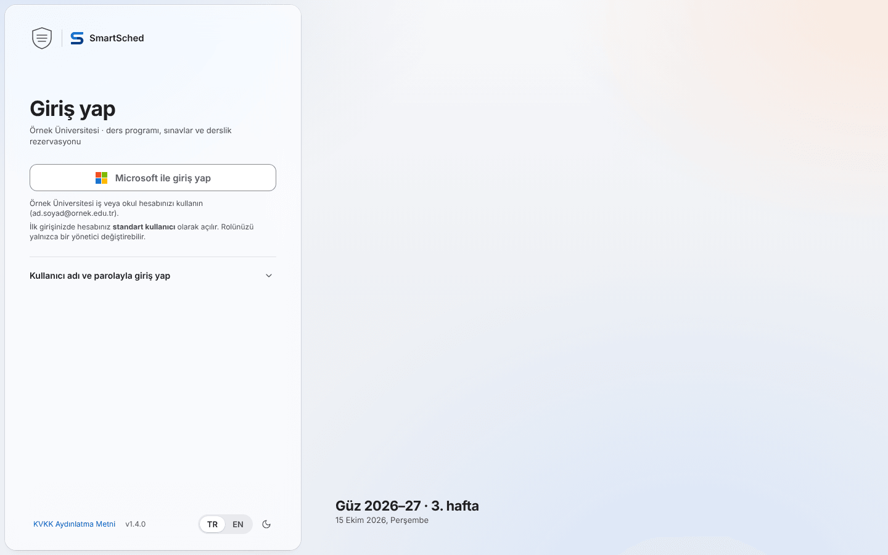
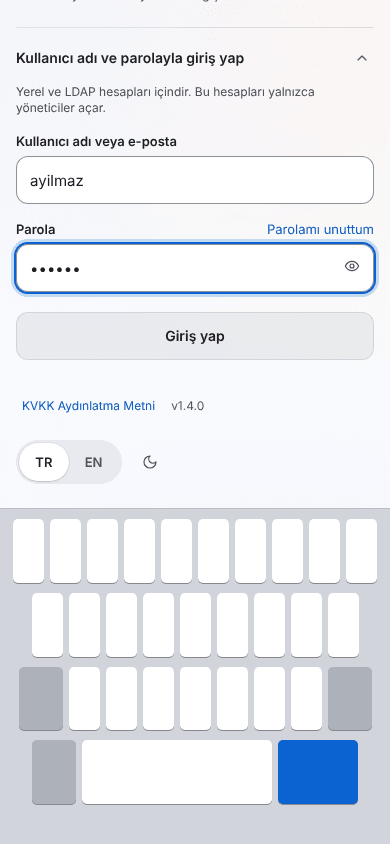

# Sign-in: Microsoft first, one quiet second door

Owner: design-pro (ledger `signin-design-2026-10-15`) · Status: v1 spec (2026-10-15) · Implementer: the dedicated
SSO/channels frontend agent (the login code is owned elsewhere; this file changes no source).
Supersedes `docs/design/settings-and-auth.md` §3.1 (login), §3.9 (login motion) and the login row of §5.
Reads with: [`liquid-glass.md`](liquid-glass.md) (material, colour), [`../tokens.md`](../tokens.md) §A (control
heights, `--border-control`, fluid type), [`motion.md`](motion.md) + the `/motion_designer` skill (motion),
[`../brand.md`](../brand.md) (the mark), the owner decisions in [`../../ROADMAP.md`](../../ROADMAP.md) ("identity and
sign-up", 2026-10-15 ~22:50) and the login mechanics in
[`../../product/2026-10-15-integrations-options.md`](../../product/2026-10-15-integrations-options.md) §5.5.

Renders: [`sign-in/`](sign-in/) (23 PNGs, HTML mockups rendered with Playwright Chromium 1194 from
`/opt/pw-browsers`; the mockup source stays outside the repo because only images are in scope).

---

## 0. BLUF

- **Pattern: "Institution sheet, one door plus a quiet second door."** A left-docked Liquid Glass sheet (the same
  place and shape as the app's sidebar) carries, top to bottom: the university's logo next to the SmartSched mark,
  `Giriş yap`, one **Microsoft ile giriş yap** button in Microsoft's own colours, two short lines that explain sign-up,
  and a collapsed disclosure **Kullanıcı adı ve parolayla giriş yap** that reveals the local/LDAP form. No centred
  card, no illustration, no "Sign up" link anywhere.
- **Sign-up is explained in one sentence, not a page:** "İlk girişinizde hesabınız standart kullanıcı olarak açılır.
  Rolünüzü yalnızca bir yönetici değiştirebilir." The password door says "Bu hesapları yalnızca yöneticiler açar."
  Invitations arrive as a banner on the same page and bind on the first Microsoft sign-in.
- **Microsoft branding is followed literally** for logo, wording, colours (`#FFFFFF`/`#5E5E5E`/`#8C8C8C` light,
  `#2F2F2F`/`#FFFFFF` dark), 15 px semibold label, 12 px paddings and ≥ 41 px height; we only round the corners
  (12 px, like our fields) and add the same 1 px `#8C8C8C` edge in dark so the shape reads on dark glass.
- **Every state has TR and EN copy** (§6): SSO disabled, wrong tenant, cancelled, generic failure (covers a disabled
  account), invite expired / invalid / mismatched, first-login welcome, session expired, maintenance, rate limit,
  offline, LDAP. Errors that reveal nothing are identical strings by test.
- **Mobile first:** at 390 the sheet becomes the page; the keyboard never covers the focused field or the submit
  button (`interactive-widget=resizes-content`, scroll-into-view inside the visual viewport, submit directly under
  the password). All targets ≥ 44 px; on touch, 48 px controls.
- **Motion is three moments**, all ≤ 300 ms with reduced variants: the disclosure making room (layout FLIP), a failed
  password (alert + 280 ms shake), the welcome check. The page itself does not animate in.
- **Admin side:** Users gets an invite sheet, status "dot + word" for invites and bindings, a "Kendi kaydı" filter for
  self-sign-ups, "Sonraki Microsoft girişinde bağla" for existing local/LDAP users, and a break-glass warning.
- **Acceptance:** 30 Playwright checks (§15), including brand redlines, no-enumeration string equality, keyboard
  visibility at 390, reduced motion and axe.



---

## 1. Owner decisions this design implements

| Decision | Where it shows |
|---|---|
| Microsoft Entra ID (the university tenant) is primary for everyone, admins included | The only primary action is the Microsoft button (§7) |
| Local e-mail/username + password stays for local and break-glass accounts; LDAP uses the same form | The disclosure (§5.3); `?method=local` when local sign-in is hidden for everyone else (§4.2) |
| Sign-up only through (a) the institution's Microsoft account → lowest role, or (b) an admin invite bound on first Microsoft login | Two footnote lines under the button (§6.1); invite banner (§12); no local registration anywhere |
| Admin rights only come from another admin | Invite sheet role list and audit note (§13); welcome copy (§6.4) |
| States: SSO disabled, SSO errors, first-login welcome, `?reason=expired`, maintenance, reset link (local only), TR/EN, KVKK link, university logo next to the SmartSched mark | §6 |
| Avoid the AI-template look (review §1, §3 "Login") | §3.2 checklist |

---

## 2. References

Researched with the Mobbin connector on 2026-10-15 (web and iOS screens + one web flow), plus Microsoft Learn.

### 2.1 Microsoft's own guidance (normative)

[Sign in with Microsoft branding guidelines](https://learn.microsoft.com/en-us/entra/identity-platform/howto-add-branding-in-apps)
(page updated 2026-06-15). What it requires and what we do:

| Guideline | Our implementation |
|---|---|
| Use the Microsoft logo (four squares `#F25022`, `#7FBA00`, `#00A4EF`, `#FFB900`, 9 × 9 in a 21 × 21 box) with the words "Sign in with Microsoft" (or "Sign in" if short of space). Don't alter the logo | Inline the official 21 × 21 SVG unchanged; label "Microsoft ile giriş yap" / "Sign in with Microsoft" |
| Redlines: height 41 px, 12 px left padding, 12 px logo-to-text gap, 12 px right padding, icon and text vertically centred, Segoe UI 15 px weight 600 | Same paddings, gap, font size and weight; height 44 px (fine pointer) / 48 px (coarse), which is ≥ 41 |
| Light: background `#FFFFFF`, text `#5E5E5E`, border 1 px `#8C8C8C`. Dark: background `#2F2F2F`, text `#FFFFFF` | Light exactly. Dark exactly, plus the light theme's 1 px `#8C8C8C` border (4.95:1 against dark regular glass; without it the button is 1.24:1 against the sheet) |
| Say "work or school account" next to the button; never "enterprise/business/corporate account", "Microsoft 365 ID", "Azure", "Active Directory" | Hint "…iş veya okul hesabınızı kullanın" / "…work or school account". No Entra/Azure words on user-facing screens (admins may see "Entra ID" in settings) |
| Once signed in, prefer the organisation's name and logo over "your organization" | The university's logo and name lead the sheet; copy names the university |
| Provide a way to sign out and switch account | "Başka bir hesapla dene" on tenant and invite errors sends `prompt=select_account` |

The guidance does not fix the corner radius; Fluent 2 itself rounds buttons. We use 12 px so the button matches the
fields in the same column (one shape per column, tokens.md §A.5). Microsoft's Turkish UI string for the action is
"Microsoft ile oturum açın"; the owner chose **"Microsoft ile giriş yap"**, which matches our other "Giriş yap"
strings. Keep the owner's wording.

### 2.2 Mobbin screens

| # | App · screen | Link | Take | Avoid |
|---|---|---|---|---|
| R1 | Slack · "Sign in to SLMobbin" with top bar "You need to sign in to see this page" | [screen](https://mobbin.com/screens/cb00a102-24b6-4683-b49c-843d1ee6bfaf) | Name the place you are signing in to; a one-line reason banner above the form for redirected users (our `?reason=expired`) | Workspace name in brand colour (G3: one tint) |
| R2 | Slack · magic-code helper with "sign in with a password instead" | [screen](https://mobbin.com/screens/a663332b-015d-4c51-a5df-de52c7574552) | The password route is a quiet secondary path, not a peer of the primary | The helper box styling |
| R3 | Linear · "Log in to Linear" with "You used email to log in last time" | [screen](https://mobbin.com/screens/3997d60f-bea7-4068-af79-3942a664072e) | Remember the last method and say so in one line; open the password door for people who used it last time | Four equal-weight buttons |
| R4 | Linear · Security settings: "Disable authentication bypass for admins" | [screen](https://mobbin.com/screens/34f99905-3147-4e31-9d52-c091158c4ba3) | Admin-side wording for "SSO only, except break-glass" | — |
| R5 | Figma · login with "Use single sign-on" and "Reset password" links | [screen](https://mobbin.com/screens/3be9f492-0ea9-4c64-a12f-a4b5bb22630e) | Reset link belongs to the password form only | Uppercase mono field labels; "No account? Create one" (we have no local sign-up) |
| R6 | Notion · login: "Use an organization email…" helper, language selector at the bottom | [screen](https://mobbin.com/screens/854dd489-e050-40d0-8567-05e5a4731aed) | Helper line under the primary control; language in the footer | Centred everything; the provider grid |
| R7 | Hex · "Log in with Microsoft" + "log in with a password instead"; its error "We couldn't find that account. Head over to sign up" | [screen](https://mobbin.com/screens/c3e8558e-6c72-46dc-a467-bb4ede649cbe), [error](https://mobbin.com/screens/19cddf81-b261-409e-8b98-e0f6ff619f54) | A full-width Microsoft button above a quieter password path | An error that confirms an account does not exist (account enumeration) and pushes sign-up; dark tiled background |
| R8 | Calendly · Continue with Microsoft in a card | [screen](https://mobbin.com/screens/275fcd1b-1caf-4143-b676-f09542baeef7) | Official four-square logo at full size, centred label group | The "OR" divider between equal choices; "Sign up for free" |
| R9 | Dropbox Dash · Continue with Google/Apple/Microsoft | [screen](https://mobbin.com/screens/e1fe4ed5-8c62-49bc-b5fb-c9e1768cde88) | Square-ish bordered provider buttons read as "the provider's", not ours | Three providers; we have one |
| R10 | Okta · "Connecting to …" institution header over the sign-in card | [screen](https://mobbin.com/screens/1abb49d8-d880-4e40-8d64-3f5acb5fc313) | Institution identity before the form | The generic boxed card |
| R11 | Intercom · "Signed out successfully" banner at the top of the form | [screen](https://mobbin.com/screens/8134c92a-2c0c-4cb1-8edd-7b717a136511) | A neutral status notice in the form column for `?reason=signed_out` | Grey disabled submit |
| R12 | incident.io · "SAML login failed, please try again or contact your administrator" | [screen](https://mobbin.com/screens/e1843d29-60fa-4786-9191-b9704e17142d) | A generic SSO failure that names the next step and the person to ask | Centred alert under the buttons |
| R13 | Grok · invite: "Your email does not match the invite … please login with the correct account" + Switch accounts | [screen](https://mobbin.com/screens/7b80eb41-1457-4075-abcb-52c90608b1a7) | Invite mismatch states both addresses and offers "switch account" | Return-to-home as the only exit |
| R14 | Retool · inline error under the form "No organization found for subdomain" | [screen](https://mobbin.com/screens/c2392d3a-5304-4c1a-b32d-4e4296232d0f) | Specific, non-enumerating SSO error near the action | Illustration panel |
| R15 | Jitter · invite "Log in as jonsmith@… to accept your invite" | [screen](https://mobbin.com/screens/8e377ce4-ec67-4894-8310-589e6b2a25bd) | The invite names the address to use | Huge coloured headline |
| R16 | WorkOS · "Accept invitation" | [screen](https://mobbin.com/screens/529e0cdb-4c09-4df7-86ab-837e59076811) | Invite acceptance is the normal sign-in with a context line | A second invite-only page |
| R17 | Fresha · "Welcome to the team · Your account has been connected with …" | [screen](https://mobbin.com/screens/03ea435b-1914-4c24-9946-0a72beedc890) | First-login confirmation says what was linked | Gradient check orb |
| R18 | Upwork / Babbel / Ferndesk · "account created" celebrations | [Upwork](https://mobbin.com/screens/d4958696-74b8-4ede-845d-574c6fa848c9), [Ferndesk](https://mobbin.com/screens/7325df51-912c-4f89-aeed-9d5d6280e409) | — | Confetti, illustrations, centred hero (all are review §1 tells) |
| R19 | Lovable · People: Active / Pending status, filter chips | [screen](https://mobbin.com/screens/9cfa9f18-ac99-48f6-a766-877770294b4c) | Invites live in the same table with a status column and a Pending filter | Black "Active" pill (badge noise, A4) |
| R20 | Productboard / Midday · "Pending invitation" rows | [Productboard](https://mobbin.com/screens/0655a94a-197a-4a2b-baaf-a963499cd0d6), [Midday](https://mobbin.com/screens/478a5a79-2f93-4be7-b3aa-71b0bbff3473) | Pending rows show the address and the intended role | Greyed-out avatars as the only signal |
| R21 | Steep / Langdock · invite dialog with role | [Steep](https://mobbin.com/screens/baafba2a-2576-46c4-9737-9f2a53153334), [Langdock](https://mobbin.com/screens/03f992c8-ae69-4859-a120-350881464352) | E-mail + role in one short form | A "Make admin" toggle (role is a list with one-line summaries) |
| R22 | Microsoft Copilot · "Logging in" flow (web) | [flow](https://mobbin.com/flows/c64586c9-9f13-4546-874b-d208a3008e10) | What users see after our button: Microsoft's own account picker and password pages. Our page should hand over cleanly (busy label, no spinner overlay) | — |
| R23 | Microsoft Teams (iOS) · Microsoft password page with keyboard | [screen](https://mobbin.com/screens/bfe9c6b9-9d5d-4e20-bef5-da15315c09ad) | On phones, the field and its action stay above the keyboard | Illustration on top |
| R24 | Sprig / Writer / Recraft · split screens with marketing imagery | [Sprig](https://mobbin.com/screens/35685629-5b55-4d94-bb70-fd34acea9848), [Writer](https://mobbin.com/screens/935033bf-a433-41bd-8198-6931d7f3f4ea) | Left-anchored form column | Marketing or photo panel (an internal tool does not sell itself) |
| R25 | Tana / Copy.ai / WorkOS · centred card with "OR" divider | [Tana](https://mobbin.com/screens/a159ebe0-6da3-4448-8f05-208f47015411), [WorkOS](https://mobbin.com/screens/6e94032d-d8e4-4c64-83d3-5f66fd2c2661) | — | **The exact template look the review flagged** |

---

## 3. The chosen pattern

### 3.1 "Institution sheet, one door plus a quiet second door"

1. **Institution sheet.** A `GlassPanel material="regular"` docked left, inset 8 px, full height, radius 2xl,
   width `clamp(400px, 36vw, 480px)`. It sits where the sidebar sits after sign-in, so the eye does not travel when
   the app appears. Material `regular` is allowed because it floats over the scene, not content (rule G1).
2. **One door.** The Microsoft button is the only primary action. It uses Microsoft's colours, not our tint. That is a
   documented exception to G3 ("one tint"): the brand is Microsoft's, and our accent stays on focus and links.
3. **A quiet second door.** A full-width disclosure row under a hairline, label-1 semibold, chevron right. It reveals
   the identifier/password form (local and LDAP share it). Its submit is `secondary` while Microsoft is on, and becomes
   the `primary` (tint) when Microsoft is off.
4. **The scene, not a hero.** Right of the sheet is the plain scene mesh. Optionally, bottom-left of that area, one
   true line from the institution's calendar: "Güz 2026–27 · 3. hafta / 15 Ekim 2026, Perşembe" (needs two public
   fields, §14; hidden when absent). No illustration, no testimonial, no product screenshot.

### 3.2 Why it does not read as a template (review §1, §3 "Login")

| Tell from the review | Here |
|---|---|
| Centred generic card | Left-docked sheet aligned with the app's sidebar; content left-aligned (A5) |
| Placeholder repeating the label | Identifier placeholder "ad.soyad" (an example, not the label); password has none |
| Input boundary 1.15:1 | Fields use `edge-control` (`--border-control`, 3.15:1 light / 3.07:1 dark) |
| Mixed control heights | Every control in the column is `--signin-control-h` (44 / 48) |
| Sparkles, gradient text, decorative orbs | None. The only gradient is the scene (G1, A1) |
| Generic copy | Real nouns: the university's name, "ders programı, sınavlar ve derslik rezervasyonu", the domain hint |
| Stock icon as logo | The SmartSched mark (`<Logo variant="mark">`) next to the university's own logo |
| Page fade-and-rise on load | Removed; nothing animates on first paint (§10) |

---

## 4. Anatomy, routes and inputs

### 4.1 Page anatomy (top to bottom inside the sheet)

1. **Brand row** (44 px): university logo (`org.logo_url`, 40 px tall, max 160 px wide, `alt=""` because the name is in
   the subtitle) · 1 × 28 px hairline · SmartSched mark 24 px + live text "SmartSched" (brand.md §7.2).
   No logo uploaded: the row starts with the SmartSched mark. The mark never stands in for the university.
2. **Notice slot** (0–2 items, gap 12): reason banner, maintenance, invite banner, SSO error. Order: error, invite,
   reason, maintenance, login message.
3. **Title block:** `h1` "Giriş yap" (`type-large-title`, 28 → 34 px) and a subtitle line
   "{org.name} · ders programı, sınavlar ve derslik rezervasyonu" (`type-callout`, label-2).
4. **Door 1:** Microsoft button + two footnote hints (work-or-school account with the domain; first sign-in creates a
   standard account and only an admin changes roles).
5. **Door 2:** hairline, disclosure row, then (open) lead line, local error slot, identifier, password with "Parolamı
   unuttum" on the label row, submit, and "Son girişiniz: kullanıcı adı ve parola" when remembered.
6. **Footer** (pinned to the sheet bottom, `margin-top: auto`): "KVKK Aydınlatma Metni" link, version, TR/EN
   `SegmentedControl`, theme `IconButton`.

### 4.2 URL contract (what `/login` reads)

| Parameter | Values | Effect |
|---|---|---|
| `next` | same-origin path (starts with `/`, not `//`) | Passed to the Microsoft start URL and to the local submit; used after success |
| `reason` | `expired`, `signed_out`, `password` | Neutral status notice (§6.2) |
| `error` | `tenant`, `cancelled`, `failed`, `unavailable`, `signup_closed`, `invite_expired`, `invite_invalid`, `invite_mismatch` | SSO error notice (§6.3). **Unknown codes render `failed`** |
| `ref` | short support code, e.g. `7F3A-21C` | Shown only inside the `failed` message; maps to the audit row |
| `invite` | opaque token | Invite banner, Microsoft-only page (§12) |
| `method` | `local` | Opens door 2 on load; the only way to reach the password form when `auth.local_enabled = false` (break-glass) |

Microsoft start link: `GET /api/v1/auth/sso/entra/start?next=…[&invite=…][&prompt=select_account][&login_hint=…]` (§14).
It is a real navigation (`<a href>`), not `fetch`.

### 4.3 Server-rendered options (no layout shift, no flash)

`/login` reads `GET /org/public` on the server and renders the doors from it. The page must never paint a password
form and then swap in the Microsoft button (or the reverse). If the request fails: render door 2 open, no Microsoft
button, and an `offline` notice, since the backend that would start SSO is unreachable anyway.

---

## 5. Layout per breakpoint

Gutters and gaps use tokens.md §A.6. Column = `min(100%, 400px)` inside the sheet.

### 5.1 1440 × 900 (and every width ≥ 1024)

```
┌─ scene ─────────────────────────────────────────────────────────────────────────────────────────────┐
│┌─ sheet: glass regular, inset 8, r 2xl, w clamp(400,36vw,480), pad 32/40 ─┐                           │
││ [uni logo 40] │ [S] SmartSched                                           │                           │
││                                                                          │                           │
││ ┌ notice slot (0–2) ──────────────────────────┐   ← clamp(24px, 8vh, 96px) from the brand row      │
││ Giriş yap                                 (large title 34)               │                           │
││ Örnek Üniversitesi · ders programı, sınavlar ve derslik rezervasyonu     │                           │
││ ┌──────────────────────────────────────────┐                             │                           │
││ │  ▦  Microsoft ile giriş yap              │  44 px, MS colours          │                           │
││ └──────────────────────────────────────────┘                             │                           │
││ Örnek Üniversitesi iş veya okul hesabınızı kullanın (ad.soyad@…).        │                           │
││ İlk girişinizde hesabınız standart kullanıcı olarak açılır. …            │                           │
││ ───────────────────────────────────────────                               │                           │
││ Kullanıcı adı ve parolayla giriş yap                            ⌄        │                           │
││                                                                          │  Güz 2026–27 · 3. hafta   │
││ KVKK Aydınlatma Metni  v1.4.0                       [TR|EN]  ◐           │  15 Ekim 2026, Perşembe   │
│└──────────────────────────────────────────────────────────────────────────┘                           │
└─────────────────────────────────────────────────────────────────────────────────────────────────────┘
```

| Render | File |
|---|---|
| Default, light / dark / English | [`1440-light-default.png`](sign-in/1440-light-default.png), [`1440-dark-default.png`](sign-in/1440-dark-default.png), [`1440-light-en-default.png`](sign-in/1440-light-en-default.png) |
| Door 2 open with a credential error | [`1440-light-local-error.png`](sign-in/1440-light-local-error.png) |
| Microsoft disabled | [`1440-light-sso-disabled.png`](sign-in/1440-light-sso-disabled.png) |
| Session expired + bookings maintenance | [`1440-light-expired-maintenance.png`](sign-in/1440-light-expired-maintenance.png) |
| Wrong tenant | [`1440-light-sso-tenant.png`](sign-in/1440-light-sso-tenant.png) |
| Invite | [`1440-light-invite.png`](sign-in/1440-light-invite.png) |
| First-login welcome | [`1440-light-welcome.png`](sign-in/1440-light-welcome.png) |
| Admin users list / invite sheet | [`1440-light-admin-users-list.png`](sign-in/1440-light-admin-users-list.png), [`1440-light-admin-users-invite.png`](sign-in/1440-light-admin-users-invite.png) |

At 900 px tall with door 2 open and an error, everything fits without scrolling (verified in the render). Shorter
viewports scroll **inside the sheet**; the footer follows the content.

### 5.2 768 × 1024 (600–1023 px)

Same sheet, width 400 (the clamp minimum), inset 8. The footer wraps to two lines (links, then controls) because the
coarse-pointer segmented control is 44 px. The calendar line moves to the right area's bottom-left if ≥ 240 px remain,
otherwise it is hidden.

```
┌──────────────────────────────────────┬───────────────────┐
│ [logo] │ [S] SmartSched               │                   │
│ Giriş yap                             │      scene        │
│ Örnek Üniversitesi · …                │                   │
│ [ ▦ Microsoft ile giriş yap ] 48 px   │                   │
│ hints                                 │                   │
│ ───────────────────                   │                   │
│ Kullanıcı adı ve parolayla …     ⌃    │                   │
│ Kullanıcı adı veya e-posta            │                   │
│ [ ad.soyad                    ] 48    │                   │
│ Parola              Parolamı unuttum  │                   │
│ [                          👁 ] 48    │                   │
│ [ Giriş yap                   ] 48    │  Güz 2026–27 ·    │
│ KVKK Aydınlatma Metni  v1.4.0         │  3. hafta         │
│ [ TR | EN ] ◐                         │                   │
└──────────────────────────────────────┴───────────────────┘
```

Renders: [`768-light-default.png`](sign-in/768-light-default.png), [`768-dark-local-open.png`](sign-in/768-dark-local-open.png).
iPad keyboard: the sheet is a scroll container; the focused field scrolls to the centre of the visual viewport (§5.4).

### 5.3 390 × 844 (< 600 px)

The sheet becomes the page: inset 0, radius 0, no outer shadow, padding `max(16px, safe-area-inset-top)` 16 px 8 px.
Content is **top-aligned** (no vertical centring that would jump when the keyboard opens). The brand row uses a
32 px university logo. The footer sits at the end of the content (`margin-top: auto` in a `min-height: 100dvh`
column), so it never floats over fields.

```
┌──────────────────────────────┐
│ [logo] │ [S] SmartSched       │ 44
│                              │ 28
│ Giriş yap                    │ large title 28
│ Örnek Üniversitesi · …       │
│ [ ▦ Microsoft ile giriş yap ]│ 48, full width
│ hints (2 × footnote)         │
│ ──────────────────────────── │
│ Kullanıcı adı ve parolayla ⌄ │ 44 row
│                              │
│ KVKK Aydınlatma Metni v1.4.0 │ 44 rows
│ [ TR | EN ]  ◐               │
└──────────────────────────────┘
```

Renders: [`390-light-default.png`](sign-in/390-light-default.png), [`390-dark-default.png`](sign-in/390-dark-default.png),
[`390-light-sso-tenant.png`](sign-in/390-light-sso-tenant.png), [`390-light-sso-generic.png`](sign-in/390-light-sso-generic.png),
[`390-light-sso-cancelled.png`](sign-in/390-light-sso-cancelled.png) (EN), [`390-light-invite.png`](sign-in/390-light-invite.png),
[`390-light-invite-expired.png`](sign-in/390-light-invite-expired.png), [`390-light-sso-disabled.png`](sign-in/390-light-sso-disabled.png),
[`390-light-welcome-invited.png`](sign-in/390-light-welcome-invited.png).

### 5.4 The keyboard must not cover inputs (390 and tablets)



1. Viewport meta: `width=device-width, initial-scale=1, interactive-widget=resizes-content` (Chromium Android
   resizes the layout viewport, so `100dvh` shrinks with the keyboard).
2. iOS Safari does not resize the layout viewport. On `focus` of any field: wait one frame, then
   `el.scrollIntoView({ block: "center" })` within the sheet (`scroll-margin-block: 24px`), and on
   `visualViewport.resize` re-run it for the focused element. No `position: fixed` element sits below the fields.
3. The submit button is directly under the password field (20 px gap), never pinned to the bottom. With a 336 px
   keyboard on an 844 px screen, the visual viewport is 508 px; password (48) + gap (20) + submit (48) = 116 px, so both
   are visible when the password is centred (the render shows it).
4. `enterkeyhint="next"` on the identifier (moves to password), `enterkeyhint="go"` on the password (submits).
   Field text is 16 px on touch so iOS does not zoom (already in `Input`).
5. Opening door 2 on touch focuses the identifier (the person asked for the form), which opens the keyboard; the
   disclosure row stays visible above it because the form opens below the row.

---

## 6. States and copy (TR / EN)

All strings go through `messages/{tr,en}.json`. Proposed keys are under `signin.*`. Use **"Parola"** everywhere in
Turkish (Microsoft's Turkish pages say "Parola"; today `auth.password` says "Şifre" and `wave1.session.password` says
"Parolanız": unify on Parola). `{org}` = `org.name`, `{domain}` = `auth.microsoft.domain_hint`,
`{role}` = `auth.self_signup_role_name` (the institution's lowest role, e.g. "Standart kullanıcı").

### 6.1 Default

| Element | TR | EN |
|---|---|---|
| Document title | Giriş yap · SmartSched | Sign in · SmartSched |
| `h1` | Giriş yap | Sign in |
| Subtitle | {org} · ders programı, sınavlar ve derslik rezervasyonu | {org} · timetables, exams and room booking |
| Microsoft button | Microsoft ile giriş yap | Sign in with Microsoft |
| … busy | Microsoft'a yönlendiriliyor… | Redirecting to Microsoft… |
| Hint 1 | {org} iş veya okul hesabınızı kullanın (ad.soyad@{domain}). | Use your {org} work or school account (name.surname@{domain}). |
| Hint 2 (sign-up door a) | İlk girişinizde hesabınız **{role}** olarak açılır. Rolünüzü yalnızca bir yönetici değiştirebilir. | Your first sign-in creates your account as a **{role}**. Only an administrator can change your role. |
| Disclosure | Kullanıcı adı ve parolayla giriş yap | Sign in with username and password |
| Door 2 lead | Yerel ve LDAP hesapları içindir. Bu hesapları yalnızca yöneticiler açar. | For local and LDAP accounts. Only administrators create these accounts. |
| Identifier label / placeholder | Kullanıcı adı veya e-posta / ad.soyad | Username or e-mail / name.surname |
| Password label | Parola | Password |
| Show / hide | Parolayı göster / Parolayı gizle | Show password / Hide password |
| Caps Lock | Caps Lock açık | Caps Lock is on |
| Reset link (only when `auth.local_enabled`) | Parolamı unuttum | Forgot password? |
| Submit / busy | Giriş yap / Giriş yapılıyor… | Sign in / Signing in… |
| Last method | Son girişiniz: kullanıcı adı ve parola | Last time you used username and password |
| Footer | KVKK Aydınlatma Metni · v{version} | Privacy notice (KVKK) · v{version} |
| Language control | Dil: TR / EN (spoken "Türkçe", "English") | Language: TR / EN |
| Calendar line (optional) | {term} · {n}. hafta / {date, full} | {term} · week {n} / {date, full} |

The domain in hint 1 is omitted when `domain_hint` is empty. If `logo_url` and `name` are both empty, the subtitle is
"Ders programı, sınavlar ve derslik rezervasyonu".

### 6.2 Notices (neutral or warning, `role="status"`)

| State | Tone · glyph | TR | EN |
|---|---|---|---|
| `?reason=expired` | neutral · clock | Oturumunuzun süresi doldu. Yeniden giriş yaptığınızda kaldığınız sayfaya dönersiniz. | Your session expired. Sign in again to return to the page you were on. |
| `?reason=signed_out` | neutral · info | Çıkış yaptınız. | You signed out. |
| `?reason=password` (existing) | neutral · info | Parolanız değiştirildi. Yeni parolanızla yeniden giriş yapın. | Your password was changed. Sign in again with the new password. |
| Maintenance (`org.maintenance_mode`) | warning · triangle | **Rezervasyonlar bakımda.** {maintenance_message} *or* Bir yönetici rezervasyonları bakım için durdurdu. Giriş yapabilir ve programları görebilirsiniz. | **Bookings are in maintenance.** {maintenance_message} *or* An administrator paused bookings for maintenance. You can still sign in and view timetables. |
| Login message (`org.login_message`) | info | (verbatim, `white-space: pre-line`) | (verbatim) |
| Setup required (existing) | info | SmartSched henüz kurulmadı · Kurulumu başlat | SmartSched is not set up yet · Start setup |
| `cancelled` | neutral · info | Microsoft girişi tamamlanmadı. Hazır olduğunuzda tekrar deneyin. | Microsoft sign-in wasn't completed. Try again when you're ready. |

`cancelled` (the person closed Microsoft's page or declined) is not an error, so it is a status, not an alert.

### 6.3 Errors (`role="alert"`, receive focus)

| Code | TR | EN | Action |
|---|---|---|---|
| `tenant` (personal account, other tenant, guest) | **Bu hesapla giriş yapılamıyor.** {org} iş veya okul hesabınızla giriş yapın. Kişisel Microsoft hesapları ve başka kurumların hesapları kabul edilmez. | **This account can't be used here.** Sign in with your {org} work or school account. Personal Microsoft accounts and accounts from other organisations aren't accepted. | Başka bir hesapla dene / Try another account (`prompt=select_account`) |
| `failed` (account disabled in SmartSched, state or nonce mismatch, token invalid, any unknown code) | **Giriş yapılamadı.** Tekrar deneyin. Sorun sürerse bu kodu yöneticinize iletin: {ref} | **We couldn't sign you in.** Try again. If it keeps happening, give this code to your administrator: {ref} | none (the Microsoft button below is the retry) |
| `unavailable` (Microsoft or the network is down) | **Microsoft'a şu anda ulaşılamıyor.** Birkaç dakika sonra tekrar deneyin. | **Microsoft can't be reached right now.** Try again in a few minutes. | none |
| `signup_closed` (self sign-up off, no invite) | **Hesabınız yok.** Kendiliğinden hesap açma kapalı; bir yöneticiye başvurun. | **No account yet.** Self sign-up is turned off; ask an administrator. | none |
| `invite_expired` | **Davetin süresi doldu.** Davet 30 gün içinde kullanılmadı. Yöneticinizden yeni bir davet isteyin. | **This invitation has expired.** It wasn't used within 30 days. Ask your administrator for a new one. | none |
| `invite_invalid` (revoked, already used, unknown token) | **Bu davet artık geçerli değil.** Yöneticinizden yeni bir davet isteyin. | **This invitation is no longer valid.** Ask your administrator for a new one. | none |
| `invite_mismatch` | **Davet başka bir adres için.** Davet {invited_masked} adresine gönderildi; Microsoft'ta {signed_in} olarak giriş yaptınız. | **The invitation is for another address.** It was sent to {invited_masked}; you signed in to Microsoft as {signed_in}. | Hesap değiştir / Switch account (`prompt=select_account&login_hint={invited}`) |
| Local 401 (wrong credentials, unknown user, disabled user, SSO-only user) | Kullanıcı adı, e-posta veya parola yanlış. | The username, e-mail or password is wrong. | — |
| Local 429 | Çok fazla deneme. {n} dakika sonra tekrar deneyin. | Too many attempts. Try again in {n} minutes. | Submit disabled until then |
| Offline / network (status 0) | Sunucuya ulaşılamıyor. Bağlantıyı kontrol edip tekrar deneyin. | The server cannot be reached. Check the connection and try again. | — |

No-enumeration rules (tests in §15): a disabled account, a deleted account and a bad token all produce the **same**
`failed` string (only `ref` differs). The local 401 string is the same for every reason (ROADMAP: "Login reveals user
disabled → generic message"). `invited_masked` shows the first two characters of the local part and the full domain
(`ay•••@ornek.edu.tr`).

### 6.4 First-login welcome (`/welcome`, once per account)

Shown after the first Microsoft sign-in that created or bound an account; a second visit redirects to the role's home.
Same sheet, same brand row.

| Element | TR | EN |
|---|---|---|
| `h1` (with a 28 px check disc) | Hesabınız oluşturuldu | Your account is ready |
| Subtitle, self sign-up | Microsoft hesabınızla ilk kez giriş yaptınız. | You signed in with your Microsoft account for the first time. |
| Subtitle, invite | Hesabınız **{inviter}** tarafından gönderilen davete bağlandı. | Your account was linked to the invitation from **{inviter}**. |
| Identity card | Microsoft logo 16 · {display_name} · {email}; "Rol: {role}"; "Bölüm: {department or —}" | Role / Department |
| Note, self sign-up | Rolünüzü yalnızca bir yönetici değiştirebilir. Daha fazla yetki gerekiyorsa bölüm sorumlunuza veya bir yöneticiye başvurun. | Only an administrator can change your role. If you need more access, ask your department lead or an administrator. |
| Note, invite | Rolünüzü yalnızca bir yönetici değiştirebilir. | Only an administrator can change your role. |
| Language | Arayüz dili: Türkçe / English (writes the profile language) | Interface language |
| Primary / link | Devam et · Profil ve bildirim ayarları | Continue · Profile and notifications |

No toast on top of this page (the page is the confirmation). After a normal (not first) sign-in, keep today's toast
"Hoş geldiniz, {name}".

### 6.5 Microsoft disabled (`auth.microsoft.enabled = false`)

No Microsoft button, no hints, no disclosure: the form is open, its submit is `primary`, and the line under it reads
"Hesabınız yoksa bir yöneticiye başvurun." / "No account yet? Ask an administrator." On fine pointers only, the
identifier gets `autoFocus` (no autofocus on touch, so the keyboard does not pop on arrival).

### 6.6 LDAP

LDAP uses door 2 unchanged. When `auth.ldap_enabled` and the directory is the usual route for some staff, the
disclosure label stays the same; the lead line already says "Yerel ve LDAP hesapları içindir". The reset link is shown
only when local accounts exist; `/reset-password` already explains that LDAP and Microsoft passwords are reset at the
university.

---

## 7. The Microsoft button (component spec)

`components/auth/microsoft-sign-in.tsx` (owned by the SSO frontend agent; not a `ui/` primitive because it carries
third-party branding).

| Property | Value |
|---|---|
| Element | `<a href={startUrl} data-testid="login-sso-microsoft">` styled as a button; full width of the column |
| Height | `var(--signin-control-h)`: 44 px fine, 48 px coarse (both ≥ the 41 px redline) |
| Padding / gap | 0 12 px; logo-to-text 12 px; the logo+label group is centred in the full-width button |
| Logo | Official 21 × 21 SVG, four 9 × 9 squares at (1,1) `#F25022`, (11,1) `#7FBA00`, (1,11) `#00A4EF`, (11,11) `#FFB900`; `aria-hidden`; `forced-color-adjust: none` on the SVG only |
| Label | `font-family: "Segoe UI", -apple-system, BlinkMacSystemFont, Inter, system-ui, sans-serif`; 15 px; weight 600 |
| Light | bg `#FFFFFF`, text `#5E5E5E` (6.48:1), edge `inset 0 0 0 1px #8C8C8C` (3.36:1 on white, 3.25:1 on the sheet) |
| Dark | bg `#2F2F2F`, text `#FFFFFF` (13.39:1), edge `inset 0 0 0 1px #8C8C8C` (4.95:1 on dark regular glass) |
| Radius | `rounded-lg` (12 × k), same as the fields |
| Hover / pressed | 7 % veil (`::after`, light: black 4 %, dark: white 7 %); pressed scale .97 on `--spring-snappy` |
| Focus | global 2 px `--focus` outline, offset 2 px |
| Busy | after click: `aria-disabled="true"`, label "Microsoft'a yönlendiriliyor…" via `BusyLabel` (150 ms delay, so instant redirects show nothing); a polite status echoes the label; a second click is ignored |
| Forced colours | text and border `ButtonText`, background `ButtonFace`; the logo keeps its colours |

Do not: recolour the logo, put it on the accent, use "Office 365", "Azure AD" or "Entra" in this label, or place a
second provider button with equal weight.

---

## 8. Components (existing primitives first)

| Need | Component | Source | Notes |
|---|---|---|---|
| Sheet | `GlassPanel material="regular" radius="2xl"` | `components/ui/glass-panel.tsx` | Replaces `AuthCard`'s centred 400 px panel; same props on mobile with inset 0, radius none |
| Brand | `Logo variant="mark" size={24} decorative` + live text; `LoginBrand` (uni logo) | `components/brand`, `components/admin/login-extras.tsx` | `LoginBrand` becomes logo-only in the row; its name moves into the subtitle |
| Notices | `Alert tone="info \| warning \| error"` | `components/admin/kit.tsx` | Add a `neutral` tone (fill-2, label-1) and an `action` slot; `role` follows tone (already) |
| Microsoft button | new `MicrosoftSignIn` | §7 | Uses `BusyLabel` from `ui/busy-label.tsx` |
| Disclosure | `Button variant="ghost" shape="rect"` full width + `aria-expanded` | `components/ui/button.tsx` | Chevron `ChevronDown` 16, stroke 1.75 |
| Fields | `Label`, `Input fieldSize="lg"` (page sets `--control-h`), `InputGroup` for the eye toggle | `components/ui/{label,input,input-group}.tsx` | `edge-control`; eye toggle is an `IconButton` with `label` |
| Submit | `BusyButton` (`variant="secondary"` or `"default"` when SSO is off), `size="lg" shape="rect"` | `components/ui/busy-label.tsx` | — |
| Footer | `SegmentedControl semantics="radiogroup" size="md"`, `IconButton` theme, `Link` | `components/ui/segmented-control.tsx`, `components/shell/{locale,theme}-toggle.tsx` | Replace `LocaleToggle`'s current look with the segmented control |
| Welcome | `Card variant="plain"`, `dl` grid, `SegmentedControl`, `Button` | `components/ui/card.tsx` | Check disc: 28 px `--status-feasible-bg` with `Check` 16 |
| Admin table | `DataTable` + `StatusDot` | `components/ui/data-table/` | Add `StatusDot tone="pending"` (hollow 8 px ring in label-2) for "Davet bekliyor" and "Bağlantı bekliyor" |
| Invite sheet | `Sheet side="right"` (bottom on touch), `Input`, radio list, `Switch`, `Alert` | `components/ui/{sheet,switch}.tsx` | — |
| Confirmations | `ConfirmDialog` | `components/admin/kit.tsx` | Revoke, unlink, bind for privileged accounts |
| Toasts | sonner | `components/ui/sonner.tsx` | "Davet gönderildi", "Bağlantı kopyalandı" |

Licences: every component above is ours or already vendored under MIT (shadcn/Base UI, beUI per
`components/ui/SOURCES.md`); the shake is the transitions.dev "Error state shake" already in
`ui/transitions/transitions-dev.css` (free licence, header kept). The Microsoft logo is Microsoft's trademark, used
under the branding guidelines above; it is not redistributed as a design asset in this repo (only drawn inline by the
component and in the renders).

---

## 9. Tokens

Page-local custom properties (set on the sign-in layout root; everything else is global):

| Token | Value | Notes |
|---|---|---|
| `--signin-sheet-w` | `clamp(400px, 36vw, 480px)` | ≥ 600 px wide; < 600 the sheet is the page |
| `--signin-sheet-inset` | 8px (≥ 600), 0 (< 600) | = `SidebarGlass floating` inset |
| `--signin-sheet-pad` | 32px 40px 20px (≥ 1024), 32px 32px 16px (600–1023), `max(16px, env(safe-area-inset-top))` 16px 8px (< 600) | |
| `--signin-col` | `min(100%, 400px)` | Form column |
| `--signin-control-h` | 44px; `@media (pointer: coarse)` 48px | Microsoft button, fields, disclosure row, submit |
| `--signin-top` | `clamp(24px, 8vh, 96px)` (≥ 600), 28px (< 600) | Brand row to the first notice or title |
| `--ms-btn-bg / -fg / -edge` | light `#FFFFFF / #5E5E5E / #8C8C8C`; dark `#2F2F2F / #FFFFFF / #8C8C8C` | Microsoft's values; never themed by `data-accent` |

Rhythm: notice gap 12; notices → title 24; title → subtitle 6; subtitle → Microsoft button 28; button → hints 12;
hint lines 6; hints → hairline 24; hairline → disclosure 8; lead → first field 16; field gap 16; label → field 6;
password → submit 20; footer top padding 24.

Global tokens used: type `type-large-title` (28 → 34), `type-callout` (13/18), `type-footnote` (12/16), `type-headline`;
colours `--label-1/2/3`, `--hairline`, `--hairline-strong`, `--border-control`, `--accent-text` (links), `--focus`,
`--status-warning-*`, `--status-infeasible-*`, `--status-feasible-*`, `--fill-2`; radii `rounded-lg` (controls),
`rounded-xl` (notices, cards), `rounded-2xl` (sheet), `rounded-full` (segmented); material `glass-regular` with
solid fallback `--mat-regular-solid` (`#fafbfc` / `#1d1e23`).

Contrast (computed with the WCAG formula; light / dark): label-2 on the sheet 8.36 / ≥ 7; label-3 7.13 (dark);
`--border-control` 3.15 / 3.07; warning notice text 6.39; error notice text 6.12; info notice link 5.52; Microsoft
button values in §7. Add the Microsoft pairs to `docs/design/v2/verify-contrast.mjs` when the component lands.

---

## 10. Motion (per `/motion_designer`; rows for `motion.md` §3.12)

Purpose sentences first; nothing animates on page load (the old "card fade + rise 200 ms" was decorative, A9).

| Moment | Purpose | Animation | Token | Reduced motion | Reduced transparency |
|---|---|---|---|---|---|
| Door 2 opens / closes | "The password form appears under the row you pressed, and the column makes room" | The column is a `motion.div layout`; the form mounts in `AnimatePresence` with opacity 0 → 1 (60 ms after the layout starts), exit opacity → 0; chevron rotates 180° (transform). No `height` animation | layout `springs.smooth`; content `dur.fast` 120 ms `ease.out`, exit 80 ms `ease.in`; chevron `springs.snappy` | No layout animation; content opacity `tween.reduced` (100 ms); chevron flips instantly | Same (the sheet is opaque; motion unchanged) |
| Microsoft button pressed | "Your press registered and we are leaving for Microsoft" | Press scale .97; busy label after 150 ms | `--spring-snappy` (CSS) | No scale; label swap only | Same |
| Local sign-in failed | "It did not work; the problem is in these two fields" | Alert enters (opacity + y −4 → 0); the field group shakes once (pattern 9) | Alert `springs.snappy`; shake 280 ms (`--shake-dur-a` 80 × 2 + `--shake-dur-b` 60 × 2) | No shake, no travel; alert opacity 100 ms. The alert text, `aria-invalid` and focus carry the state | Same |
| SSO error / notice on arrival | (none: it is the page's initial state) | None | — | — | — |
| Welcome check | "The account now exists" | Check path `pathLength` 0 → 1 and the 28 px disc scale .8 → 1, once on mount (pattern 10) | `springs.bouncySubtle` (≤ 32 px, overshoot allowed) | Static check | Same |
| Language switch | "This option is now selected" | Segmented thumb (pattern 2); text changes without animation | `springs.glassMorph` | Thumb jumps | Same |
| After success | — | Standard route enter of `app/(app)/template.tsx` (pattern 13); no extra | — | per pattern 13 | — |
| Admin: invite sheet | "The form comes from the button's side and returns there" | `Sheet` (pattern 4) | `springs.sheet`, exit 120 ms | Opacity 100 ms | Opaque sheet |
| Admin: invite created | "It worked; here is the next step" | Toast (pattern 5) with "Bağlantıyı kopyala". **No row insert animation** (the users list has > 40 rows) | `springs.smooth` | Toast opacity only | Opaque toast |

Choreography and budget: one focal motion at a time; inside the glass sheet only children animate (never the sheet's
opacity or filter, G6); transform and opacity only; the layout animation touches ≤ 12 elements. Checklist §8 of the
skill: purpose sentences above; tokens from `@/lib/motion` / CSS vars; every one-shot ≤ 280 ms; re-clicking the
disclosure mid-flight re-targets (layout springs are interruptible) and input is never blocked; keyboard path = the
disclosure is a button (Enter/Space); non-motion signals = `aria-expanded`, alert text, focus.

Audit hook: add `sign-in` to `e2e/motion-audit.spec.ts` (open and close door 2 three times quickly at 4× CPU: ≤ 3
dropped frames, no `Layout` events per frame after the first, nothing > 300 ms in `document.getAnimations()`, and under
`reducedMotion: "reduce"` the form is fully visible on the next frame).

---

## 11. Accessibility

**Structure.** `<main>` › `<section aria-labelledby="signin-title">`. One `h1`. The brand row is not a landmark.
`<html lang>` follows the language control; the document title is localised.

**Focus order.** (1) error alert, if present (programmatic focus on mount, `tabIndex=-1`); (2) action inside a notice
("Başka bir hesapla dene", "Hesap değiştir"); (3) Microsoft button; (4) disclosure; (5) identifier; (6) password;
(7) show-password toggle; (8) "Parolamı unuttum"; (9) submit; (10) KVKK link; (11) language radiogroup (arrow keys
inside); (12) theme toggle. With door 2 closed, items 5–9 are `hidden` (not just visually collapsed), so they are out
of the tab order and the accessibility tree.

**Autofocus.** None by default (a screen-reader user hears the page from the top). Exceptions: an SSO error focuses the
alert; door 2 opened by the user focuses the identifier; Microsoft disabled + fine pointer focuses the identifier.

**Live regions.** One polite `role="status"` region for notices and for the busy echo ("Microsoft'a yönlendiriliyor…",
"Giriş yapılıyor…"); errors use `role="alert"` once (not re-announced on re-render). The form has
`aria-describedby` pointing at the local error; both fields get `aria-invalid="true"` on a credential error (never
only one: that would reveal which part was wrong). The 429 countdown updates once per minute, not per second.

**Labels.** Visible `<label for>` on both fields; the eye toggle is an `IconButton` with `aria-pressed` and
`aria-controls="password"`. Placeholders never replace labels. Microsoft button: accessible name = visible text, logo
`aria-hidden`, `aria-describedby` = both hint ids. Language options carry `lang="tr"` / `lang="en"` and spoken names.
University logo `alt=""` when its name is in the subtitle; otherwise `alt={org.name}`.

**Autocomplete.** `username` and `current-password`; `autocapitalize="none"`, `autocorrect="off"`, `spellcheck={false}`
on the identifier. Never `autocomplete="off"` on sign-in.

**Contrast and targets.** §9 and §7 ratios; all controls ≥ 44 × 44 (WCAG 2.5.5 AAA on this page, not only 2.5.8);
footer links get 44 px tall hit areas through padding.

**Preferences.** Reduced motion per §10. Reduced transparency and `prefers-contrast: more` turn the sheet into
`--mat-regular-solid` (liquid-glass §8). Forced colours: the sheet becomes `Canvas` with a `CanvasText` border; the
Microsoft logo keeps its colours.

**Reflow.** At 320 CSS px (400 % zoom of 1280) the < 600 layout applies; nothing scrolls horizontally.

**Caps Lock.** On `keydown`/`keyup` in the password field, `event.getModifierState("CapsLock")` toggles a footnote
under the field ("Caps Lock açık"), linked by `aria-describedby`.

---

## 12. Invite-binding UX

**Rule (owner, ROADMAP 2026-10-15):** an admin creates the user as an invite; the first Microsoft sign-in whose verified
UPN/e-mail equals the invite binds `oid + tid` to it. One-time, audited, expires after 30 days. The link in the e-mail
is a convenience: binding also happens if the person signs in from the plain `/login` with the matching account.

```
Admin › Kullanıcılar › Kullanıcı davet et
   e-mail (UPN), role, department?, name?, send e-mail? ──► row "Davet bekliyor · 30 gün kaldı"
                                                              audit user.invited
E-mail (if SMTP) "SmartSched davetiniz · {org}"
   who invited, role, expiry date, button "Microsoft ile giriş yap" → /login?invite=<token>
   (no SMTP: admin uses "Bağlantıyı kopyala")
/login?invite=<token>
   invite banner (who, role, masked address, days left); door 2 hidden; hint "Davetteki adresin
   Microsoft hesabıyla giriş yapın; hesabınız ilk girişte bağlanır."
   Microsoft start URL carries invite=<token> and login_hint=<invited address>
Callback
   ├─ tenant ok, verified e-mail == invite e-mail, invite valid ─► bind, set role, invite accepted
   │                                                               audit user.invite_accepted + auth.identity_bound
   │                                                               → /welcome?invited=1
   ├─ e-mail differs (link context)  ─► /login?error=invite_mismatch&invite=<token>  [Hesap değiştir]
   ├─ invite expired                 ─► /login?error=invite_expired
   ├─ invite revoked / used / bad    ─► /login?error=invite_invalid
   └─ wrong tenant                   ─► /login?error=tenant
Plain /login, first Microsoft sign-in
   ├─ matching pending invite         ─► bind as above → /welcome?invited=1
   ├─ matching "bind on next login"   ─► bind to the existing local/LDAP user → /welcome?bound=1 (role kept)
   └─ nothing matches                 ─► self sign-up as {role} → /welcome
```

Copy for the invite banner: TR "**{inviter} sizi SmartSched'e davet etti.** Rol: {role} · Davet edilen adres:
{invited_masked} · {n} gün geçerli" / EN "**{inviter} invited you to SmartSched.** Role: {role} · Invited address:
{invited_masked} · valid for {n} days". Welcome after `bound=1`: TR "Microsoft hesabınız mevcut SmartSched hesabınıza
bağlandı. Rolünüz ve rezervasyonlarınız aynı kaldı." / EN "Your Microsoft account is now linked to your existing
SmartSched account. Your role and bookings are unchanged."

Edge rules the UI must reflect:
- E-mail comparison is case-insensitive and Unicode-normalised; the admin field lower-cases on blur and warns when
  the domain differs from `domain_hint` ("Bu adres kurumun alan adında değil" / "This address is not on the
  institution's domain"), without blocking (some staff have aliases).
- One open invite per address: inviting an address with a pending invite offers "Daveti yenile" instead.
- An address that already belongs to a bound account cannot be invited ("Bu adres zaten {name} hesabına bağlı").
- Expiry is shown as days left in the row and as a date in the e-mail; renewing resets it to 30 days (audited).

---

## 13. Admin "Kullanıcılar" screen changes

Renders: [`1440-light-admin-users-list.png`](sign-in/1440-light-admin-users-list.png),
[`1440-light-admin-users-invite.png`](sign-in/1440-light-admin-users-invite.png).

**Header.** Title "Kullanıcılar"; subtitle with plain counts: "248 kullanıcı · 3 davet bekliyor · son 7 günde 12 kişi
kendi kaydoldu". Actions: `İçe aktar` (secondary) and `Kullanıcı davet et` (primary). "Yeni kullanıcı" (local
account) moves into a split-button menu or the ⋯ menu as "Yerel hesap oluştur" because local accounts are now the
exception (break-glass, service accounts).

**Break-glass warning** (Alert, warning) when Microsoft is on, `local_enabled = false`, and no active local admin
exists: "Acil durum hesabı yok. Microsoft'a ulaşılamazsa kimse giriş yapamaz. Bir yerel yönetici hesabı oluşturun." /
"No break-glass account. If Microsoft is unreachable, nobody can sign in. Create a local administrator account."

**Filters.** Chips: Tümü · Davet bekliyor {n} · Kendi kaydı (7 gün) {n} · Devre dışı; menu "Giriş yöntemi": Microsoft,
Yerel, LDAP, Bağlantı bekliyor.

**Columns** (DataTable column system, tokens.md §A.10):

| Column | Content | Priority |
|---|---|---|
| Ad | Name (headline) + e-mail or username (footnote). Tags: "Kendi kaydı" (self sign-up, until an admin edits the role or 7 days pass), "Acil durum hesabı" (lock glyph, break-glass) | 1, pinned |
| Rol | Role name, plain text | 2 |
| Giriş yöntemi | Microsoft logo 12 + "Microsoft" · "Microsoft · davet" · "Yerel" · "LDAP" · link glyph + "Yerel → Microsoft" (binding scheduled) | 3 |
| Durum | `StatusDot` + word: Aktif (feasible) · Davet bekliyor (pending ring) + "{n} gün kaldı · {inviter}" · Bağlantı bekliyor (pending ring) + "Sonraki Microsoft girişinde bağlanır" · Davetin süresi doldu (warning) + "{date}'de doldu" · Devre dışı (neutral) | 2 |
| Son giriş | Relative time; "—" for invites | 4 |
| ⋯ | Row menu | pinned right |

**Row menu by state.**

| State | Actions |
|---|---|
| Active, Microsoft | Düzenle · Rolü değiştir · Erişimi kontrol et · Devre dışı bırak · (in Düzenle › Kimlikler) Microsoft bağlantısını kaldır (danger, confirm) |
| Pending invite | Daveti yeniden gönder (SMTP only) · Bağlantıyı kopyala · Rolü değiştir · Daveti iptal et (confirm) |
| Invite expired | Daveti yenile (30 gün) · Daveti sil |
| Local or LDAP, not bound | Sonraki Microsoft girişinde bağla · Parola sıfırlama kodu (local only) · Düzenle |
| Binding scheduled | Bağlamayı iptal et |
| Privileged account (admin role, approver scope, elevated custom role) | "Sonraki Microsoft girişinde bağla" needs a ConfirmDialog that names the risk, cannot target yourself, and is audited; the dialog recommends the self-service route (Profil › "Microsoft hesabını bağla", which proves both sides) |

**Invite sheet** (`Sheet side="right"`, bottom sheet on touch): "Microsoft hesabı (e-posta)" (required, `type=email`,
hint "Kurumun iş veya okul hesabı olmalı (@{domain})."); "Ad soyad · isteğe bağlı" (placeholder "İlk girişte
Microsoft'tan alınır"); "Rol" as a radio list with one-line summaries, **only roles the inviter may grant**
(no-escalation; an admin may grant admin, with the note "Denetim kaydına yazılır"); "Bölüm" (optional select);
"Davet e-postası gönder" switch (disabled with "E-posta ayarlanmadı" when SMTP is off); an info Alert
"{email} ile ilk Microsoft girişinde hesap ona bağlanır. Davet 30 gün geçerlidir."; footer İptal / Davet et.
Submit → toast "Davet gönderildi · {email}" with "Bağlantıyı kopyala".

**Edit dialog › Kimlikler** (new section): one row per bound identity: Microsoft logo, "Microsoft (iş veya okul)",
tenant name, `oid` in mono truncated with copy, "Bağlandı {date} · Son giriş {date}". "Bağlantıyı kaldır" (danger):
explains that the person cannot sign in with Microsoft until an admin schedules a new binding.

**Audit actions to display** (domain sentences, review §3 "Audit log"): `user.invited` "Davet gönderildi",
`user.invite_resent`, `user.invite_renewed`, `user.invite_revoked`, `user.invite_accepted` "Davet kabul edildi",
`auth.self_signup` "Microsoft ile kendi kaydı", `auth.identity_bound`, `auth.identity_unbound`,
`auth.binding_scheduled`, `auth.login` (method `oidc`), `auth.login_refused` (reason in details only).

---

## 14. Backend contract (confirmed by the SSO backend builder, 2026-10-16)

These are the routes the backend serves; they are canonical (`smartsched/backend/app/api/v1/sso.py`,
`app/services/sso.py`). Every path below is under `/api/v1/auth/sso`.

**Public (no token)**

- `GET /providers` → `{ auth, providers, messages }`. `auth` is the login page block:
  `{ microsoft: { enabled, label, start_url, domain_hint, self_signup }, local_enabled, ldap_enabled,
  self_signup_role_name }`. `local_enabled = false` means the password form is reachable only through
  `/login?method=local` (break-glass). `self_signup` is the owner's `sso_self_signup` setting (default on); when it is
  off, drop hint 2 and show "Hesabınız yoksa bir yöneticiye başvurun". `messages` maps each error code to `{tr, en}`
  (the frontend may keep its own copy). Merging `auth` into `GET /org/public` needs a one-line change in `org.py`
  (owner of `org.py`); until then read it from this route. No term or week before sign-in (owner, §16.3).
- `GET /entra/start?next=&invite=&prompt=&login_hint=` → 302 to Microsoft. A real navigation (`<a href>`).
  - `next` is kept only if it is a same-origin path.
  - `prompt` accepts `select_account` (the default) or `login`.
  - `invite` checks the token first. An unknown, used or revoked token redirects to `/login?error=invite_invalid`;
    an expired one to `/login?error=invite_expired`. A valid invite also sets `login_hint` to the invited address.
  - Microsoft not configured or switched off redirects to `/login?error=failed&ref=…`.
- `GET /entra/callback` (the registered redirect URI) → 302 to exactly one of:
  - `/login/sso?ticket=<one-time>[&next=<path>][&welcome=self|invited|bound]`: success. The panel's `/login/sso`
    page posts the ticket (below), stores the token, then goes to `/welcome?invited=1` / `/welcome?bound=1` /
    `/welcome` when `welcome` is set, else to `next` or the role's home.
  - `/login?error=<code>[&ref=S-<n>]`, for these codes:
    - `failed`: always with `ref`, which is the audit row id.
    - `cancelled`, `unavailable`, `tenant`, `signup_closed`, `invite_expired`, `invite_invalid`.
    - `invite_mismatch`, with `&invite=<token>&invited_masked=ay•••@uni.edu.tr&signed_in=ba•••@uni.edu.tr`.
  - `/profile?sso=linked` after a profile link, or `/profile?error=<code>`: `already_linked`, `failed`,
    `cancelled`, `tenant`, `unavailable`.
- `POST /exchange {ticket}` → `{ access_token, token_type, expires_in, password_change_required, next, welcome,
  inviter_name }`. The ticket is single use and lasts 2 minutes; a reuse returns 401. `welcome` is the one-time
  "first login" flag: it is set only on the sign-in that created or bound the account, so no `welcome-seen` call is
  needed.
- `GET /invites/{token}` → `{ kind, inviter_name, role_name, invited_masked, login_hint, days_left, expires_at }`, or
  404 (unknown, used or revoked) / 410 (expired). This feeds the banner of `/login?invite=<token>`.

**No enumeration.** A disabled account, an existing account without an invite, a bad or forged token and a replayed
state all redirect to the same `/login?error=failed&ref=…` URL; only `ref` differs (backend test
`test_refusals_do_not_reveal_whether_an_account_exists`). The precise reason is in the audit log
(`auth.login_refused`). A password sign-in refused by "Microsoft only for non-admins" should get the generic local
401 (a one-line change in `auth.py`, owned by the auth module).

**Signed in.** `GET /me` → `{ linked, email_at_login, display_name, linked_at, last_login_at, pending_bind,
has_password }`. `POST /entra/link {password, confirm: true}` → `{ authorize_url }` (Profil › "Microsoft hesabını
bağla"; the panel navigates there). `DELETE /entra/link` unlinks the own identity; it returns 409 when no password
would remain.

**Administration**

- `planning.admin`:
  - `GET/PUT /admin/entra`: tenant, client id, `client_secret_set` (the secret is write-only), `redirect_uri`,
    `self_signup`, `domain_hint`, `default_role`, `oidc_only_non_admins`, `role_mapping_enabled`,
    `allow_admin_mapping`, `invite_days`, `break_glass_admins`.
  - `GET/POST /admin/entra/mappings`, `DELETE /admin/entra/mappings/{id}`.
- `setup.users`, under the no-escalation rules. These map to the §13 actions:
  - `POST /admin/invites {email, full_name?, role|role_id, department_id?, instructor_id?, days?}` (invite sheet). It
    returns the row with `link` for "Bağlantıyı kopyala". 409 codes:
    - `invite_pending`: offer "Daveti yenile".
    - `account_bound`: "Bu adres zaten … hesabına bağlı".
    - `account_exists`: offer "Sonraki Microsoft girişinde bağla".
  - `GET /admin/invites`.
  - `POST /admin/invites/{id}/renew`: a new link and 30 days again; the old link stops working.
  - `DELETE /admin/invites/{id}`: revoke an invite, or cancel a scheduled binding.
  - Resending the invite e-mail is not built yet; "Bağlantıyı kopyala" works.
  - `POST /admin/users/{id}/bind {email?, days?}` (schedule binding). Returns 422 `self` for your own account (point
    the admin to the Profile route) and 403 for an account they may not manage.
  - `DELETE /admin/users/{id}/identity`: remove the Microsoft link. It also ends that user's sessions.
  - `PUT /admin/users/{id}/instructor {instructor_id|null}`: link the login to an instructor record (flow F-05).
  - `GET /admin/user-status` → `{ "<user_id>": { status, auth_methods[], invite { id, kind, expires_at, invited_by },
    binding_pending, self_signup_at, break_glass, instructor_id } }` for every user. The `status` values are
    `linked`, `invited`, `invite_expired`, `binding` and `none`. Join it to `GET /users` client-side.

**Audit actions** (§13 list): `user.invited`, `user.invite_renewed`, `user.invite_revoked`, `user.invite_accepted`,
`auth.self_signup`, `auth.identity_bound` (`kind` = invite | bind | link), `auth.identity_unbound`,
`auth.binding_scheduled`, `auth.login` (`auth_method: oidc`), `auth.login_refused` (reason in details),
`user.instructor_link`, `sso.config_update`, `sso.mapping_create`, `sso.mapping_delete`, `sso.role_change`,
`sso.demotion_blocked`.

---

## 15. Acceptance checks (Playwright, `e2e/sign-in.spec.ts`)

Mock `GET /org/public` and the callback redirects with `page.route`; run at 1440 × 900, 768 × 1024 (`hasTouch`) and
390 × 844 (`isMobile`, `hasTouch`), light and dark, TR and EN.

**Doors and branding**
1. Microsoft enabled: `getByRole("link", { name: "Microsoft ile giriş yap" })` is visible; `href` starts with
   `/api/v1/auth/sso/entra/start` and carries `next` from the page URL. EN: name "Sign in with Microsoft".
2. The button's SVG has four `rect`s with fills `#f25022 #7fba00 #00a4ef #ffb900`, rendered 21 × 21 px.
3. Light computed style: background `rgb(255,255,255)`, color `rgb(94,94,94)`, font-weight 600, font-size 15px, an
   inset 1 px `rgb(140,140,140)` edge; dark: background `rgb(47,47,47)`, color `rgb(255,255,255)`.
4. Button height ≥ 44 (fine) and ≥ 48 (coarse); its left padding to the logo group is ≥ 12; logo-to-text gap = 12.
5. Microsoft disabled: no Microsoft link, no disclosure, the form is visible and the submit has the primary tint;
   the "ask an administrator" line is present.
6. No sign-up: no link or button matches `/kaydol|kayıt ol|sign ?up|register|hesap oluştur|create account/i` on
   `/login`, `/login?invite=…` and `/welcome`.
7. The hint text contains "iş veya okul hesabı" (EN "work or school account") and the self-sign-up role name; the page
   text never contains `Azure`, `Active Directory`, `Entra`, `Office 365`.

**Door 2**
8. Disclosure starts `aria-expanded="false"`; fields are not in the accessibility tree; Tab from the disclosure goes
   to the KVKK link.
9. Clicking it sets `aria-expanded="true"` and focuses `#identifier` within 400 ms.
10. `?method=local` opens it on load; with `auth.local_enabled=false` and no `method`, the disclosure is absent.
11. Reset link visible only when door 2 is open and `local_enabled` is true.
12. Wrong credentials (401): one `role="alert"` with the generic string, both fields `aria-invalid="true"`, password
    cleared, identifier kept, focus on the alert.
13. 401 for "disabled user", "unknown user" and "SSO-only user" fixtures produce byte-identical alert text.
14. 429 shows the minutes and disables submit; offline (route abort) shows the offline string.

**SSO states**
15. Each `?error=` code renders its string from §6.3 (TR and EN), `role="alert"`, focused on load. The final codes
    (§14): `failed`, `cancelled`, `unavailable`, `tenant`, `signup_closed`, `invite_expired`, `invite_invalid`,
    `invite_mismatch`; on `/profile` also `already_linked`.
16. `?error=failed&ref=7F3A-21C` and `?error=nonsense&ref=7F3A-21C` render identical text.
17. `tenant` and `invite_mismatch` actions link to the start URL with `prompt=select_account` (mismatch also with
    `login_hint`).
18. `?error=cancelled` renders `role="status"` (not alert) and does not steal focus.
19. `?reason=expired&next=/timetable`: status notice present; the Microsoft link and the local submit both carry
    `next=/timetable`; an external `next=//evil.example` is dropped.
20. Maintenance mock shows the warning notice with glyph and the org message, and sign-in still works.

**Invite and welcome**
21. `/login?invite=t` shows the banner (inviter, role, masked address, days), no disclosure, and the start link carries
    `invite=t` and `login_hint`.
22. `/welcome` (first login) shows "Hesabınız oluşturuldu", the role, the admin note and "Devam et" → role home; a
    reload without the `welcome` flag from `POST /api/v1/auth/sso/exchange` redirects away. `/welcome?invited=1` names
    the inviter (`inviter_name`).

**Layout, keyboard, a11y**
23. No horizontal overflow at 390 and 768; every interactive element ≥ 44 × 44 at 390 and 768 (`hasTouch`).
24. Keyboard simulation at 390: set the viewport to 390 × 508 after focusing the password; the password field and the
    submit button bounding boxes are fully inside the viewport.
25. At 1440 × 900 with door 2 open and an error, the footer is visible without scrolling the sheet.
26. Field boundary contrast ≥ 3:1 (computed from `--border-control` against the sheet's solid fallback) in both themes.
27. Placeholders differ from their labels.
28. axe (`color-contrast`, `label`, `target-size`, `region`, `heading-order`, `nested-interactive`): 0 violations in
    every state above, both themes.
29. Reduced motion (`emulateMedia({ reducedMotion: "reduce" })`): opening door 2 leaves no running animation longer
    than 100 ms (`document.getAnimations()`), and no shake class runs after a 401.
30. Visual baselines for the 23 renders' states (`toHaveScreenshot`, `maxDiffPixelRatio: 0.01`, version text masked).

---

## 16. Open questions

1. Self sign-up switch: the owner made door (a) always on. Should admins be able to turn it off (invite-only)? The UI
   would drop hint 2 and show "Hesabınız yoksa bir yöneticiye başvurun". Not designed further until decided.
2. Expired invite then plain sign-in: this spec keeps refusing (`invite_expired`) while an expired invite exists for the
   address, so the admin decides (renew or delete). Alternative: fall through to self sign-up as the lowest role.
3. Calendar line: needs `calendar` in `/org/public`. If the backend prefers not to expose it pre-auth, drop it; the
   layout does not depend on it.
4. Should the welcome page offer notification-channel linking (Profile › Bildirim kanalları) as a second step? Kept to
   one link for now.

## 17. Hand-off

- **SSO frontend agent:** implement §4–§13 in `app/login`, `components/auth/*`, `components/admin/login-extras.tsx`,
  `components/admin/users-admin.tsx`, a new `app/welcome`; add the `signin.*` messages (TR + EN, "Parola" unified);
  add `StatusDot tone="pending"` and the `Alert` neutral tone/action slot through the design-system owner; write §15.
- **motion.md owner:** add the §10 table as `§3.12 Sign-in and users` (this agent's scope excluded `motion.md`).
- **settings-and-auth.md:** §3.1, §3.9 and the login row of §5 are superseded by this file.
