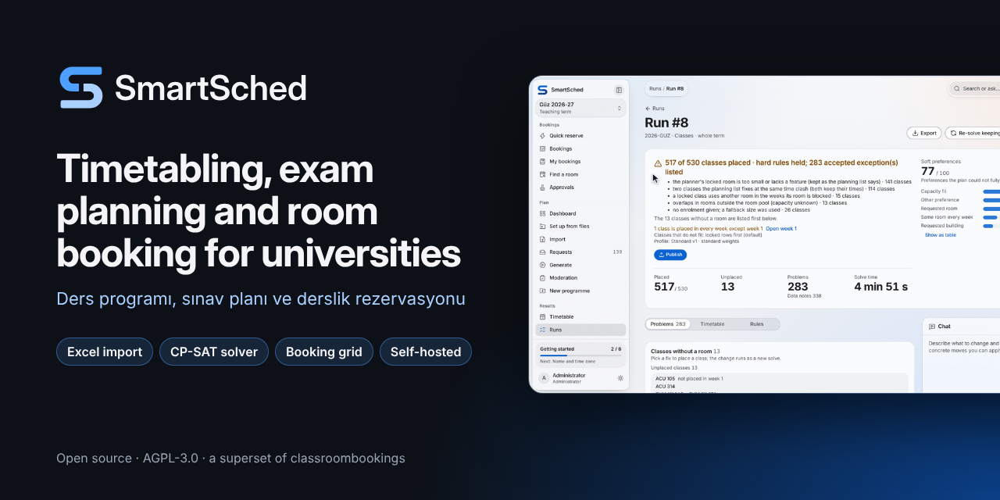
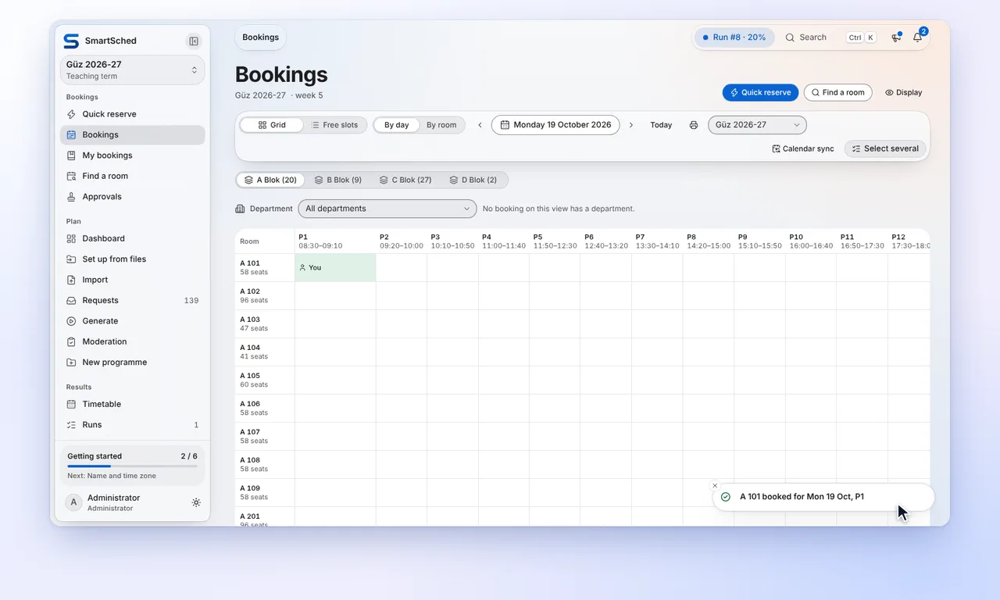
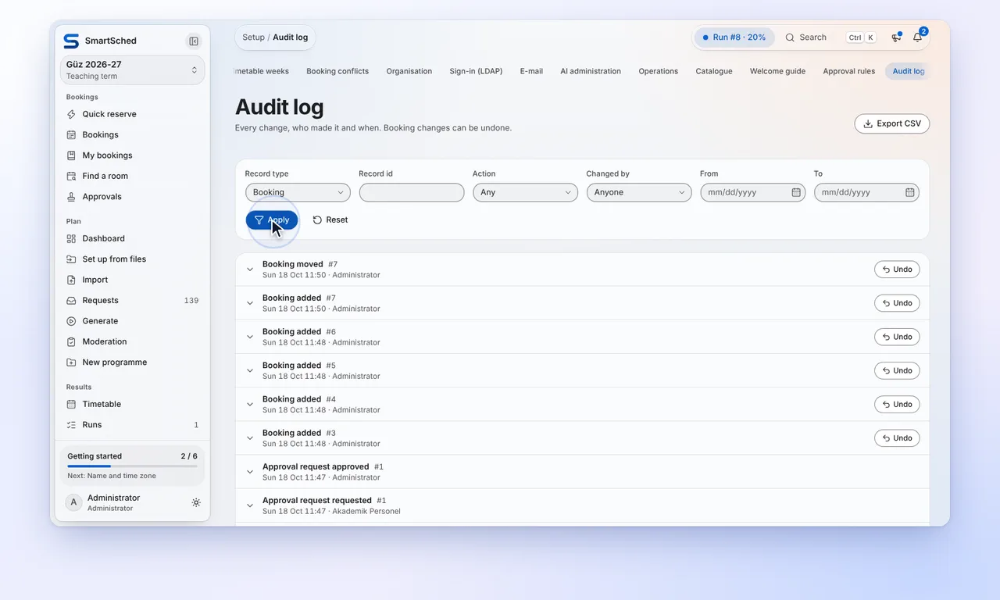
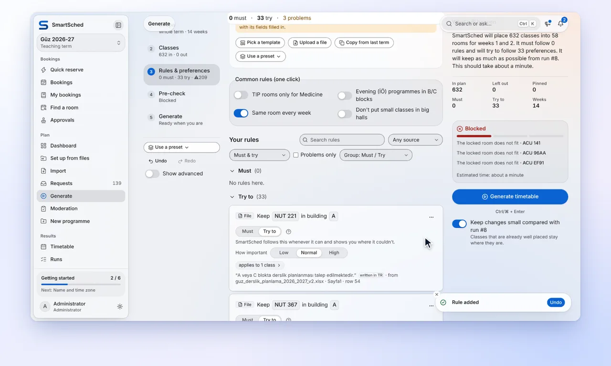
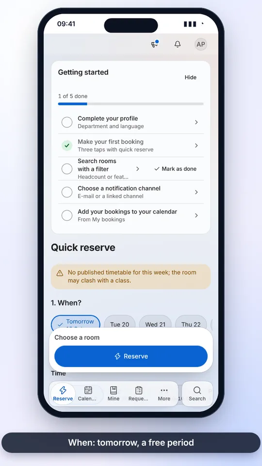
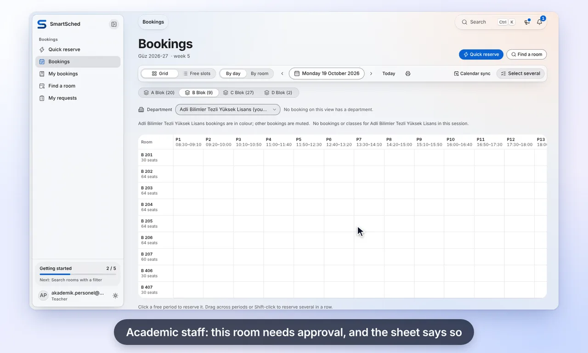
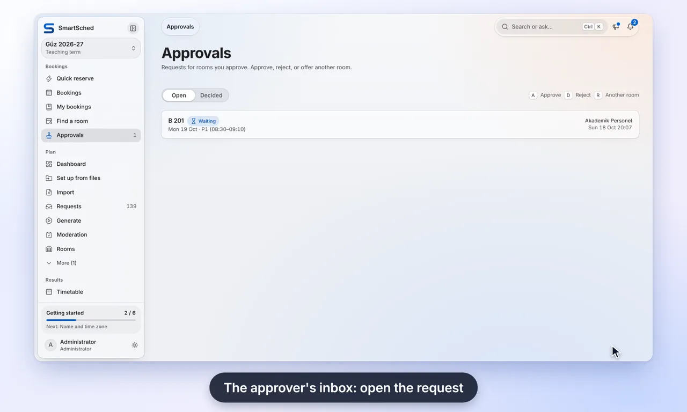
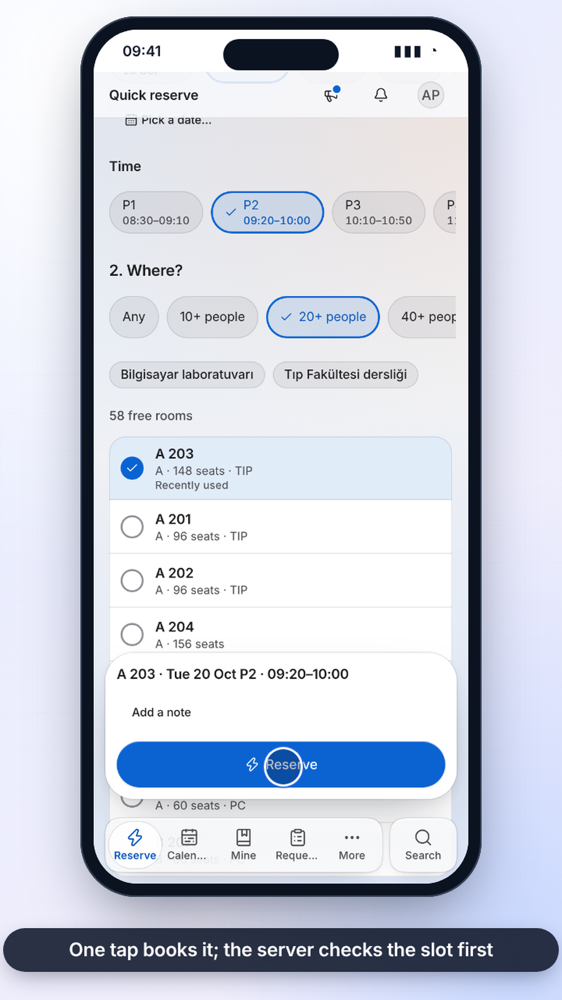
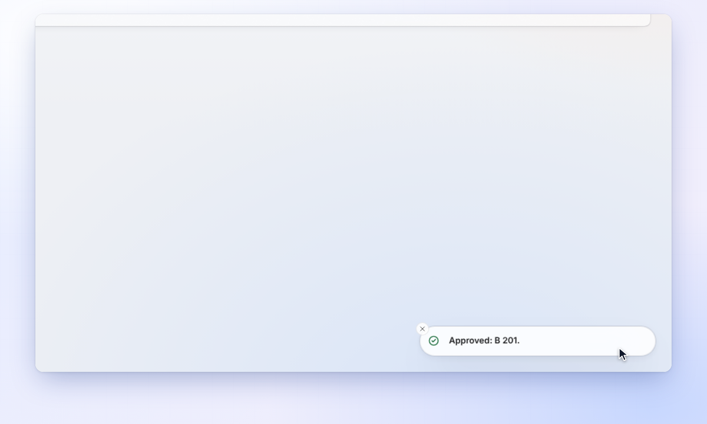

# SmartSched launch video

The launch video and the README media are built from the real application on the real 2026 workbooks (instructor
names reduced to initials, RECORDLY.md "KVKK"), recorded losslessly and rendered offline at 60 fps. Why this route
and not Remotion, Recordly or a screen recorder: [RESEARCH.md](RESEARCH.md).

## 1. Deliverables

<!-- launch:deliverables (rewritten by hand from dist/REPORT.txt and dist/QUALITY.json after each render) -->

Render of 2026-10-18 from `8890a86` (the top-bar / tab-bar alignment fix included; UI in English, captions English,
light theme), 79.1 s, every take captured deterministically (§3):

| File (`media/`) | Size | What, measured |
|---|---|---|
| [`smartsched-launch.mp4`](media/smartsched-launch.mp4) | 34.51 MB | the hero cut: 1920x1080, 60 fps, H.264 High crf 15 (`-preset slow -tune animation`), yuv420p BT.709, `+faststart`, 3.5 Mbit/s; [poster](media/smartsched-launch-poster.png), [English captions](media/smartsched-launch.en.vtt) (also burned in) |
| [`smartsched-launch-av1.webm`](media/smartsched-launch-av1.webm) | 20.36 MB | the same cut in AV1: SVT-AV1 preset 5, crf 28, 10-bit, 2.1 Mbit/s |
| [`smartsched-launch-vertical.mp4`](media/smartsched-launch-vertical.mp4) | 27.49 MB | phones and social: 1080x1920, 60 fps, H.264 High crf 15, 2.8 Mbit/s; [poster](media/smartsched-launch-vertical-poster.png) |
| [`smartsched-launch-attach.mp4`](media/smartsched-launch-attach.mp4) | 9.57 MB | for GitHub's 10 MB attachment limit (§4): 1920x1080, 30 fps (every other frame of the master, all real), crf 26 |
| [`smartsched-hero.webp`](media/smartsched-hero.webp) | 2.85 MB | **the README hero**: the desktop product in 22 s (a full-term run held to every hard rule, publish, find a room, reserve, move a class), 1280x720, 30 fps; [poster](media/smartsched-hero-poster.png) |
| [`smartsched-loop.webp`](media/smartsched-loop.webp) | 0.40 MB | the phone booking scene as a loop, 1280x720, 30 fps (linked under the hero); [poster](media/smartsched-loop-poster.png), [AVIF](media/smartsched-loop.avif) 0.18 MB |

Quality gate (`launch.sh check`, `launch/quality.py`), before (the 2026-10-18 morning render, screencast capture)
and after:

| | Before | After |
|---|---|---|
| Unique frames (mpdecimate), whole video | 2405 of 4738 (50.8 %) | 2438 of 4745 (51.4 %): the rest are still screens and holds, not repeats |
| Frames identical to the one before **inside visible motion** (the judder signature) | 41 | **0** (master and MP4) |
| Unique frames inside motion segments | 96.0 % | 96.8 % master, 96.2 % MP4 (the remainder: frames that change below mpdecimate's threshold, e.g. ease-out tails) |
| freezedetect freezes ≥ 50 ms | 227 | 104, of which 103 are slow motion below freezedetect's noise floor or holds; 1 is the camera at rest for 83 ms between two moves (all real frames) |
| VMAF v0.6.1 of the MP4 against the lossless master | (no master kept) | **97.13** mean, 94.46 1st percentile; PSNR-Y 46.5 dB |
| Bitrate | 1.7 Mbit/s (crf 18) | 3.5 Mbit/s (crf 15): most of the picture is still UI, so crf 15 needs fewer bits than the 6-10 Mbit/s budgeted |

The README clips (`docs/images/recordings`, names unchanged) come from the same takes and pipeline: MP4 1600x960 60 fps
crf 16 (phone 720x1280), WebP 1280 px 30 fps in `media/clips/`, and a GIF fallback (25 fps) only for the three clips
the README shows. reserve-panel 6.59 MB, find-room 1.01, audit-undo 2.84, calendar-move 7.51, studio-rule-fix 7.70,
approval-flow 4.53, launch-reserve-phone 0.63. `onboarding` (needs an empty instance) keeps its 2026-10-16 GIF and MP4.

## 2. The story (scripts/record/launch/story.mjs)

| # | Scene | Source |
|---|---|---|
| 0 | Intro: the SmartSched lockup, the `hero-solver` Lottie (vector, drawn at 1056 px), the tagline | Lottie |
| 1 | "Start from the planning office's own workbooks" (`file-to-rules` Lottie) → the import page: the workbook kinds, then an edited room master whose two changes are listed before anything is saved | `launch-import` |
| 2 | Solve: a real solver run on Güz 2026-27 (the journey takes the newest finished run with every hard rule held that is not the published one, preferring a full-term run). On 2026-10-18 `stack.sh runs` was given 900 s for the full-term run instead of 240 s (`REC_RUNS="2026-GUZ:WEEK:3:120 2026-GUZ:TERM:-:900"`); it finished in 4 min 51 s with hard score 100, so the take shows **run #8, the whole term: 517/530 placed, hard rules held, 283 accepted exceptions** (the 240 s run of `a39559b` had ended at hard 99, and the take showed the week-3 run #7) | `launch-run` steps 0-1 |
| 3 | "Nothing is dropped silently" (`precheck-fix` Lottie) → the run report: each unplaced class, why, and what would fix it | `launch-run` steps 2-3 |
| 4 | Publish, with the dialog that names the 13 classes left out; run #8 covers fewer weeks than the published week-3 run, so the server asks once more (`scope_reduction`) and the dialog names the week that leaves the published timetable | `launch-run` steps 4-5 |
| 5 | A member of staff books a room on a phone with quick reserve (`/reserve`), touch taps shown as finger dots | `launch-reserve` (390x844, `isMobile`, `hasTouch`) |
| 6 | The approver opens the request and approves it | `approval-flow` steps 2-4 |
| 7 | The admin views of wave 3: AI console (providers/models, usage, limits, guardrails) and the operations panel | `launch-admin` |
| 8 | Outro: the lockup (mark + product name) and one line. No repository address, branch or host anywhere in the video (owner, 2026-10-18: the repository and branches will move) | — |

The vertical cut uses the same scenes: desktop scenes become a 1000x800 window that follows the camera, the phone fills
the frame, titles sit above.

## 3. How it is made

```
stack.sh up (+ runs)          real backend + production frontend on the real workbooks, names masked
        │
record.mjs --engine frames    Playwright drives each journey in a page that runs on Chromium's virtual time
        │  (lib/frameclock.mjs)  (chrome-headless-shell, --deterministic-mode, a target with BeginFrame control): per
        │                     1/60 s of page time one budget, one HeadlessExperimental.beginFrame, one lossless PNG
        │                     (desktop 1440x810 CSS px at 1.5x, phone 390x844 at 2x); the Recorder logs steps, camera
        │                     targets, pointer track, taps and typed keys on the same page clock
render.mjs (story.mjs)        per output frame (60 fps): take tick n of its span, spring camera (lib/camera.mjs), cursor
        │                     and ripples, finger taps, keystroke chips, caption pill, chapter chip, Lottie frame →
        │                     compositor.html in headless Chromium → PNG → ffmpeg (H.264 RGB lossless master)
launch.sh encode              MP4 / AV1 / vertical / attach / WebP loop / AVIF / posters / VTT
launch.sh check               quality gate (launch/quality.py): judder, freezes, PSNR / VMAF against the master
launch.sh clips / hero        the README feature clips and the desktop hero loop from the same takes
```

Why it is smooth: nothing in the chain samples a live screen. The page under the camera runs on virtual time and is
rendered once for every 1/60 s of it, so a sheet sliding in, a smooth scroll or a fading toast has a real frame at each
of the 60 per second, however slow the host is (a slow host makes the take take longer, not the video choppier).
Timers, `Date`, `performance.now`, `requestAnimationFrame`, CSS transitions and the motion library all read that one
clock. The camera, cursor, taps, captions, transitions and Lottie on top are computed for each output frame from the
same clock, and a take's spans and every scene start sit on the 1/60 s grid, so output frame n shows take tick n:
never a repeated or skipped frame. A frame identical to the one before is stored once (its time is kept).

Waiting for the server costs no page time: the budget pauses while a fetch is pending (a response reaches the page on
its next frame, so while one is pending the clock sends frames that draw nothing and move the frame time by 10 µs).
A fetch that stays open for more than 4 s (a stream) is let through with the `advance` policy, counted in the take's
`capture.advanced`. Still stretches longer than 2 s (`LAUNCH_MAX_IDLE_MS`) are still shortened to 2 s.

`REC_FRAMES_CAPTURE=screencast` brings back the previous capture (Chrome's screencast, frames as painted): before
2026-10-18 the launch video was made that way, and on a loaded host the app's own animations got 3-30 paints per
second, which the 60 fps output showed as repeated frames (§5).

### Reproduce

```bash
export REC_WORKDIR=/tmp/launch-stack REC_API_PORT=19610 REC_WEB_PORT=19611 REC_TEACHER=1 REC_LANG=tr REC_CAL_SIGNOFF=0
export REC_BASE_URL=http://127.0.0.1:19611
export REC_RUNS="2026-GUZ:WEEK:3:120 2026-GUZ:TERM:-:900:nopub"     # the full-term run stays unpublished: launch-run publishes it
scripts/record/stack.sh up && scripts/record/stack.sh runs        # REC_IGNORE_TS=1 for a checkpoint that does not type-check
scripts/record/launch.sh all /tmp/launch-out                       # record, render, encode, clips, publish
scripts/record/stack.sh down
```

Steps one by one: `launch.sh record|render|encode|clips|publish OUT`. Preview a scene without rendering everything:
`node scripts/record/launch/render.mjs --takes OUT/takes --scenes reserve --out /tmp/p.mkv --still 3=/tmp/p.png`.
A single README clip: `node scripts/record/launch/render.mjs --takes OUT/clip-takes --story clip --format clip --take find-room-light --clip find-room --out /tmp/c.mkv`.
Dependencies: what the repository already has (Playwright + Chromium and `lottie-web` from the frontend's
lockfile, ffmpeg ≥ 6 with libx264, libsvtav1, libwebp; ImageMagick only for contact sheets). No music: the video is
silent by design (captions carry it), so there is no licence to track for audio.

## 4. README use

The top of the README (the desktop hero since the evening of 2026-10-18; owner: the README must show the desktop product, one hero and at most three clips):

```html
<a href="docs/launch/media/smartsched-launch.mp4">
  <picture>
    <source media="(prefers-reduced-motion: reduce)" srcset="docs/launch/media/smartsched-hero-poster.png">
    
  </picture>
</a>
<sub>▶ <a href="docs/launch/media/smartsched-launch.mp4">Launch video (1080p60, MP4)</a> ·
<a href="docs/launch/media/smartsched-launch-av1.webm">AV1</a> ·
<a href="docs/launch/media/smartsched-launch-vertical.mp4">vertical, for phones</a> ·
<a href="docs/launch/media/smartsched-loop.webp">booking on a phone (loop)</a></sub>
```

**Inline player (owner, by hand).** `docs/launch/media/smartsched-launch-attach.mp4` (9.6 MB, 1920x1080, 30 fps,
H.264 crf 26) is the file to drag into GitHub's README editor; it fits the 10 MB attachment limit of a free plan.
Open README.md on github.com → edit (pencil) → drag the file into the editor where the player should be → keep the
`https://github.com/user-attachments/assets/…` line GitHub inserts, on its own line → commit. GitHub renders that
line as a video player. The link only exists after the upload in the browser, so no script or agent can make it.

Check after a commit that GitHub kept the reduced-motion `<source>`:

```bash
curl -sS -H "Accept: application/vnd.github.html+json" \
  "https://api.github.com/repos/ArioMoniri/classroombookings/contents/README.md?ref=<branch>" | grep -o '<source[^>]*>'
```

## 5. Media weight

<!-- launch:weight (filled from dist/REPORT.txt) -->

| | 2026-10-18 morning | 2026-10-18 evening |
|---|---|---|
| README top | phone loop, WebP 0.50 MB | desktop hero, WebP 2.85 MB (the phone loop is a link) |
| README clips | 8 inline (GIF + WebP), 11 takes in a table | 3 inline (WebP, GIF fallback), the rest under [More clips](#more-clips) |
| Launch video | 1080p60, 17.1 MB, 1.7 Mbit/s, screencast capture | 1080p60, 34.5 MB, 3.5 Mbit/s, deterministic capture (+ AV1 20.4 MB, vertical 27.5 MB) |

`python3 -I scripts/record/check_readme.py` reports the referenced media and fails on orphans (it checks this file
too since 2026-10-18).

## 6. Social preview



`media/social-preview.png` (1280 × 640 PNG, about 0.26 MB) is the card GitHub shows when the repository is shared.
It is made from the dark brand lockup (`docs/images/brand/smartsched-lockup-dark.svg`), Inter and a crop of
`media/smartsched-hero-poster.png`, rendered with headless Chromium (README-X, 2026-10-18). It names no repository
address, owner or branch, so a rename does not make it stale. GitHub does not read it from the tree: an owner
uploads it in **Settings → General → Social preview → Edit → Upload an image…**.

## More clips

The README shows three clips (`featured` in `docs/images/recordings/clips.json`); these are the others, and every full
take. Each clip opens its take.

<!-- AUTO:recordings-more -->

<table>
  <tr>
    <td width="50%" valign="top">
      <a href="../images/recordings/reserve-panel.mp4"></a>
      <br><sub><b>Book several periods.</b> Drag across free periods of one room. One sheet books them together.</sub>
    </td>
    <td width="50%" valign="top">
      <a href="../images/recordings/audit-undo.mp4"></a>
      <br><sub><b>Undo from the audit log.</b> A move shows the room before and after. Undo puts it back.</sub>
    </td>
  </tr>
  <tr>
    <td width="50%" valign="top">
      <a href="../images/recordings/studio-rule-fix.mp4"></a>
      <br><sub><b>Pre-check and fix.</b> The Studio checks the plan against the term's data and applies one of its fixes.</sub>
    </td>
    <td width="50%" valign="top">
      <a href="../images/recordings/launch-reserve-phone.mp4"></a>
      <br><sub><b>Quick reserve on a phone.</b> A day, a period, how many people, a free room: one tap books it, and the receipt can undo it.</sub>
    </td>
  </tr>
  <tr>
    <td width="50%" valign="top">
      <a href="../images/recordings/approval-flow.mp4"></a>
      <br><sub><b>Ask for a room that needs approval.</b> A room with an approver: the booking is sent as a request, and the approver is told.</sub>
    </td>
    <td width="50%" valign="top">
      <a href="../images/recordings/approval-flow.mp4"></a>
      <br><sub><b>Approve the request.</b> The approver opens the request and approves it; the booking is confirmed.</sub>
    </td>
  </tr>
  <tr>
    <td width="50%" valign="top">
      <a href="../images/recordings/onboarding-intake.mp4"></a>
      <br><sub><b>Start from an empty instance.</b> Drop the exam workbook with AI off. It is read, a term is proposed, reviewed and saved.</sub>
    </td>
    <td width="50%"></td>
  </tr>
</table>

Every full take (11, MP4):

<table>
  <tr>
    <td width="25%" valign="top">
      <a href="../images/recordings/reserve-panel.mp4"></a>
      <br><sub><a href="../images/recordings/reserve-panel.mp4">Reservation panel: a click, a drag, room details</a> · <a href="../images/recordings/reserve-panel-tr.mp4">Turkish</a></sub>
    </td>
    <td width="25%" valign="top">
      <a href="../images/recordings/find-room.mp4"></a>
      <br><sub><a href="../images/recordings/find-room.mp4">Find a room</a></sub>
    </td>
    <td width="25%" valign="top">
      <a href="../images/recordings/audit-undo.mp4"></a>
      <br><sub><a href="../images/recordings/audit-undo.mp4">Audit log with undo</a></sub>
    </td>
    <td width="25%" valign="top">
      <a href="../images/recordings/calendar-move.mp4"></a>
      <br><sub><a href="../images/recordings/calendar-move.mp4">Move a class in the calendar, then undo</a></sub>
    </td>
  </tr>
  <tr>
    <td width="25%" valign="top">
      <a href="../images/recordings/studio-rule-fix.mp4"></a>
      <br><sub><a href="../images/recordings/studio-rule-fix.mp4">Studio: a rule from a template, the pre-check and a fix</a></sub>
    </td>
    <td width="25%" valign="top">
      <a href="../images/recordings/onboarding-intake.mp4"></a>
      <br><sub><a href="../images/recordings/onboarding-intake.mp4">Onboarding an empty instance</a></sub>
    </td>
    <td width="25%" valign="top">
      <a href="../images/recordings/room-booking.mp4"></a>
      <br><sub><a href="../images/recordings/room-booking.mp4">Book a room with a note, My bookings</a></sub>
    </td>
    <td width="25%" valign="top">
      <a href="../images/recordings/admin-user.mp4"></a>
      <br><sub><a href="../images/recordings/admin-user.mp4">Create an account and pick its role</a></sub>
    </td>
  </tr>
  <tr>
    <td width="25%" valign="top">
      <a href="../images/recordings/run-report-fix.mp4"></a>
      <br><sub><a href="../images/recordings/run-report-fix.mp4">Run report: apply a suggested fix</a></sub>
    </td>
    <td width="25%" valign="top">
      <a href="../images/recordings/launch-reserve-phone.mp4"></a>
      <br><sub><a href="../images/recordings/launch-reserve-phone.mp4">Quick reserve on a phone (390x844, touch)</a></sub>
    </td>
    <td width="25%" valign="top">
      <a href="../images/recordings/approval-flow.mp4"></a>
      <br><sub><a href="../images/recordings/approval-flow.mp4">A request that needs approval, approved</a></sub>
    </td>
  </tr>
</table>

<!-- /AUTO:recordings-more -->
