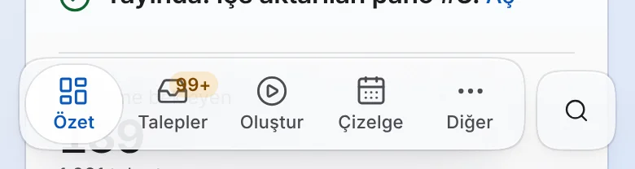
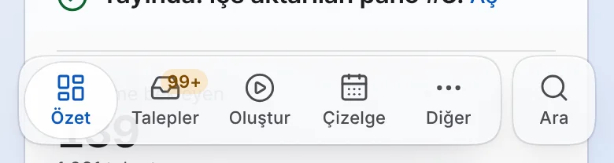
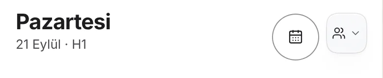
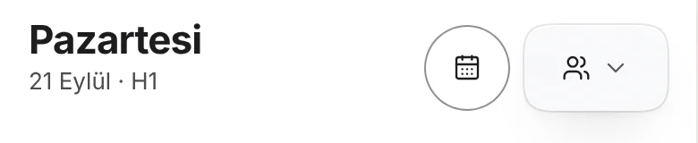
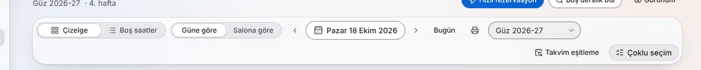
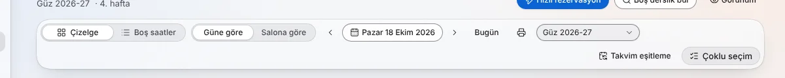
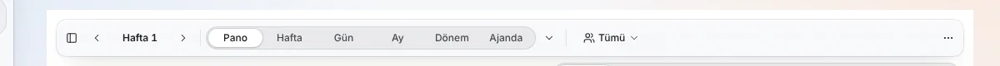
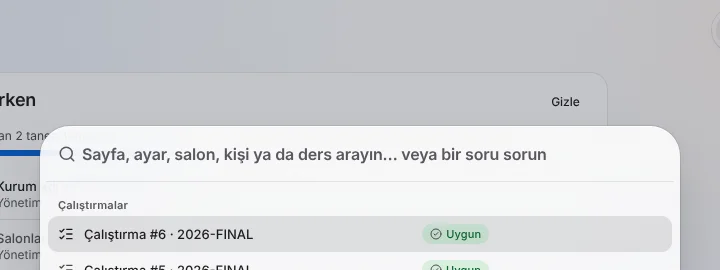
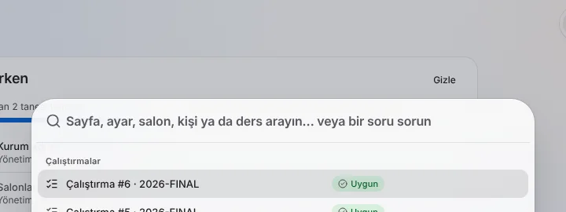
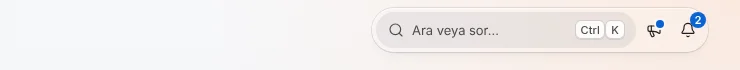

# UI alignment audit (2026-10-18)

The owner saw in the launch video that the search icon did not sit on the same line as the other icons. This audit
measured the bounding box of every icon and control in the shell and toolbar rows with Playwright on the recording
stack (`scripts/record/stack.sh up` with all the fixture workbooks, `REC_TEACHER=1 REC_LANG=tr REC_CAL_SIGNOFF=0`).
It ran at 1440 × 900 with a mouse and at 390 × 844 with touch (`isMobile`, `hasTouch`), in light and dark, tr-TR,
signed in as the admin. It covered `/`, `/timetable`, `/find-room`, `/reserve`, `/bookings`, `/runs`, `/admin`,
`/admin/users`, `/admin/rooms`, `/admin/settings` and the ⌘K palette.

**Rule:** in one row, icon centres may differ by at most 1 px, controls on one line share a centre, and the row uses
one icon size (tokens §A.5 "nothing in one row mixes heights"; §A3 icons are 16 or 20 px, 14 px in sm controls). A
toolbar that wraps is judged line by line. Text baselines were checked too: in every one-line button with an icon,
the icon's centre was compared with the text line's centre, and in every input with a leading icon, the icon's centre
was compared with the input's centre. Neither check found an offset over 1 px.

## Findings

| # | Row | Before | Root cause | Fix |
|---|---|---|---|---|
| 1 | **Phone tab bar: search** (the issue in the video) | The search glyph sat **12 px below** the tab icons (centre 808 vs 796), was **16 px** next to their 20 px, and its control sat 4 px low | `components/shell/tab-bar.tsx`: (a) the row was `items-end`, so the 48 px circle lined up with the bottom of the 56 px capsule; (b) a circle centres its glyph, but tab glyphs sit above their labels; (c) `[&_svg]:size-5` lost to IconButton md's more specific `[&_svg:not([class*='size-'])]:size-4` | The detached search is now built like a tab: the same `p-1` glass capsule, the shared `ITEM` box, the new shared `ICON` glyph box (20 px) and a `tab-label` ("Ara"). The row is `items-center`. The control is still detached glass, hidden below 22.5rem as before, 56 px tall and at least 44 px wide, named "Ara veya sor". Landscape (≤ 500 px tall) drops the padding like the capsule. |
| 2 | Phone `/timetable` header (lens button + subject picker) | The subject capsule's centre was **4 px above** the lens button's; its glyphs were 14 and 12 px next to the button's 16 px | `components/timetable/mobile-calendar.tsx`: a 40 px `size-10` circle held a 44 px sm trigger, next to a 48 px icon-lg button, and the row had no `items-center` | The row is `items-center` and the capsule is `h-(--control-h-lg) min-w-(--control-h-lg)`. `SubjectPicker` takes a new `size` prop and gets `"md"` here, so all its glyphs are 16 px. |
| 3 | Desktop `/bookings` toolbar | Date trigger and term select were **32 px** in a row of 28 px (sm) controls; the date icon was **16 px** next to 14 px icons | `DatePicker` always rendered an md Button. `SelectField` (admin/kit) dropped any size and always rendered md. | `DatePicker` takes `size` (default md) and `SelectField` takes `fieldSize` (passed on to `NativeSelect`). The desktop toolbar passes `sm` to the date trigger and to the room and term pickers; the filter sheet keeps md. The loading skeleton is `h-(--control-h-sm)` instead of `h-8`. |
| 4 | Desktop `/timetable` toolbar | The subject picker's chevron was **12 px** in a row of 14 px glyphs, including the board-mode chevron in the same row | `capsule-toolbar.tsx`: a hard-coded `size-3` | The `size-3` is gone, so the chevron takes the button's own icon size (14 px for sm, 16 px for md). |
| 5 | ⌘K palette input row | The search glyph was **18 px** (`size-[18px]`), which is off the icon scale. It was centred correctly. | `ui/command.tsx`: an arbitrary size | `size-5` (20 px, the scale step for the title-3 input) |

Rows that were already aligned (0 px spread, both sizes, both themes): the desktop top bar ("Ara veya sor (Ctrl+K)"
trigger, What's new, notifications), the phone top bar (What's new, notifications, user menu), the sidebar account row
(user menu and theme), page-header actions, and the `/find-room`, `/reserve`, `/runs` and `/admin/*` toolbars. The
desktop trigger is 36 px next to 32 px icon buttons by design (helper.md §2.2), and its centre matches theirs.

## Before / after

| Row | Before | After |
|---|---|---|
| Phone tab bar |  |  |
| Phone `/timetable` header |  |  |
| `/bookings` toolbar |  |  |
| `/timetable` toolbar |  |  |
| ⌘K input row |  |  |
| Desktop top bar (unchanged) |  |  |

Full pages: `full-phone-*.webp`, `full-desktop-bookings-*.webp`.

## Verification

- `e2e/ui-alignment.spec.ts` (added to the Playwright `testMatch`) asserts the centre-line rule for these rows. It
  runs at both sizes and in both themes, plus one test for the tab-bar search glyph (same line, same size, ≥ 44 px,
  accessible name). On the old build it failed on findings 3 and 4 (desktop). On the fixed build: **5 passed**.
  Command: `PW_PORT=3610 E2E_REAL=1 NEXT_PUBLIC_API_URL=http://127.0.0.1:8610 npx playwright test ui-alignment --project=chromium`.
- `src/components/ui-alignment.test.tsx` (new) pins the classes and size props. In `mobile-a-phase2.test.tsx`, the
  landscape check now expects `[@media(max-height:500px)]:p-0` on the search control instead of `size-11`.
- Whole-project tsc 0 errors; eslint clean on the touched files; `node scripts/check-design.mjs` passed; vitest on
  shell, ui, bookings, timetable, admin, helper and the two test files above: 113 files, 711 tests passed.
- Touch targets: tab-bar items and the search control are ≥ 48 px; the phone timetable controls are 44–48 px. Inputs
  keep 16 px text on touch (`coarsePhoneText` / `pointer-coarse:text-base`, unchanged).
